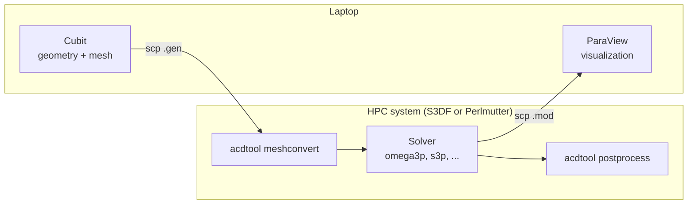

# Getting started

ACE3P runs on HPC systems. Pre- and post-processing happen on your own computer with Cubit and ParaView, while the solvers run on a cluster through the Slurm batch scheduler.

Choose the system you will run on:

- **[S3DF](s3df.md)**, SLAC's Shared Scientific Data Facility. Use this if you are at SLAC or have an S3DF account.
- **[NERSC Perlmutter](perlmutter.md)**. Use this if you have access to the `m349` ACE3P allocation at NERSC.

Then install the [local tools](local-tools.md) on your laptop and continue to the [workflow overview](../workflow/index.md).

## Prerequisites

- An account on S3DF or NERSC with access to the ACE3P installation.
- Familiarity with a Unix shell: `cd`, `ls`, `cp`, `mkdir`, and a text editor such as `vi`, `emacs`, or `nano`.
- An SSH client. Linux and macOS have `ssh` and `scp` built in. On Windows 10 or later, use `ssh` from PowerShell, or install PuTTY and WinSCP.

## Example files

The tutorials in this documentation use the examples and exercises prepared for the CW23 workshop. They are available on both systems:

| System | Examples | Exercises |
|---|---|---|
| S3DF | `/sdf/data/rfar/nfs/acd/u01/userspace/cho/cw23/examples` | `/sdf/data/rfar/nfs/acd/u01/userspace/cho/cw23/exercises` |
| Perlmutter | `$CFS/ace3p/cw23/examples` | `$CFS/ace3p/cw23/exercises` |

Copy the directory you need into your own working area before running anything, since the example directories are read-only for most users.
