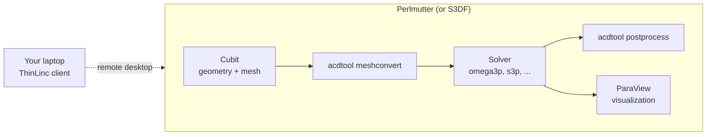

# Getting started

ACE3P solvers run on an HPC system under the Slurm batch scheduler. The main platform is **NERSC Perlmutter**, where ACE3P is installed for all users with access to the `m349` allocation. Pre-processing (geometry and meshing in Cubit) and post-processing (ParaView) are already installed on Perlmutter as well, so a complete workflow needs nothing more than a NERSC account and a remote-desktop client.

!!! note "S3DF is for SLAC users only"
    SLAC's Shared Scientific Data Facility (S3DF) also hosts ACE3P, Cubit and ParaView, but it is only reachable with a SLAC account. If you are at SLAC, see [Running on S3DF](s3df.md). Everything else in this manual applies to both systems.

## Three steps to a first run

1. **Get access.** Request a NERSC account on the `m349` project through the ACE3P team (<ace3p@slac.stanford.edu>) and set up multi-factor authentication at [iris.nersc.gov](https://iris.nersc.gov). NERSC's own guide is at [docs.nersc.gov/accounts](https://docs.nersc.gov/accounts/).
2. **Connect with a graphical desktop.** Install the ThinLinc client and connect to Perlmutter. You get a Linux desktop with a terminal, Cubit and ParaView in one window. See [Connecting with ThinLinc](#connecting-with-thinlinc) below.
3. **Run the pillbox example.** Follow [Running on NERSC Perlmutter](perlmutter.md) to load the ACE3P environment and submit a job, then the [Omega3P pillbox tutorial](../modules/omega3p/tutorial-pillbox.md).

Once a job has run, the [Workflow](../workflow/index.md) chapter explains the five-step pipeline every solver follows, and the [Cubit](../cubit/index.md) chapter covers geometry and meshing in depth.

## Connecting with ThinLinc

ThinLinc gives you a full Linux desktop on Perlmutter in a window on your laptop. It is the recommended way to work with ACE3P because Cubit and ParaView are graphical programs, and running them on Perlmutter avoids copying meshes and field files back and forth.

1. **Install the client** for your operating system from [cendio.com/thinlinc/download](https://www.cendio.com/thinlinc/download/). Windows, macOS and Linux are supported.
2. **Create an sshproxy key.** ThinLinc at NERSC authenticates with a key generated by `sshproxy`, not with a password. Follow the [sshproxy section](perlmutter.md#avoid-repeated-otp-prompts-with-sshproxy) on the Perlmutter page once; the key is valid for 24 hours.
3. **Connect.** In the ThinLinc client set the server to `thinlinc.nersc.gov`, your NERSC username, and under *Options, Security* choose *Public key* with the path to the `nersc` key from sshproxy. On first connection compare the fingerprint with the one published by NERSC.
4. **Open a terminal** from the desktop menu. You are on a Perlmutter login node; everything on the [Perlmutter page](perlmutter.md) applies.

NERSC's full guide, including troubleshooting, is at [docs.nersc.gov/connect/thinlinc](https://docs.nersc.gov/connect/thinlinc/).

!!! tip "Plain SSH still works"
    If you only need a terminal, `ssh <username>@perlmutter.nersc.gov` is enough. You will then run Cubit and ParaView on your own computer; see [Pre- and post-processing tools](tools.md).

## Prerequisites

- Familiarity with a Unix shell: `cd`, `ls`, `cp`, `mkdir`, and a text editor such as `vi`, `emacs`, or `nano`.
- For the SSH route, an SSH client. Linux and macOS have `ssh` and `scp` built in. On Windows 10 or later use `ssh` from PowerShell, or install PuTTY and WinSCP.

## Example files

The tutorials use the examples and exercises prepared for the CW23 workshop. They are installed on both systems:

| System | Examples | Exercises |
|---|---|---|
| Perlmutter | `$CFS/ace3p/cw23/examples` | `$CFS/ace3p/cw23/exercises` |
| S3DF | `/sdf/group/rfar/ace3p/cw23/examples` | `/sdf/group/rfar/ace3p/cw23/exercises` |

Each `cw23/` tree also holds the per-module command references in `commands/`, the ParaView macros in `macros/`, and release notes in `news/`. Copy the directory you need into your own working area before running anything; the example directories are read-only.
