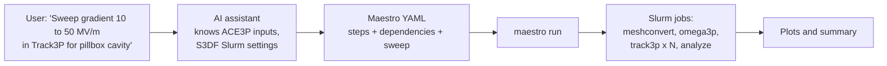

# AI workflow assistant

Multi-step ACE3P campaigns, such as a mesh convergence study, a gradient sweep for multipacting, or an Omega3P-to-Track3P pipeline, involve many Slurm jobs with dependencies between them. The S3DF workflow project automates these with the Maestro workflow engine and uses an AI assistant to generate the workflow specification from a plain-English description.

Source: <https://github.com/lge0303/s3df-workflow>

## How it fits together



The assistant does not replace the workflow engine or the scheduler. It writes the specification; Maestro resolves dependencies and submits jobs; Slurm runs them. The user reviews the generated YAML before anything is submitted.

## Validated pipelines

| Workflow | What it does | Result |
|---|---|---|
| Omega3P single solve | Pillbox cavity, 16 MPI ranks | Mode 1 at 1.3138 GHz, matches reference to 8 digits |
| FE order convergence | Three parallel Omega3P runs, orders 1 to 3, with a fan-in comparison step | Order 1 has 0.08% error; order 2 converged |
| Omega3P to Track3P | Eigenmode solve, then multipacting scan over field levels, then plot generation | Resonant particles and enhancement counter at 23 to 25 MV/m |

The whole Omega3P-to-Track3P pipeline runs in about five minutes on the S3DF `milano` partition.

## Example specification

A generated Maestro step for the solver looks like this:

```yaml
- name: omega3p-solve
  description: Run Omega3P eigenmode solver
  run:
    cmd: |
      source /sdf/group/rfar/ace3p/ace3p.sh
      cd $(WORKSPACE)
      srun --overlap --cpu-bind=none -n 16 omega3p pillbox.omega3p
    depends: [meshconvert]
    nodes: 1
    procs: 16
    walltime: "00:30:00"
```

Parameter sweeps use Maestro's `global.parameters` block, which expands one step into one job per value. Fan-in steps that aggregate results depend on `step_*`.

## Relationship to this documentation

The assistant's knowledge of ACE3P input files comes from the same information presented in this manual. As the [keyword reference](../reference/index.md) is generated from source, it becomes a reliable foundation for validating generated inputs. Keeping the documentation and the workflow tooling in step is a goal of both projects.
