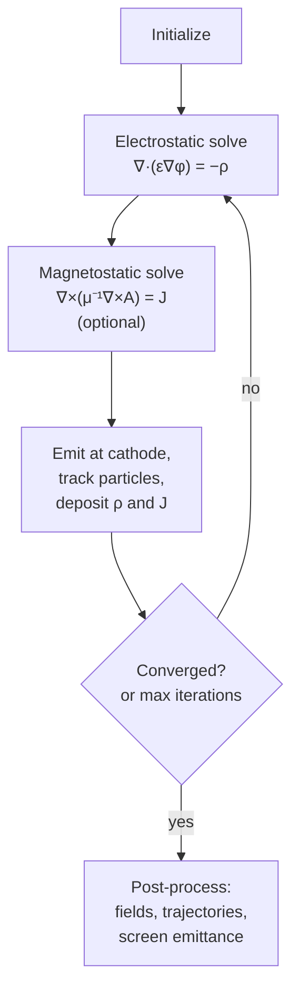
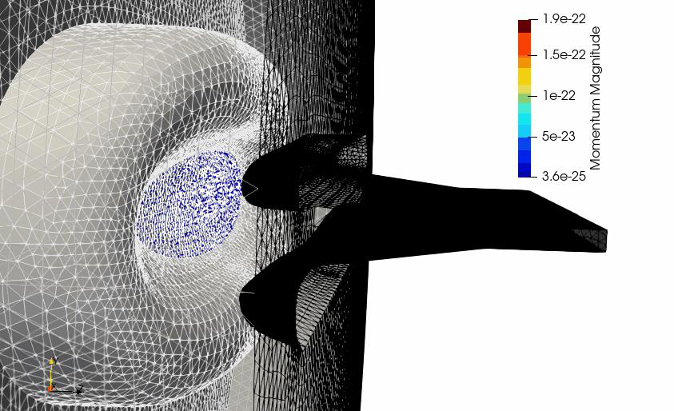

# Gun3P

Gun3P is a static solver for DC electron guns. It computes the electrostatic potential from the electrode voltages, emits electrons from the cathode under the space-charge limit, tracks them, deposits their charge, and iterates until the fields and the beam are self-consistent. Optionally it also solves the magnetostatic field of the beam's own current. The outputs are the emitted current, the beam trajectories and envelope, emittances at a screen, and the fields on the mesh.

## What it solves



The electrostatic field is $\mathbf{E} = -\nabla\phi$ with Dirichlet conditions on metal surfaces (fixed voltage) and Neumann on symmetry planes. The optional magnetostatic field is $\mathbf{B} = \nabla\times\mathbf{A}$ driven by the beam current. Particles obey $d\mathbf{p}/dt = q(\mathbf{E} + \mathbf{v}\times\mathbf{B})$. The cathode emits according to the Child-Langmuir space-charge-limited law, with the current determined by the local field a short distance in front of the surface, so emission and field settle together.

Convergence is measured as the relative change in the field degrees of freedom between iterations, and the run stops when it drops below the tolerance or when `MaxIterations` is reached. Current and perveance per iteration are printed so you can see the approach to steady state.

{ width="620" }
/// caption
Electron trajectories in a sheet beam klystron gun, colored by momentum, with the focusing electrode and anode.
///

**Benchmark.** Gun3P was compared with the commercial code MICHELLE on this gun: both give 129.3 A of emitted current with cathode current densities of 1.75 to 2.4 A/cm², from different mesh types.

## Input file

Every block and key is described in the [Gun3P command syntax](../../reference/commands/gun3p.md).

A `.gun3p` file has up to four top-level blocks. It shares the `ElectrostaticProblem` and `MagnetostaticProblem` block types with [TEM3P](../tem3p/index.md), and the `Tracker` block with [Track3P](../track3p/index.md); the syntax conventions of each carry over.

```text title="dcgun.gun3p (abridged)"
DCGunProblem: {
  RunId: test
  SymmetryFactor: 1                   // 1 full, 2 half, 4 quarter
  ElectricRelativeTolerance:  1.00e-12
  ElectricRelativeTolerance2: 1.00e-12  // with magnetic solver active
  MagneticRelativeTolerance:  1.00e-12
  MaxIterations: 32
  Save iteration data: On
}

ElectrostaticProblem: {
  AnodeBoundaryId: 12
  MeshFile: dcgun.ncdf
  BasisOrder: 2
  CurvedSurfaces: on
  Charge averaging factor: 0.1        // under-relaxation of the deposited charge

  VolumeMaterial: {
    Id: 1
    MediumName: Vacuum
    PhysicalParameter: { Name: Permittivity  ConstantValue: 1. }
  }

  Write dofs to disk: on
  Use reduced solver: On
  Outputs: { Dofs for vizualization: On }

  Boundary: { Id: 1   ConditionType: Dirichlet  DirichletValue: 0. }       // cathode
  Boundary: { Id: 2   ConditionType: Dirichlet  DirichletValue: -500. }    // focus electrode
  Boundary: { Id: 12  ConditionType: Dirichlet  DirichletValue: 115000. }  // anode
  Boundary: { Id: 3   ConditionType: Neumann    NeumannValue: 0. }         // open boundary
  Boundary: { Id: 10  ConditionType: Neumann    NeumannValue: 0. }
  Boundary: { Id: 4   ConditionType: Dirichlet  DirichletValue: 0. }

  Compute non zero initial guess: On
  LinearSolver: {
    Solver: CG                        // or MUMPSFLOAT for small problems
    Preconditioner: CHOLESKY
    Tolerance: 1.00e-16
    MaxIterations: 5000
  }
}

MagnetostaticProblem: {
  ...same mesh, materials, and solver pattern; all boundaries Dirichlet 0...
}

Tracker: {
  JobName: ./gun3p_results/OUTPUT
  Particlefile: partpath
  t: 6.0e-6                           // forward tracking time, s
  Generate output for vizualization: on
  Print emission statistics: On
  Backward: { t: 6.0e-6  Generate output for vizualization: on }

  Domain: {
    t0: 0.0
    dt: 1.0e-12
    MaxImpacts: 2
    Emission Nx: 200   Emission Ny: 100   Emission Nz: 300
    Tracking Nx: 200   Tracking Ny: 100   Tracking Nz: 300
    Tracking box x min: -0.11   Tracking box x max: 0.11
    Tracking box y min: -0.04   Tracking box y max: 0.04
    Tracking box z min: -0.001  Tracking box z max: 0.18
  }

  Monitor: {
    Type: PlaneCrossingsVsT
    Name: screen
    Plane point: 0., 0., 0.15999
    Plane normal: 0., 0., 1.
    Compute densities: On
    Max x for densities: 0.110   X number of densities: 11
    Max y for densities: 0.004   Y number of densities: 80
  }

  MeshInterface: { Type: pd  Localizer: { Type: USS_Curve } }

  Emitter: {
    Type: 6                           // Child-Langmuir
    BoundaryID: 1                     // cathode sideset
    N: 1.0e+0                         // electrons per macroparticle
    M: 9.10938e-31                    // kg
    Q: -1.60218e-19                   // C
    d: 0.1e-3                         // macroparticle radius, m
    Sample Type: 1                    // 1 face centers, 2 stochastic
    Child Langmuir: {
      Whole boundary is emitter: On
      Use electric field direction for initial forward velocity: On
      Max allowed total current: 1.35e+9
      Reference z for emission surface: 1.50e-3
      Particles per face: 5
      ...tuning parameters, keep the defaults...
    }
  }

  Material: { BoundarySurfaceID: 1   Type: 2 }   // 2 = Absorber
  Material: { BoundarySurfaceID: 2   Type: 2 }
  Material: { BoundarySurfaceID: 12  Type: 2 }
  ...
}
```

### DCGunProblem

| Key | Meaning |
|---|---|
| `RunId` | Label for the run |
| `SymmetryFactor` | 1, 2, or 4. Emitted current is scaled to the full gun. |
| `ElectricRelativeTolerance` | Convergence criterion on the electric field change between iterations, when the magnetic solver is off |
| `ElectricRelativeTolerance2`, `MagneticRelativeTolerance` | The same when the magnetic solver is on |
| `MaxIterations` | Stop here regardless. The example uses 32; convergence to 10⁻⁵ relative change takes about that many. |
| `FirstIterationForMagnetostaticProblem` | Iteration at which to start including the beam's self-magnetic field. Leave commented out to never run it. |
| `JustGenerateTreecotree` | Run on one core to precompute the tree-cotree gauge for the magnetostatic solve. Needed if the magnetostatic problem fails to converge. |
| `Save iteration data` | Keep per-iteration fields and particles under `OUTPUT/ITER_<n>/` |

### ElectrostaticProblem and MagnetostaticProblem

These follow the [TEM3P conventions](../tem3p/index.md#input-file): `MeshFile`, `BasisOrder`, `CurvedSurfaces`, one `Boundary` block per sideset, `VolumeMaterial` by block. Differences:

| Key | Meaning |
|---|---|
| `AnodeBoundaryId` | Sideset of the anode. Used to reference the accelerating voltage for perveance. |
| `Charge averaging factor` | Under-relaxation: new charge = (1 − f) × previous + f × computed. 0.1 is stable; larger converges faster if it converges. |
| `VolumeMaterial.PhysicalParameter` | `Name` is `Permittivity`, `Permeability`, or `Sigma`, with `ConstantValue` |
| `Compute non zero initial guess` | Start each iteration's solve from the previous solution |
| `Use reduced solver` | Eliminate constrained DOFs before solving. Keep on. |
| `Outputs.Dofs for vizualization` | Write the field for `gun3pOutputConverter` to turn into a `.mod` file |
| `Outputs.ElectrostaticFieldToken`, `FileName`, `Nx`, `Ny`, `Nz` | Also export the field on a Cartesian grid, for use as an external field in Track3P |
| `LinearSolver.Solver` | `CG` with `CHOLESKY` for large problems, `MUMPSFLOAT` for small. Other keys as shown. |

In the magnetostatic problem every boundary is Dirichlet 0 and the material parameter is still named `Permittivity` in the examples, which the code accepts.

### Tracker

| Key | Meaning |
|---|---|
| `JobName` | Output directory; must match the second argument on the command line |
| `t` | Forward tracking time in s. Make it long enough for the slowest particles to reach the screen. |
| `Backward` | Backward tracking from the emission reference plane to the cathode, used by the Child-Langmuir model to set the launch conditions |
| `Domain.dt` | Tracking time step |
| `Domain.Emission Nx/Ny/Nz`, `Tracking Nx/Ny/Nz` | Grid resolution for the particle localizer in the emission region and the tracking region |
| `Domain.Tracking box ...` | Bounding box of the tracking region, m. Particles outside are dropped. |
| `MeshInterface` | Localizer settings. Keep as in the example. |

### Emitter

`Type: 6` is Child-Langmuir, the model for thermionic DC guns. The other numbered types are shared with Track3P and are listed on its [module page](../track3p/index.md#emitter).

| Key | Meaning |
|---|---|
| `BoundaryID` | Cathode sideset |
| `N`, `M`, `Q` | Electrons per macroparticle, and the real particle mass and charge |
| `d` | Macroparticle radius for space-charge deposition |
| `Sample Type` | 1 launches from face centers, 2 stochastically across each face |
| `Child Langmuir.Reference z for emission surface` | Distance in front of the cathode at which the field is sampled to set the emission current |
| `Child Langmuir.Particles per face` | Macroparticles launched per cathode face per iteration. Increase for smoother current; the reference says to experiment for convergence. |
| `Child Langmuir.Max allowed total current` | Safety cap in μA |

The remaining Child-Langmuir keys control the iteration strategy and are documented as "keep as default" in the command reference.

### Monitor

| `Type` | Keys | Output |
|---|---|---|
| `PlaneCrossingsVsT` | `Plane point`, `Plane normal`, `Compute densities`, density grid extents and counts | Emittances and current density of particles crossing one plane, printed per iteration |
| `PlanesCrossing` | `First plane point`, `Common plane normal`, `Distance between first and last planes`, `Number of planes` | The same at a stack of parallel planes |

### Material

Particle boundary behavior by sideset, numbered: 1 Reflector, 2 Absorber, 3 Secondary emitter, 4 Test surface, 5 SymmetryPlane. In a gun, every metal surface is an absorber.

## Running

```bash
srun -n 256 gun3p dcgun.gun3p gun3p_results
```

The second argument names the results directory and must agree with `Tracker.JobName`. The sheet beam gun with 459,000 elements and 32 iterations took 232 s on 256 ranks across two nodes. Each iteration is a full electrostatic solve plus tracking, so the cost scales with iteration count.

## Output

| Location | Content |
|---|---|
| `gun3p_results/gun3p.log` | Timing summary. The detailed iteration log goes to standard output, so keep the Slurm output file. |
| Standard output | Per iteration: `||E dofs - prev|| ... rel. tol.`, emitted current and perveance from the Child-Langmuir model, and the screen monitor's emittances |
| `OUTPUT/previousPerveanceAtIter<n>` | Micro-perveance after each iteration, one number per file |
| `OUTPUT/emissionMap<n>` | Emission current per cathode face |
| `OUTPUT/ITER_<n>/E/`, `PARTICLES/` | Per-iteration fields and trajectories when `Save iteration data` is on |
| `OUTPUT/E/`, `OUTPUT/M/` | Final electrostatic and magnetostatic DOFs; `staticDofs.ncdf.mod` appears after the converter runs |
| `OUTPUT/PARTICLES/partpath_ts<n>.ncdf` | Particle positions per time step of the final iteration, for animation |

## Post-processing

The fields are stored as DOF vectors. Convert them to ParaView `.mod` files with the companion program:

```bash
gun3pOutputConverter dcgun.gun3p e        # electric field, final iteration
gun3pOutputConverter dcgun.gun3p m        # magnetic field
gun3pOutputConverter dcgun.gun3p e 30     # electric field at iteration 30
```

Output goes to `OUTPUT/E/staticDofs.ncdf.mod` and `OUTPUT/M/`. If `ElectrostaticFieldToken` was on, the converter also writes the field on the Cartesian grid as a text file, which Track3P reads through `Domain.ElectroStaticFieldMap`. The [Track3P module page](../track3p/index.md#domain) describes that coupling.

In ParaView, load the mesh with the `.mod` file for the field and the `partpath_ts*.ncdf` series for the trajectories.

## Tutorial

**[Sheet beam klystron gun](tutorial.md)**: a 115 kV DC gun with a focus electrode, run to self-consistency and compared with MICHELLE.
