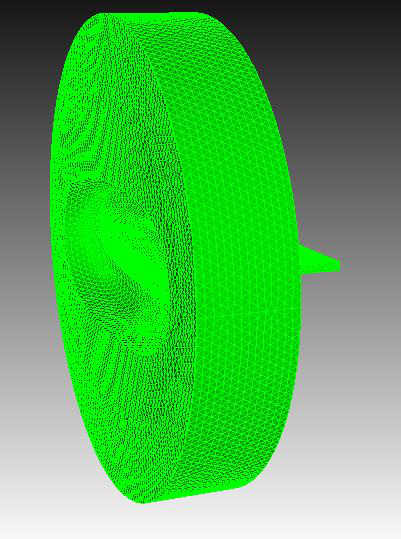
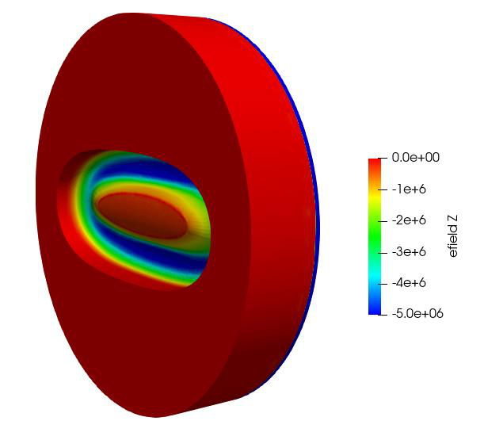
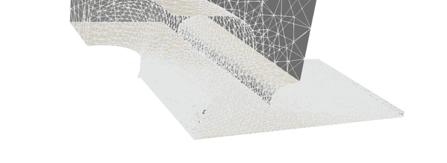
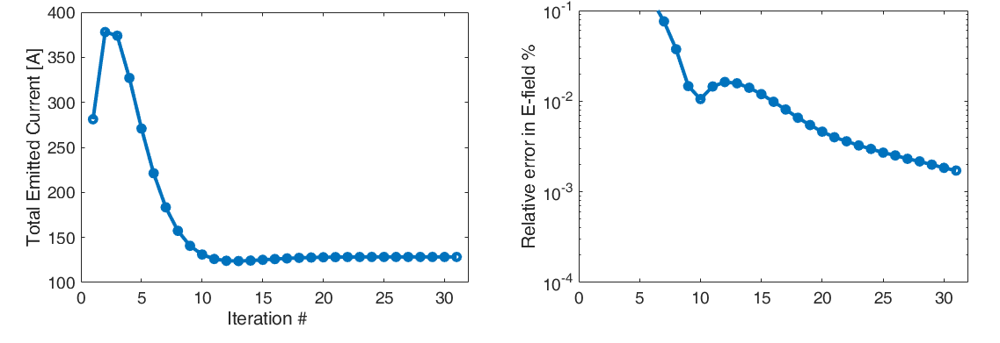
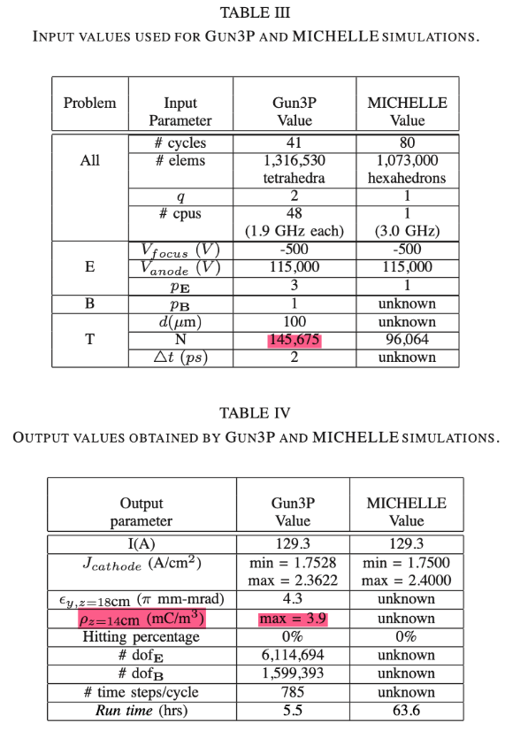

# Gun3P tutorial: sheet beam klystron gun

**Example directory:** `examples/gun3p/LSBK`

A DC gun for a sheet beam klystron: a wide, flat cathode at ground, a focus electrode at −500 V, and an anode at 115 kV. The beam exits through the anode aperture toward a screen 16 cm downstream. Gun3P finds the self-consistent emitted current and the beam shape at the screen.

{ width="260" }
{ width="300" }
/// caption
The full-model mesh, and the electrostatic potential: anode (red, 115 kV), cathode and focus electrode (blue, near 0 V).
///

## Mesh from a STEP file

Unlike the other tutorials, this geometry arrives as a CAD STEP file rather than a Cubit journal. The journal imports and heals it, refines the cathode surfaces, meshes, and assigns sidesets by explicit surface lists.

```text title="dcgun.jou"
reset
import step "SBK_3D.step" heal

surface 1 size 3                           # cathode
surface 47 size 3
volume all scheme tetmesh
vol 1 sizing function skeleton scale 3 min_size 0.1 max_size 7 max_gradient 1.3
mesh volume all

sideset 1 surface 1 47                     # cathode
sideset 2 surface 33 12 3 23 32 31 48 49 22 21 10 11   # focus electrode
sideset 3 surface 34                       # open boundary
sideset 4 surface 2 36
sideset 12 surface 4 5 6 7 8 9 13 14 15 16 17 18 19 20 24 25 26 27 28 29 30 35 37 38 40 41 42 43 44 45 46   # anode
sideset 10 surface 39                      # open boundary

block 1 volume 1
block all element type tetra10
volume all scale 0.001
export genesis "dcgun.gen" overwrite
```

`import step ... heal` repairs small CAD defects on import. The result is 459,206 elements with boundary IDs 1, 2, 3, 4, 10, 12. Long explicit surface lists like the anode's are fragile; for your own models prefer Cubit groups selected by coordinate or by name, as the [Cubit page](../../cubit/index.md#sidesets-and-blocks) describes.

{ width="440" }
/// caption
The cathode, focus electrode, and anode nose. The mesh is refined at the cathode where emission is computed.
///

## Input

The full file is shown on the [module page](index.md#input-file). The decisions it encodes:

- **Full model, `SymmetryFactor: 1`.** The gun is not symmetric enough in its CAD representation to cut.
- **Voltages.** Cathode 0 V, focus electrode −500 V, anode 115 kV. The small negative bias on the focus electrode shapes the beam edge.
- **Both field solvers.** `MagnetostaticProblem` is present, so the beam's self-magnetic field is included once `FirstIterationForMagnetostaticProblem` is reached. In the shipped file that key is commented out, so the magnetostatic solve is set up but never activated; the run is electrostatic only.
- **32 iterations**, with the fields and particles of each saved.
- **Screen at z = 0.15999 m**, just before the exit boundary at 0.16, collecting emittances and current density on an 11 by 80 grid.
- **Child-Langmuir emission** from the whole cathode, five macroparticles per face, each representing one electron, with a 0.1 mm space-charge radius.

## Run

```bash
srun -n 256 gun3p dcgun.gun3p gun3p_results
```

The run completed in 232 s on 256 ranks. Standard output carries the iteration history; `gun3p_results/gun3p.log` has only the timing summary.

## Convergence

The emitted current and micro-perveance from the Child-Langmuir model, per iteration:

| Iteration | Emitted current (A) | Micro-perveance (μA/V^3/2^) |
|---|---|---|
| 0 | 562.6 | 7.21 |
| 1 | 475.1 | 7.21 |
| 2 | 370.1 | 9.70 |
| 8 | 124.1 | 8.39 |
| 16 | 127.5 | 4.04 |
| 24 | 128.4 | 3.18 |
| 31 | 128.4 | 3.29 |

The first guess, with no space charge in the field, over-emits by a factor of four. Space charge builds up over the first ten iterations and suppresses the emission to its self-consistent value of 128.4 A, after which the current is steady and only the field keeps refining. The relative change in the electric field falls from 2.4×10⁻³ at iteration 1 to 1.6×10⁻⁵ at iteration 31, far from the 10⁻¹² tolerance in the input, so the run ended on `MaxIterations`. That is normal: the tolerance in the shipped file is unreachable in double precision, and 10⁻⁵ is well converged for engineering purposes.

{ width="620" }
/// caption
Total emitted current and relative field error against iteration, from the workshop slides. The current settles by iteration 12; the field continues to converge geometrically.
///

## Comparison with MICHELLE

The same gun was simulated with MICHELLE, a commercial finite-element gun code. From the published comparison:

| Quantity | Gun3P | MICHELLE |
|---|---|---|
| Elements | 1,316,530 tetrahedra | 1,073,000 hexahedra |
| Basis order | 2 | 1 |
| Emitted current | 129.3 A | 129.3 A |
| Cathode current density | 1.75 to 2.36 A/cm² | 1.75 to 2.40 A/cm² |
| Beam hitting electrodes | 0 % | 0 % |
| Run time | 5.5 h on 48 cores | 63.6 h on 1 core |

The tutorial's coarser 459,000-element mesh gives 128.4 A, within 0.7 percent of the fine-mesh value.

{ width="440" }

## Post-process

```bash
gun3pOutputConverter dcgun.gun3p e
gun3pOutputConverter dcgun.gun3p m
```

writes `OUTPUT/E/staticDofs.ncdf.mod` and the magnetic equivalent. In ParaView, load `dcgun.ncdf` with that `.mod` file for the potential and field, and add the `OUTPUT/PARTICLES/partpath_ts*.ncdf` series to animate the beam from cathode to screen. The screen monitor's emittances are in the standard output, labelled `plane monitor 'screen'`, in π mm·mrad.

## Variations

- **Turn on the self-magnetic field.** Uncomment `FirstIterationForMagnetostaticProblem: 1` or set it to an iteration after the current has settled. For a 129 A beam the magnetic self-pinch is not negligible.
- **Trim the iterations.** The current is converged by iteration 12. Set `MaxIterations` accordingly and halve the run time, or raise `Charge averaging factor` cautiously to converge in fewer.
- **Export the field for Track3P.** Add `ElectrostaticFieldToken: On` with a `FileName` and `Nx`, `Ny`, `Nz` to `Outputs`, and `XRange`, `YRange`, `ZRange` if you want the grid to cover only the gun region (for this gun, `XRange: -0.02 0.02`, `YRange: -0.01 0.01`, `ZRange: 0.0 0.10` puts 90 % of the points inside the mesh instead of 23 %); rerun the converter, and the Cartesian field file can be loaded in Track3P as a static field alongside an RF field. The `Coax-StaticField` example under `examples/track3p` does exactly this.
- **Electrostatic only.** Remove the `Tracker` block and set `MaxIterations: 0` to use Gun3P as a plain electrostatic solver for electrode design.
