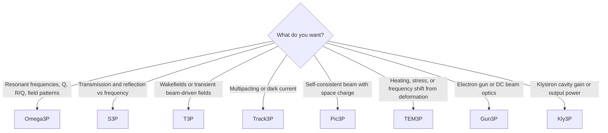

# Modules

ACE3P is a family of solvers that share one mesh format, one input syntax, and one post-processing toolchain. Each module addresses a different physics regime.

| Module | What it computes | Guide |
|---|---|---|
| **Omega3P** | Resonant modes of RF cavities: frequencies, Q, R/Q, field patterns | [Introduction](omega3p/index.md), [tutorials](omega3p/tutorial-pillbox.md), [post-processing](omega3p/postprocess.md) |
| **S3P** | S-parameters of couplers, bends, loads and windows across a frequency scan | [Introduction](s3p/index.md), [tutorials](s3p/tutorials.md) |
| **T3P** | Time-domain fields: wakefields, port excitation, transients, moving window | [Introduction](t3p/index.md), [tutorials](t3p/tutorials.md) |
| **Track3P** | Particle tracking in RF fields: multipacting and dark current | [Introduction](track3p/index.md), [tutorials](track3p/tutorials.md) |
| **Pic3P** | Self-consistent particle-in-cell beam dynamics with space charge | [Introduction](pic3p/index.md), [tutorial](pic3p/tutorial.md) |
| **TEM3P** | Thermal and mechanical analysis driven by RF loads, frequency shifts | [Introduction](tem3p/index.md), [tutorials](tem3p/tutorials.md) |
| **Gun3P** | DC electron guns: electrostatics, space-charge-limited emission, beam optics | [Introduction](gun3p/index.md), [tutorial](gun3p/tutorial.md) |
| **Kly3P** (new) | Klystron large-signal operating point: mode amplitudes self-consistent with beam loading | [Command syntax](../reference/commands/kly3p.md); user guide to come |

## Which module do I need?

Several modules chain together. Track3P reads the mode fields that Omega3P produces. TEM3P reads Omega3P or S3P fields as a heat source. The [ACE3P GUI](../interfaces/gui.md) and [lume-ace3p](https://github.com/slaclab/lume-ace3p) automate such chains.
