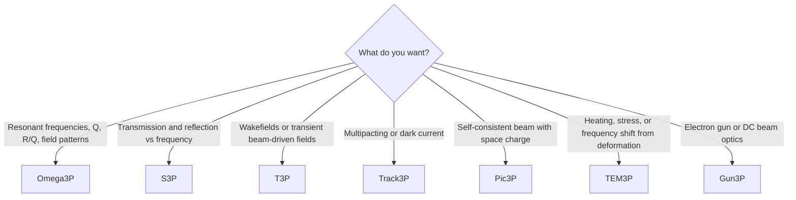

# Modules

ACE3P is a family of solvers that share one mesh format, one input syntax, and one post-processing toolchain. Each module addresses a different physics regime.

| Module | Guide | Status of this documentation |
|---|---|---|
| **Omega3P** | [User guide and tutorials](omega3p/index.md) | Complete: concepts, three tutorials, post-processing |
| **S3P** | [User guide and tutorials](s3p/index.md) | Complete: concepts, input blocks, output files, three tutorials |
| **T3P** | [User guide and tutorials](t3p/index.md) | Complete: wakefields, port excitation, moving window, SIBC, five tutorials |
| **Track3P** | [User guide and tutorials](track3p/index.md) | Complete: multipacting and dark current, six tutorials, S3DF rerun |
| **Pic3P** | [User guide and tutorial](pic3p/index.md) | Complete: self-consistent PIC, LCLS gun tutorial |
| **TEM3P** | [User guide and tutorials](tem3p/index.md) | Complete: thermal, elastic, LF detuning, mechanical eigenmodes, four tutorials |
| **Gun3P** | [User guide and tutorial](gun3p/index.md) | Complete: DC gun iteration, sheet beam gun tutorial with MICHELLE comparison |

## Which module do I need?

Several modules chain together. Track3P reads the mode fields that Omega3P produces. TEM3P reads Omega3P or S3P fields as a heat source. The [ACE3P GUI](../interfaces/gui.md) and [lume-ace3p](https://github.com/slaclab/lume-ace3p) automate such chains.
