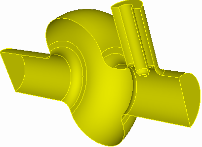

# Omega3P

Omega3P computes the resonant modes of an RF cavity: the eigenfrequencies, the quality factors, and the electromagnetic field distribution of each mode. It is the most widely used ACE3P module and the starting point for most other analyses, since Track3P, TEM3P, and the acdtool RF post-processor all consume its output.

{ width="420" }
/// caption
Cavities analyzed in the tutorials: rounded pillbox, coax coupler, waveguide coupler with lossy load, and a traveling-wave cell.
///

## What it solves

In the frequency domain, Maxwell's equations in a source-free cavity reduce to the vector wave equation for the electric field:

$$
\nabla \times \left(\mu^{-1} \nabla \times \mathbf{E}\right) - \omega^2 \varepsilon\, \mathbf{E} = 0
$$

Discretizing with high-order Nédélec vector finite elements gives a generalized eigenvalue problem $K\mathbf{x} = \lambda M\mathbf{x}$ with $\lambda = \omega^2$. Omega3P handles three cases:

| Case | Eigenvalue | When |
|---|---|---|
| **Lossless, closed cavity** | Real | Perfect electric or magnetic walls, periodic boundaries. Wall loss and Q~0~ are computed afterward by perturbation from the surface conductivity. |
| **Open or lossy cavity** | Complex | Waveguide ports, absorbing boundaries, lossy dielectrics, surface impedance. The imaginary part gives the external or dielectric Q. |
| **Multiple ports with different cutoffs** | Nonlinear | Each port adds a frequency-dependent term. Solved with the CORK rational Krylov method. |

The frequency is $f = \omega / 2\pi$ and, for a complex eigenvalue, $Q = \mathrm{Re}(f) / 2\,\mathrm{Im}(f)$.

## Capabilities

- Perfect electric and magnetic boundary conditions for symmetry reduction
- Periodic boundaries with an arbitrary phase advance, for dispersion curves of traveling-wave structures
- Waveguide ports with modal expansion, for coupler external Q
- Absorbing boundaries for simple beam-pipe truncation
- Volume materials with complex permittivity, for loads and windows
- Surface conductivity for wall-loss Q~0~, and surface impedance for coatings
- Finite-element orders 1 through 6 on curved tetrahedra
- Adaptive mesh refinement driven by an error estimate
- Checkpoint and restart of long eigensolves

## Input file

The input `<project>.omega3p` uses the [common blocks](../../workflow/input-format.md) plus `EigenSolver` and, for open cavities, one `Port` block per port. A complete lossless example:

```text title="pillbox.omega3p"
ModelInfo : {
  File: ./pillbox4.ncdf
  BoundaryCondition : {
    Magnetic: 1, 2
    Exterior: 6
  }
  SurfaceMaterial : {
    ReferenceNumber: 6
    Sigma: 5.8e7
  }
}

FiniteElement: {
  Order:           2
  CurvedSurfaces: on
}

EigenSolver : {
  NumEigenvalues: 2
  FrequencyShift:  1.0e9
}

PostProcess : {
  Toggle: on
  ModeFile: mode
}
```

### EigenSolver block

| Key | Default | Meaning |
|---|---|---|
| `NumEigenvalues` | 1 | How many modes to find, counting upward in frequency from `FrequencyShift` |
| `FrequencyShift` | 10 GHz | Target frequency. The solver finds the modes nearest to and above this value. Set it a little below the lowest mode you want. |
| `FrequencyShiftImag` | 0 | Imaginary part of the shift, for complex problems |
| `Tolerance` | 1e-8 | Relative residual for eigenpair convergence |
| `MaxIterations` | 200 | Krylov iteration limit |
| `SolverMode` | `automatic` | Choose the algorithm explicitly: `Arnoldi`, `InexactLanczos`, `ESIL`, `SOAR`, `CORK`. Automatic picks by problem type. |
| `CORK` | | Sub-block with `TargetFrequencyMin`, `TargetFrequencyMax`, `TargetFrequencyImag`, `ApproxTolerance`, `ApproxMaxDegree` for the nonlinear solver. See [Tutorial 2](tutorial-ports.md#nonlinear-eigenproblem). |

The full list, including adaptive refinement and matrix dump options, is in the [Omega3P keyword reference](../../reference/omega3p.md).

### Port block

```text
Port : {
  ReferenceNumber : 7     // sideset of the port surface
  NumberOfModes : 1       // waveguide modes to load at this port
}
```

A surface listed under `Waveguide` in `BoundaryCondition` must have a matching `Port` block, or Omega3P loads one mode by default. The port is treated as matched for every loaded mode. Choosing how many modes to load is discussed in [Tutorial 2](tutorial-ports.md).

## Output

Results go into `omega3p_results/` next to the input file.

| File | Content |
|---|---|
| `omega3p.out` | Full log: parsed input, mesh statistics, DOF count, iteration history, and a `Mode` block per eigenpair with `Frequency`, `QualityFactor`, `ExternalQ`, `TotalEnergy`, `PowerLoss`, and the field file name |
| `omega3p.log` | Shorter progress log |
| `omega3p.warn` | Warnings. Read this if a result is unexpected. |
| `omega3p.l0.m0000.<freq>.mod` | Field file for mode 0 at refinement level 0. One per mode. For complex problems the name carries `R<real>.I<imag>`. |
| `2dports.log` | Cutoff frequencies and types of the waveguide modes computed on each port surface |
| `VECTOR/` | Raw eigenvectors |

A typical mode summary:

```text
Mode : {
    TotalEnergy : 4.2137588190101e-12 , 0
    ExternalQ : 267.27097453785
    QualityFactor : 26238.857067312
    File : omega3p_results/omega3p.l0.m0000.R1.1762928e+09.I2.2005621e+06.mod
    PowerLoss : 1.1869161916105e-06
    Frequency : 1176292763.7678 , 2200562.1182804
}
```

`QualityFactor` is the wall-loss Q~0~ from `SurfaceMaterial`. `ExternalQ` is from the ports and is only present for complex problems. The two `Frequency` numbers are the real and imaginary parts in hertz.

## Tutorials

1. **[Pillbox cavity](tutorial-pillbox.md)**: the complete workflow from Cubit journal to R/Q, plus a mesh convergence study.
2. **[Coax and waveguide couplers](tutorial-ports.md)**: waveguide ports, external Q, and the nonlinear eigenproblem with two ports.
3. **[Lossy load and periodic boundaries](tutorial-advanced.md)**: multiple materials with complex permittivity, and a dispersion point of a disk-loaded structure.

Post-processing with `acdtool postprocess rf` has its own page: **[Post-processing](postprocess.md)**.
