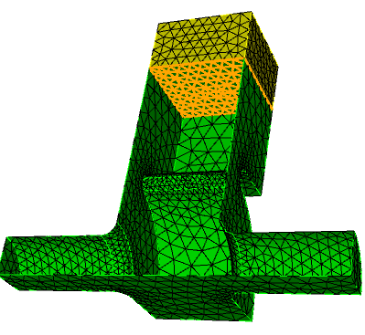
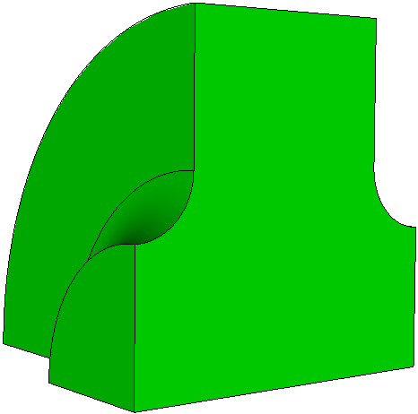
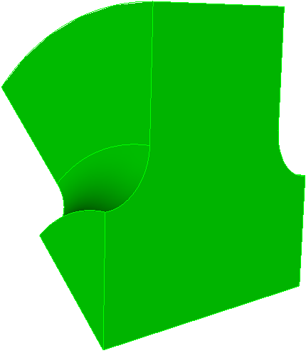
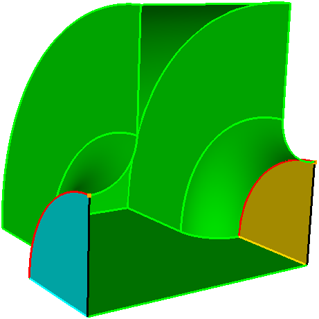

# Tutorial 3: lossy load and periodic boundaries

Two further Omega3P features: a second material with complex permittivity, which absorbs power and produces a complex eigenvalue without any port, and periodic boundary conditions for one cell of a traveling-wave structure.

## Part A: waveguide coupler with a lossy load

**Example directory:** `examples/omega3p/pillbox+recWG+load`

{ width="130" }
{ width="130" }

Instead of terminating the waveguide of [Tutorial 2](tutorial-ports.md) with a port, fill its end with a lossy dielectric. The journal `step3-ADD-load.jou` webcuts the guide at y = 200 mm so the far section becomes a separate volume.

### Imprint and merge

Two volumes that touch must share a single interface surface, otherwise the mesh is disconnected across it and the solver sees two separate cavities. Cubit does this with `imprint` and `merge`:

```text
reset
import acis "pillbox+recWG+load.sat"
imprint body 1 2
merge body 1 2
volume all scheme Tetmesh
volume 1 sizing function type skeleton scale 7 time_accuracy_level 2 min_size auto max_size 15 max_gradient 1.2
volume 2 sizing function type skeleton scale 7 time_accuracy_level 2 min_size auto max_size 10 max_gradient 1.2
mesh volume all

Sideset 1 surface 4 20
Sideset 2 surface 9
Sideset 6 surface all except 4 20 9 1

block 1 volume 1          # vacuum
block 2 volume 2          # load
block all element type tetra10
volume all scale 0.001
export Genesis "pillbox+recWG+load.gen" block all overwrite
```

Each volume goes in its own block so the solver can assign different materials. The load gets a finer mesh since the wavelength inside a high-permittivity material is shorter.

{ width="420" }
/// caption
After imprint and merge, the interface between guide and load is one surface. Verify this in Cubit before export.
///

### Input with two materials

```text title="pillbox+recWG+load.omega3p"
ModelInfo : {
  File: ./pillbox+recWG+load.ncdf
  BoundaryCondition : {
    Magnetic:  1, 2
    Exterior:  6
  }
  Material : {
    Attribute: 1
    Epsilon:   1.0
    Mu:        1.0
  }
  Material : {
    Attribute: 2
    Epsilon:   10.0
    EpsilonImag: -1.52         // loss tangent 0.152
    Mu:        1.0
  }
  SurfaceMaterial : {
    ReferenceNumber: 6
    Sigma: 5.8e7
  }
}

FiniteElement: {
  Order:           1
  CurvedSurfaces: on
}

EigenSolver : {
  NumEigenvalues: 2
  FrequencyShift:  1.1e9
}
```

`EpsilonImag` is negative for a lossy material. There is no `Waveguide` boundary and no `Port` block; the loss comes entirely from the volume. The problem is still a complex eigenproblem.

### Results

```text
Eigenvalue: (591.2395988707802, 0.1200579050951992)
        Frequency: (1160172571.152617, 117793.09714004)
Eigenvalue: (600.8495902547749, 90.41431550096833)
        Frequency: (1172850486.101091, 87749817.12126675)
```

Mode 0 at 1.160 GHz has a small imaginary part, Q of about 4900 from the load, and is the cavity mode. Mode 1 at 1.173 GHz has an imaginary part of 88 MHz, Q below 10, and lives mostly in the load. Heavily damped modes like this appear whenever a lossy volume is present; recognize them by their very low Q and by inspecting the field in ParaView.

## Part B: periodic boundaries for a disk-loaded structure

**Example directory:** `examples/omega3p/dlwg-pbc`

{ width="200" }
{ width="180" }
/// caption
One cell of a disk-loaded waveguide as a quarter model and as an eighth model.
///

A traveling-wave accelerator structure is periodic. Rather than model many cells, simulate one with a periodic boundary condition: the field on the exit face equals the field on the entry face times a phase factor $e^{-j\theta}$. Sweeping the phase advance $\theta$ gives the dispersion curve.

### Mesh the master and slave faces identically

The periodic condition maps each node on the master face to a node on the slave face, so the two surface meshes must be the same. Mesh the master surface first, copy its mesh to the slave with matching curve and vertex pairs, then mesh the volume.

```text title="step2a-pbc-mesh_1fourth.jou"
reset
import acis "ds-cell-1fourth.sat"
volume 1 scheme tetmesh
volume 1 size 2.0
surface 5 6 size 1.          # nose cone
surface 9 size 1.            # iris

mesh surface 2               # master face
copy Mesh Surface 2 Onto Surface 4 source curve 10 target curve 17 source vertex 9 target vertex 10 Nosmoothing
mesh volume 1

sideset 3 surface 2          # Periodic_M
sideset 4 surface 4          # Periodic_S
sideset 1 surface 3
sideset 2 surface 1
sideset 6 surface all except 2 4 3 1

block 1 vol all
block 1 element type tetra10
transform mesh output scale 0.001
export genesis "pbc-4.gen" overwrite
```

{ width="320" }

!!! warning
    Do not smooth the mesh after copying, and do not let a volume smoother move the periodic faces. The `Nosmoothing` option and the commented-out smooth lines in the example are deliberate.

### Input with a phase advance

```text title="dlwg-pbc4-m0.omega3p"
ModelInfo : {
  File: ./pbc-4.ncdf
  BoundaryCondition : {
    Exterior: 6
    Magnetic: 1, 2
    Periodic_M: 3              // master face
    Periodic_S: 4              // slave face
    Theta: -150                // phase advance per cell, degrees
  }
  SurfaceMaterial: {
    ReferenceNumber: 6
    Sigma: 5.8e7
  }
}

FiniteElement: {
  Order:           2
  CurvedSurfaces: on
}

EigenSolver : {
  NumEigenvalues: 1
  FrequencyShift:  1.10e9
}
```

`Periodic_M` and `Periodic_S` name the master and slave sidesets. `Theta` is the phase advance in degrees. The sign convention follows the direction from master to slave. For a $2\pi/3$ structure, set `Theta` to 120 or -120 and compare the frequency against the design.

### Dispersion curve

Run the same mesh with `Theta` at several values between 0 and 180 and plot frequency against phase advance. The 0 and 180 degree points are the band edges and can also be obtained with the ordinary magnetic and electric boundary conditions on the two faces; use that as a cross-check of the periodic implementation.

The example includes `dlwg-pbc4-m1.omega3p`, which switches one symmetry plane to `Electric` to pick the dipole band instead of the monopole band, and `dlwg-pbc8-m0.omega3p` for the eighth model.
