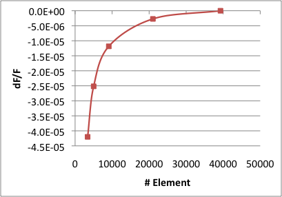
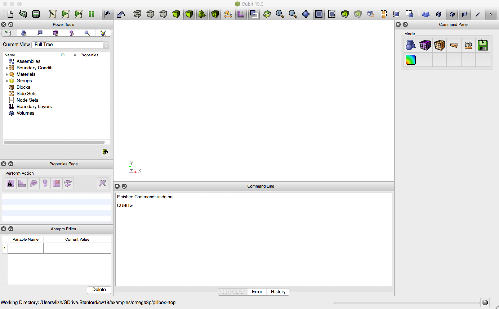
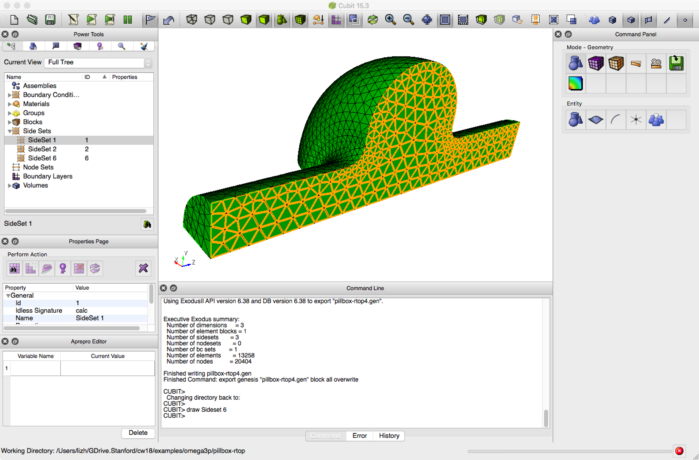
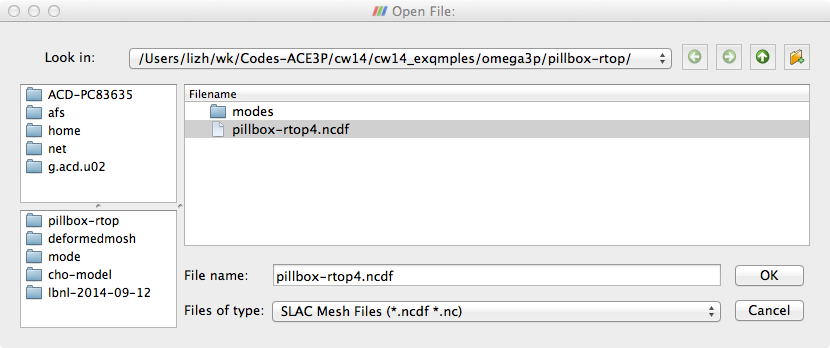
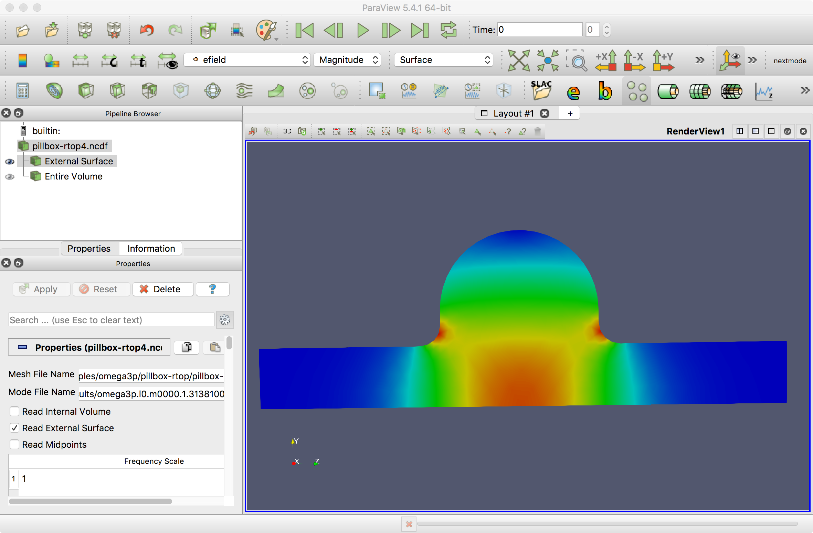
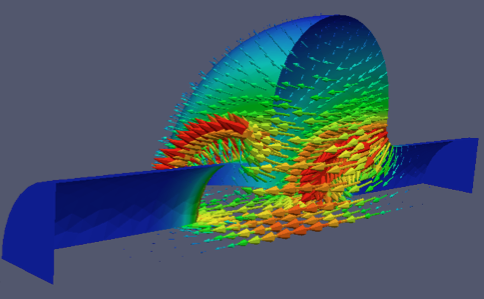
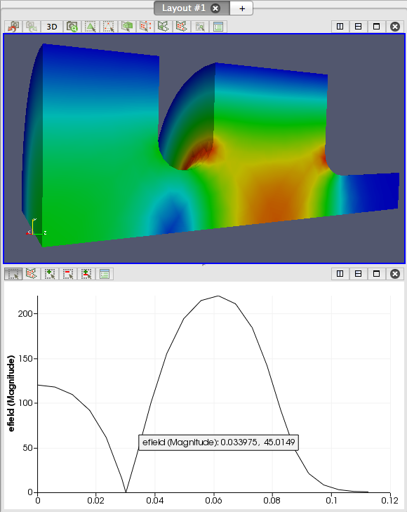

# Tutorial 1: pillbox cavity

This tutorial runs the complete ACE3P workflow on the simplest useful cavity: a pillbox with rounded top and beam pipes. You will build and mesh the geometry in Cubit, convert the mesh, compute the two lowest monopole modes with Omega3P, look at the fields in ParaView, extract R/Q and peak surface fields with acdtool, and finish with a mesh convergence study.

**Example directory:** `examples/omega3p/pillbox-rtop`

{ width="300" }

| Parameter | Value |
|---|---|
| Cavity length | 90 mm |
| Cavity radius | 100 mm |
| Beam pipe radius | 35 mm |
| Beam pipe length | 300 mm total |
| Iris rounding | 12 mm |
| Top rounding | 45 mm |

Expected result: the TM~010~ mode at **1.3138 GHz** with Q~0~ of **28,885** for copper walls.

## Step 1: Build the geometry

The journal `step1-Make-pillbox-rtop.jou` builds the full cavity, then cuts it to a quarter model using the two symmetry planes.

```text title="step1-Make-pillbox-rtop.jou"
reset
#{cav_length = 90}
#{cav_radius = 100}
#{bp_length  = 300}
#{bp_radius  = 35 }
#{iris_rounding = 12}

create Cylinder height {cav_length} radius {cav_radius}
create Cylinder height {bp_length} radius {bp_radius}
unite volume all
compress ids
modify curve 6 5  blend radius {iris_rounding}
modify curve 1 2 blend radius {0.5*cav_length}
export acis "pillbox-rtop0.sat" overwrite

webcut volume 1 with plane xplane offset 0 noimprint nomerge
delete volume 2
compress ids
webcut volume 1 with plane yplane offset 0 noimprint nomerge
delete volume 1
compress ids
export acis "pillbox-rtop4.sat" overwrite
```

Lines starting with `#{...}` define Cubit variables, so dimensions can be changed in one place. The full model is saved as `pillbox-rtop0.sat` before cutting, so it can be reused when adding couplers in [Tutorial 2](tutorial-ports.md). The quarter model is `pillbox-rtop4.sat`.

Run it in Cubit with the Play button, or through **Tools, then Journal Editor**.

{ width="500" }

## Step 2: Mesh

```text title="step2-Mesh-pillbox-rtop.jou"
reset
import acis "pillbox-rtop4.sat"

volume all scheme Tetmesh
volume all sizing function type skeleton scale 5 time_accuracy_level 2 min_size auto max_size 12 max_gradient 1.2
mesh volume all

Sideset 1 surface 7
Sideset 2 surface 1
Sideset 6 surface all except 7 1

block 1 volume all
block 1 element type tetra10

volume all scale 0.001
export Genesis "pillbox-rtop4.gen" block all overwrite
```

Sidesets 1 and 2 are the two symmetry planes. Sideset 6 is every other surface, which is the cavity wall. The element type must be `tetra10` and the model is scaled from millimeters to meters just before export.

{ width="700" }
/// caption
The meshed quarter model. The Cubit command window reports 13,258 elements and three sidesets.
///

## Step 3: Convert the mesh

Copy `pillbox-rtop4.gen` to your working directory on the HPC system and convert it:

```bash
acdtool meshconvert pillbox-rtop4.gen
```

Check the statistics it prints. You want `Euler Char is OK`, boundary IDs `1 2 6`, one material ID, and zero invalid second-order elements. The meaning of each line is explained in [Mesh preparation](../../workflow/mesh.md#read-the-statistics).

## Step 4: Write the Omega3P input

```text title="pillbox-rtop.omega3p"
ModelInfo : {
  File: ./pillbox-rtop4.ncdf

  BoundaryCondition : {
    Magnetic: 1, 2          // symmetry planes: monopole modes
    Exterior: 6             // cavity wall
  }

  SurfaceMaterial : {
    ReferenceNumber: 6
    Sigma: 5.8e7            // copper, S/m, for Q0
  }
}

FiniteElement: {
  Order:           2
  CurvedSurfaces: on
}

EigenSolver : {
  NumEigenvalues: 2
  FrequencyShift:  1.0e9    // look for modes above 1 GHz
}

PostProcess : {
  Toggle: on                // write field files for ParaView
  ModeFile: mode
}
```

Two magnetic symmetry planes select modes whose electric field is normal to both planes, which for a cylindrical cavity means the monopole family. To get dipole modes, change one plane to `Electric`.

The default volume material is vacuum, so no `Material` block is needed. If you want to be explicit:

```text
  Material : {
    Attribute: 1            // Cubit block ID
    Epsilon: 1.0
    Mu: 1.0
  }
```

## Step 5: Run Omega3P

Submit a batch job with the header for your system from [Getting started](../../getting-started/index.md). The solver line is:

```bash
srun -n 16 omega3p pillbox-rtop.omega3p
```

For this mesh, 16 ranks finish in about one minute. Watch progress with `squeue -u $USER` and `tail -f` on the Slurm output file.

## Step 6: Read the results

Look in `omega3p_results/`:

```text
omega3p.l0.m0000.1.3138129e+09.mod
omega3p.l0.m0001.2.3291363e+09.mod
omega3p.log
omega3p.out
omega3p.warn
VECTOR/
```

The mode frequencies are already in the file names. In `omega3p.out`, the mode summary gives the details:

```text
Mode : {
    TotalEnergy : 4.4270939088102e-12
    QualityFactor : 28885.092644708
    File : omega3p_results/omega3p.l0.m0000.1.3138100e+09.mod
    PowerLoss : 1.2651947886823e-06
    Frequency : 1313809979.5477
}
Mode : {
    TotalEnergy : 4.4270939088102e-12
    QualityFactor : 33830.795068362
    File : omega3p_results/omega3p.l0.m0001.2.3291386e+09.mod
    PowerLoss : 1.9150571359106e-06
    Frequency : 2329138623.836
}
```

Mode 0 at 1.3138 GHz is TM~010~ with Q~0~ of 28,885 for copper walls. Mode 1 at 2.329 GHz is the next monopole mode. Above the summary, the log records the DOF count, which you will need for the convergence study:

```text
*	Total Number of Elements used: 	13382
*	Total Number of DOFs: 	82592
```

## Step 7: Visualize in ParaView

Open the mesh and the mode files in ParaView on the ThinLinc desktop (see [ParaView](../../getting-started/tools/paraview.md)), or copy them to your laptop:

```bash
scp <user>@<host>:<dir>/pillbox-rtop4.ncdf .
scp '<user>@<host>:<dir>/omega3p_results/*.mod' .
```

In ParaView with the SLAC toolbar enabled, click the SLAC folder icon, select the mesh file and a mode file, and Apply.

{ width="560" }

Color the external surface by `efield` magnitude to see the field pattern. For TM~010~ the field peaks on axis in the cavity and at the iris.

{ width="700" }

For an arrow plot, apply **Filters, Alphabetical, Glyph** with `efield` as the vector. To look through the symmetry plane, select External Surface, apply **Extract Block**, and keep only the dataset for the wall.

{ width="480" }

The **Line plot** button on the SLAC toolbar plots a field component along a line, typically the beam axis.

## Step 8: Post-process with acdtool

Shunt impedance, kick factor, and peak surface fields come from `acdtool postprocess rf`, driven by an `.rfpost` file. The example directory contains `pillbox-rtop.rfpost` with `RoverQ` and `maxFieldsOnSurface` enabled. Run:

```bash
srun -n 1 acdtool postprocess rf pillbox-rtop.rfpost
```

Output for the two modes:

```text
[RoverQ]
 ModeID  Frequency           (V_r, V_i)                     |V|           RoQ(ohm/cavity)
    0   1.31381e+09  ( 2.2980e+00,  3.4925e+00)    4.18073e+00      1.19567e+02
    1   2.32914e+09  (-7.2671e-04,  6.2729e-04)    9.59998e-04      3.55621e-06

[maxFieldsOnSurface]
   surfaceID :   6
      ModeID :   0
        Emax :  4.22488e+07 (V/m)   at ( 3.9627e-02,  1.8486e-02, -4.5454e-02)
        Hmax :  5.80786e+04 (A/m)   at ( 3.3116e-02,  7.9193e-02,  3.2771e-02)
```

R/Q of about 120 ohm per cavity for TM~010~, and essentially zero for mode 1, which has no net on-axis voltage. Peak fields are scaled to the gradient given in the `RFField` block. The `.rfpost` file format and all available functions are described in [Post-processing](postprocess.md).

## Convergence study

A single mesh tells you nothing about accuracy. The directory includes `mesh0.jou` through `mesh3.jou`, identical except for the sizing function `scale`, which is 10, 8, 6, and 4 respectively, so `mesh0` is the coarsest and `mesh3` the finest. The input file `mesh-conv.omega3p` reads `mesh0.ncdf`; edit the file name for each level.

Run all four meshes and record the TM~010~ frequency and element count from each `omega3p.out`. Treat the finest mesh as the reference and plot the relative frequency error against element count.

{ width="420" }

With order 2 elements, the frequency converges to a few parts in 10^5^ by about 20,000 elements. Use this kind of plot to decide how fine a mesh you need for a given accuracy target, and remember that surface fields converge more slowly than frequency.

!!! tip "Order versus mesh density"
    Raising `FiniteElement.Order` from 2 to 3 on the same mesh often gains more accuracy per DOF than refining the mesh. The [ACE3P GUI](../../interfaces/gui.md) workflow-orchestration mode can run such an order sweep automatically.

## Exercise

`examples/omega3p/omega3p-exercise-1` contains a 1.5-cell gun geometry with target dimensions. Build it, find the pi mode, and adjust the cell dimensions so the mode frequency is correct and the field is balanced between cells.

{ width="260" }
