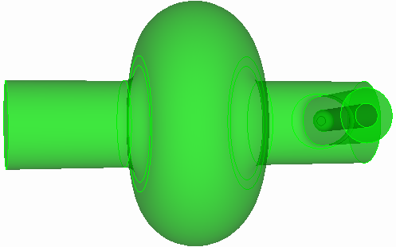
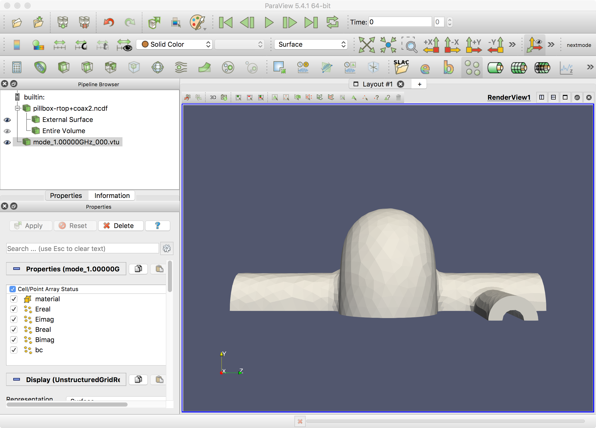
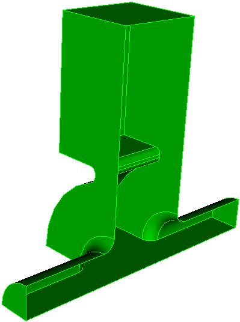
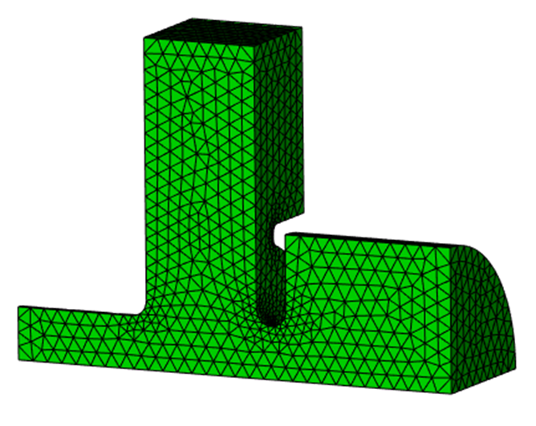
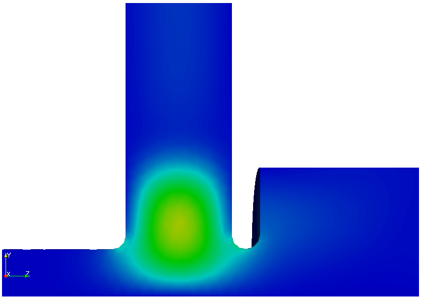
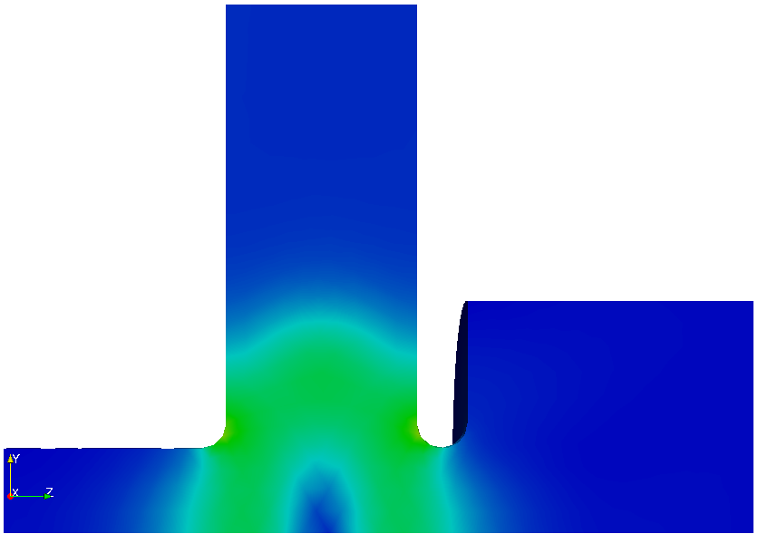
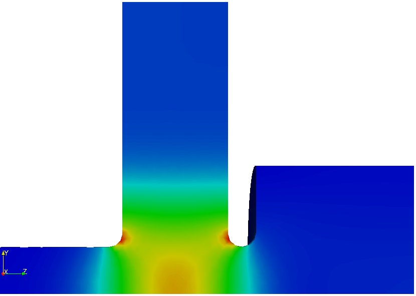

# Tutorial 2: couplers and waveguide ports

Real cavities have couplers. A coupler turns the lossless eigenproblem into a complex one: energy leaves through the port, the eigenfrequency acquires an imaginary part, and the external Q follows. This tutorial adds a coax coupler and then a waveguide coupler to the pillbox from [Tutorial 1](tutorial-pillbox.md), and ends with a two-port case that requires the nonlinear eigensolver.

## Part A: coax coupler

**Example directory:** `examples/omega3p/pillbox-rtop+coax`

{ width="360" }

| Coax dimension | Value |
|---|---|
| Inner conductor radius | 8.7 mm |
| Outer conductor radius | 20 mm |
| Axial position | z = 100 mm |
| Inner conductor tip | 30 mm from beam axis |
| Tip rounding | 5 mm |
| Outer-to-beampipe rounding | 7 mm |

### Build in steps

Complex models are easiest to build incrementally. Reuse the full pillbox saved in Tutorial 1, add the coax, then cut to a half model. Only one symmetry plane survives because the coupler breaks the other.

```text title="step2-ADD-coax.jou"
reset
create Cylinder height 120 radius 20
create Cylinder height 120 radius 8.7
body 1 2 rotate 90 about y
body 1 2 move -60 0 100
body 2 move -30 0 0
import acis "pillbox-rtop0.sat"
unite body 1 3
compress ids
subtract body 2 from 1
compress ids
modify curve 10 blend radius 7
modify curve 12 blend radius 5
export acis "pillbox-rtop+coax.sat" overwrite
webcut volume 1 with plane yplane offset 0
delete body 1
compress ids
export acis "pillbox-rtop+coax2.sat" overwrite
```

### Mesh with a port sideset

```text title="step3-Mesh-pillbox-rtop+coax.jou"
reset
import acis "pillbox-rtop+coax2.sat"
volume all scheme Tetmesh
volume all sizing function type skeleton scale 7 time_accuracy_level 2 min_size auto max_size 15 max_gradient 1.5
mesh volume all
Sideset 2 surface 1            # symmetry plane
Sideset 3 surface 3            # beam pipe end
Sideset 4 surface 2            # beam pipe end
Sideset 7 surface 17           # coax port
Sideset 6 surface all except 1 3 2 17
block 1 volume all
block 1 element type tetra10
volume all scale 0.001
export Genesis "pillbox-rtop+coax2.gen" block all overwrite
```

The coax end surface gets its own sideset, 7, so it can be declared a port. The beam pipe ends are 3 and 4.

### Input with a port

```text title="pillbox-rtop+coax.omega3p"
ModelInfo : {
  File: ./pillbox-rtop+coax2.ncdf
  BoundaryCondition : {
    Magnetic:  2
    Electric:  3, 4          // beam pipe ends, below cutoff
    Exterior:  6
    Waveguide: 7             // coax port
  }
  SurfaceMaterial : {
    ReferenceNumber: 6
    Sigma: 5.8e7
  }
}

FiniteElement: {
  Order:           2
  CurvedSurfaces: on
  Tolerance: 1e-7
}

EigenSolver : {
  NumEigenvalues: 1
  FrequencyShift:  1.0e9
}

Port : {
  ReferenceNumber : 7
  NumberOfModes : 1          // the coax TEM mode
}

PostProcess : {
  Toggle: on
  ModeFile: mode
}
```

The beam pipe ends are closed with `Electric`. That is fine here because the pipe is below cutoff at 1.3 GHz, so the field there has decayed to nothing. The coax port is `Waveguide` with one mode loaded: a coax has a TEM mode with zero cutoff, and nothing else propagates at this frequency.

### Run and read

Convert, run, and post-process exactly as in Tutorial 1. The mode summary now has a complex frequency and an external Q. From the example's stored results:

```text
Mode : {
    TotalEnergy : 4.4270939088102e-12 , 0
    ExternalQ : 1024235.9558753
    QualityFactor : 28815.235456204
    File : omega3p_results/omega3p.l0.m0000.R1.3137561e+09.I6.4133469e+02.mod
    PowerLoss : 1.2682100135575e-06
    Frequency : 1313756106.8639 , 641.33469408486
}
```

`ExternalQ` is the coupler Q~ext~, here about 1.0 million: with the inner conductor tip 30 mm from the axis, this coax barely couples to TM~010~. `QualityFactor` is still the wall Q~0~, essentially unchanged from the closed cavity. The loaded Q is $1/Q_L = 1/Q_0 + 1/Q_{ext}$, and the imaginary part of the frequency is $f_r / 2 Q_L$. Pushing the probe deeper toward the axis lowers Q~ext~ rapidly; the hands-on exercise in Part B does the equivalent for a waveguide iris.

### Port modes in ParaView

Omega3P writes the 2D port mode it computed on the port surface to `omega3p_results/port7/mode_1.00000GHz_000.vtu`. Load the 3D mesh with the SLAC toolbar, then **File, Open** the `.vtu` file and color by `Ereal`. Switch to wireframe if the port surface hides behind the wall.

{ width="560" }

## Part B: rectangular waveguide coupler

**Example directory:** `examples/omega3p/pillbox+recWG`

{ width="260" }

A waveguide coupler attaches a rectangular guide to the cavity through an iris. The journal `step2-ADD-recWG-to-pillbox.jou` parameterizes the guide width `wguide`, height `hguide`, iris width `wiris`, and iris depth `diris`, builds the guide as two bricks, unites with the full pillbox, rounds the iris corners, and cuts to a quarter model. The waveguide end becomes sideset 7.

The input is the same shape as the coax case:

```text
BoundaryCondition : {
  Magnetic:  1, 2
  Electric:  3, 4
  Exterior:  6
  Waveguide: 7
}
Port : {
  ReferenceNumber : 7
  NumberOfModes : 1          // TE10 of the rectangular guide
}
```

A rectangular guide, unlike a coax, has a nonzero cutoff. Omega3P computes the guide's modes on the port surface numerically and writes them to `2dports.log`. Check that the TE~10~ cutoff is below the cavity frequency, otherwise the port is not actually propagating.

### Absorbing boundary alternative

If modal accuracy at the port does not matter, a first-order absorbing boundary is simpler:

```text
BoundaryCondition : {
  ...
  Absorbing: 7
}
Port : {
  ReferenceNumber : 7
  CutoffFrequency : 1e9      // phase velocity from this cutoff
}
```

Without a `Port` block, the absorbing boundary assumes a phase velocity of $c$. With `CutoffFrequency`, it uses the guide's phase velocity at the eigenfrequency. The absorbing boundary is less accurate than a waveguide port with modal expansion and should be reserved for beam-pipe truncation.

### Hands-on

Change `wiris` in the journal, remesh, rerun, and find the iris width that gives Q~ext~ of about 4000. Two or three iterations usually bracket it.

## Part C: two ports with different cutoffs {#nonlinear-eigenproblem}

**Example directory:** `examples/omega3p/pillbox+recWG+cirWG`

{ width="460" }

Add a circular waveguide on the beam axis to the Part B model. Now there are two ports, each with several modes near the cavity frequency and with different cutoffs. The waveguide boundary term depends on frequency through $\sqrt{\omega^2 - \omega_c^2}$ for each loaded mode, and with more than one distinct cutoff the eigenproblem is no longer quadratic. Omega3P solves it with CORK, a rational Krylov method.

```text title="in1.omega3p (EigenSolver and Port blocks)"
EigenSolver : {
  NumEigenvalues:  3
  Tolerance:       1e-10
  FrequencyShift:  1.0e9
  SolverMode:      CORK
  CORK : {
    TargetFrequencyMin:   1.0e9    // search window, real part
    TargetFrequencyMax:   2.4e9
    TargetFrequencyImag:  5.0e8    // search window, imaginary part
    MaxIterations:        500
    ApproxTolerance:      1e-12    // rational approximation accuracy
    ApproxMaxDegree:      100
  }
}

Port : {
  ReferenceNumber : 4            // circular guide
  NumberOfModes : 10
}
Port : {
  ReferenceNumber : 7            // rectangular guide
  NumberOfModes : 10
}
```

CORK searches a rectangle in the complex frequency plane rather than expanding around a single shift, so you give it a window instead of a target. Start by loading generously many port modes, here 10 per port, so no propagating mode is missed.

### Check the port modes

After the run, `2dports.log` lists each port's modes with cutoff frequency and type. For this geometry:

| Mode | Port 4 (circular) | Port 7 (rectangular) |
|---|---|---|
| 1 | TM 1.043 GHz | TE 0.908 GHz |
| 2 | TE 1.325 GHz | TE 1.897 GHz |
| 3 | TM 2.228 GHz | TM 1.897 GHz |
| 4 | TE 2.307 GHz | TE 2.726 GHz |
| 5 | TM 2.395 GHz | TE 3.194 GHz |

The first run found three eigenmodes at 1.176, 2.062, and 2.197 GHz. Compare these against the cutoffs. Port 4 has TM modes with cutoffs at 2.228 and 2.395 GHz, very close to eigenmodes 2 and 3. A loaded mode whose cutoff sits almost on top of an eigenfrequency has $\sqrt{\omega^2-\omega_c^2}$ near zero, which makes the rational approximation poorly conditioned and contaminates the solution.

### Rerun with only the propagating modes

Load exactly the modes that propagate at the eigenfrequencies of interest:

```text title="in2.omega3p"
Port : {
  ReferenceNumber : 4
  NumberOfModes : 2
}
Port : {
  ReferenceNumber : 7
  NumberOfModes : 3
}
```

| Mode | in1 f (GHz) | in1 Q~ext~ | in2 f (GHz) | in2 Q~ext~ |
|---|---|---|---|---|
| 1 | 1.176 | 267 | 1.176 | 271 |
| 2 | 2.062 | 496 | 2.057 | 273 |
| 3 | 2.197 | 749 | 2.196 | 693 |

Mode 1 is unaffected since no cutoff is near it. Modes 2 and 3 change noticeably, and the second run is the trustworthy one. The lesson generalizes: **load all propagating port modes and no evanescent mode whose cutoff is close to an eigenfrequency.** Run once with many modes to learn the cutoffs, then run again with the right count.

{ width="220" }
{ width="220" }
{ width="200" }
/// caption
Complex electric fields of the three modes from the second run.
///
