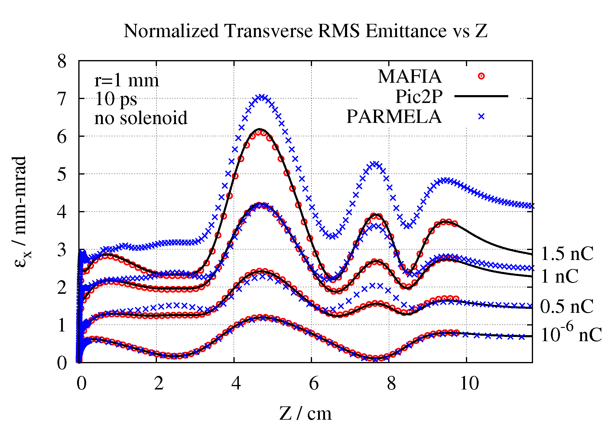

# Pic3P

Pic3P is the electromagnetic particle-in-cell mode of the T3P time-domain solver. It advances Maxwell's equations and the particles together, so the fields the particles feel include their own space charge, image charges on the walls, and the wakefields they leave behind. It is the tool for RF guns and other low-energy, high-charge situations where the beam modifies the fields it moves in.

There is no separate `pic3p` executable. A `.pic3p` input file is run with `t3p`, and T3P switches to PIC mode when it finds a `Loading` block with `Particles` inside. Results go to `t3p_results/`.

## When to use it

| Question | Tool |
|---|---|
| Where do field-emitted or secondary electrons go in a given RF field? | [Track3P](../track3p/index.md): the field is fixed, particles do not change it |
| How does a bunch's own charge affect its emittance in a gun? | **Pic3P**: full self-consistency |
| What is the wake left by a rigid bunch? | [T3P](../t3p/index.md) beam excitation: the bunch is a prescribed current |

Pic3P is the only ACE3P module in which the particle distribution and the fields evolve each other. Everything else in the time-domain family treats one of the two as given.

## Physics

The field solve is the T3P implicit scheme on the full mesh. The particles are macroparticles pushed with the Lorentz force; their charge is deposited on the finite-element basis as a current source for the next field step. Because the field solve is implicit, the time step is set by the particle dynamics and the bunch spectrum rather than by a Courant limit.

**Causal moving window.** A bunch at low energy moves slowly and its self-field is confined to its light cone. Pic3P therefore solves at full order only inside a region that causality can reach from the particles, and at order 0 elsewhere. Two `PRegion` blocks define this: `PICCausality` is the light-cone region, `PICDomain` the smaller region holding the particles themselves, which may use a higher order. The window follows the bunch down the structure.

**Space charge on and off.** `TrackingOnly: yes` disables charge deposition and turns Pic3P into a tracker for the external fields only. Running once with and once without is the quickest way to isolate space-charge effects.

**Benchmark.** The 2D predecessor Pic2P was validated against MAFIA and PARMELA on the LCLS gun, reproducing the normalized emittance evolution for bunch charges from negligible to 1.5 nC.

{ width="520" }
/// caption
Normalized transverse RMS emittance along the LCLS gun for four bunch charges, 1 mm radius, 10 ps flat-top, no solenoid: Pic2P (lines) against MAFIA (circles) and PARMELA (crosses).
///

## Input file

Every block and key is described in the [Pic3P command syntax](../../reference/commands/pic3p.md).

```text title="LCLSGun.pic3p"
CheckPoint: {
  Action: none
  Ntimesteps: 100
}

ModelInfo: {
  File: LCLSGun-Pic3P.ncdf
  BoundaryCondition: {
    Magnetic: 1 2
    Absorbing: 3 5
    Exterior: 4 6
  }
}

FiniteElement: {
  Order: 0                       // outside the window
}

PRegion: {
  Type: PICCausality             // light-cone region around the bunch
  Order: 1
}

PRegion: {
  Type: PICDomain                // region containing the particles
  Order: 1
}

TimeStepping: {
  MaximumTime: 4.2e-10
  DT: 5e-13
}

Monitor: {
  Type: Volume
  Name: scatter
  TimeStep: 2e-11
}

LinearSolver: {
  Solver: MUMPS
}

Loading: {
  SymmetryFactor: 4
  SymmetryOrigin: 0 0 0

  Particles: {
    TrackingOnly: no             // yes turns space charge off
    z0: -6.0325e-2               // cathode center, m
    TotalCharge: -1e-9           // C, negative for electrons

    Distribution: {
      Beta: 0 0 0.003            // initial v/c, keep small
      NumberOfParticles: 1e3
      Radial:       { rMin: 0  rMax: 1e-3 }
      Longitudinal: { Type: Flattop  DeltaT: 10e-12  RiseTime: 2e-12 }
    }

    Monitors: {
      DumpInterval: 2e-11                   // phase-space dump every 20 ps
      DumpPhases: 18 64                     // and at these drive-field phases
      DumpPositions: 0 1e-2                 // and when <z> reaches these
      ObserverPlaneZPositions: -2e-2 2e-2   // record every crossing of these planes
    }
  }

  ConstantField: { E: 0 0 0   B: 0 0 0 }

  DriveField: {
    FieldValueAtPhase0: -120e6   // V/m, sign matches the charge
    FieldComponent: 2            // 0 x, 1 y, 2 z
    SamplePoint: 0,0,-6.0325e-2  // where the field is normalized
    CentroidPhaseBeforeCrest: -58
    Omega3PMap: {
      Directory: omega3p_results
      ModeNumber: 1              // pi mode is the second mode
    }
  }
}
```

### Loading

| Key | Meaning |
|---|---|
| `SymmetryFactor` | 1, 2, or 4 for full, half, quarter model. Pic3P reflects particles and fields accordingly. |
| `SymmetryOrigin` | Point the symmetry planes pass through |

### Particles

| Key | Meaning |
|---|---|
| `TrackingOnly` | `no` for self-consistent PIC, `yes` to disable space charge |
| `z0` | z of the emission plane, usually the cathode |
| `TotalCharge` | Bunch charge in C, negative for electrons |
| `Distribution` | Built-in generator, below, or `File` naming a NetCDF distribution |
| `Monitors` | When to write phase-space dumps |

Instead of a `Distribution`, three self-consistent emission models can create particles from a surface during the run:

| Block | Model | Keys |
|---|---|---|
| `FieldEmission` | Fowler-Nordheim | `BoundaryID`, `WorkFunction` in eV, `FieldEnhancement`, `MaxCurrentDensity` |
| `ThermionicEmission` | Schottky, J = A exp(B √E) | `BoundaryID`, `A`, `B`, `MaxCurrentDensity` |
| `DCEmission` | Constant current normal to the surface | `BoundaryID`, `BeamCurrentDensity`, `Beta0` |

### Distribution

The built-in generator is uniform in radius between `rMin` and `rMax`, uniform in azimuth, with a chosen longitudinal profile and a single initial velocity `Beta`.

| `Longitudinal.Type` | Keys |
|---|---|
| `Flattop` | `DeltaT` duration, `RiseTime` for the edges. Implemented as a Fermi-Dirac profile, which is what the output files call it. |
| `Gaussian` | `SigmaT`, `NumSigma` |
| `Ellipsoid` | `DeltaT` |

For an arbitrary distribution, write a text file with the particle count on the first line and then one `x px y py z pz` line per particle in meters and normalized momentum, convert it with `acdtool postprocess pic3pconvert dist.txt`, and give the resulting `.ncdf` as `Distribution: { File: dist.ncdf }`.

### DriveField

The external RF field, read from an Omega3P solution or a Superfish file. More than one `DriveField` block is allowed, for multi-cell structures with separately normalized fields.

| Key | Meaning |
|---|---|
| `FieldValueAtPhase0` | Field amplitude at RF phase zero, V/m. Sign convention follows the charge: negative here so that negative electrons are accelerated in +z. |
| `FieldComponent` | Which component is normalized: 0, 1, 2 for x, y, z |
| `SamplePoint` | Where the normalization is applied, typically the cathode center |
| `CentroidPhaseBeforeCrest` | RF phase at which the bunch centroid is injected, degrees before crest |
| `Omega3PMap` | `Directory` and `ModeNumber` (from 0) of the Omega3P solution |
| `PoissonMap` | `File` and `Frequency` for a Superfish field map instead |

A `Solenoid` block with `SolenoidStrength`, `Component`, `SamplePoint`, and a `PoissonMap` adds a static focusing field from a Poisson map.

### PRegion and FiniteElement

Set `FiniteElement.Order` to 0 for the background and give `PICCausality` and `PICDomain` their own orders. Order 1 in both is adequate for the example; the command reference recommends order 2 or above in `PICDomain` for production accuracy.

### Monitors

`Point` and `Volume` field monitors from T3P work unchanged. The `Volume` monitor is how you animate the self-field in ParaView.

## Running

```bash
srun -n 32 -c 8 t3p LCLSGun.pic3p
```

The example's 121,000-element quarter model runs 840 steps in about 100 s on 24 ranks. Particle pushing is about 20 percent of the time, field solves 30 percent, monitors 13 percent.

## Output

| Location | Content |
|---|---|
| `t3p_results/t3p.log`, `t3p.warn` | Log and warnings. `t3p.warn` also lists every defaulted parameter. |
| `OUTPUT/<volume>ts_t<time>ps.out.mod` | Field snapshots from the `Volume` monitor |
| `OUTPUT/Particles/initial.particle.distribution.ncdf` | The distribution at t = 0 |
| `OUTPUT/Particles/particles.<time>ps.ncdf` | Phase-space dumps at each `DumpInterval` |
| `OUTPUT/Particles/DumpAtPhase/`, `DumpAtZ/` | Dumps triggered by `DumpPhases` and `DumpPositions` |
| `OUTPUT/Particles/ObserverPlanes/ObserverPlaneAtZ<z>.ncdf` | Every particle crossing of each observer plane, with time |
| `OUTPUT/Particles/Function_LongitudinalFermiDirac`, `.histo` | The longitudinal profile used and its histogram |
| `OUTPUT/Particles/particles.stat` | One row every 10 steps: time, particle count, centroid, RMS sizes, RMS momenta, correlations, emittances, RF phase, mean beta and gamma, mean kinetic energy in MeV, total charge, bounding box |

`particles.stat` is the file to look at first. Its columns:

```text
step time particles x y z px py pz x_rms y_rms z_rms px_rms py_rms pz_rms
xpx ypy zpz emit_x emit_y emit_4D RFphase0 beta gamma Ekin charge xmin ymin zmin xmax ymax zmax
```

Emittances are RMS, in m·rad; multiply by 10^6^ for mm·mrad. `Ekin` is the mean kinetic energy in MeV, consistent with `gamma`.

## Post-processing

**acdtool.** Two subcommands read the phase-space files:

```bash
acdtool postprocess pic3pconvert particles.000000000160ps.ncdf   # to text: x px y py z pz
acdtool postprocess pic3pconvert dist.txt                        # text to ncdf
acdtool postprocess pic3pstats   particles.000000000160ps.ncdf 4 [fwhm]
```

`pic3pstats` takes the symmetry factor, 1 or 4, and prints moments and emittances for the full bunch; with a FWHM argument it also writes slice statistics.

**ParaView.** Load the mesh, a field snapshot, and the particle file series through the SLAC toolbar and press Play to see the bunch move through its own field.

**Your own scripts.** `particles.stat` is a plain whitespace table with a header line.

## Tutorial

One worked example: **[LCLS RF gun](tutorial.md)**, a 1 nC bunch from the cathode through the 1.6-cell S-band gun with space charge.
