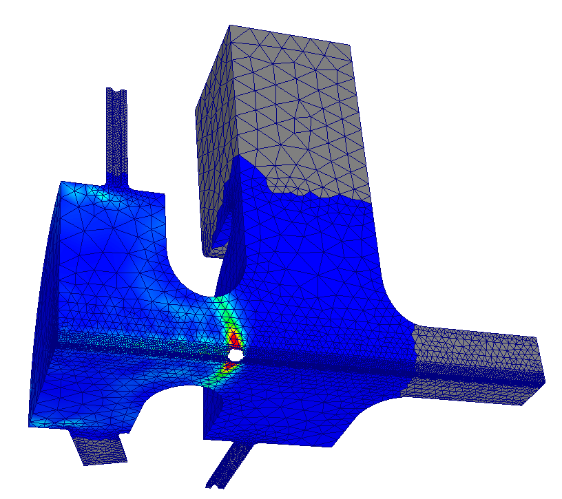
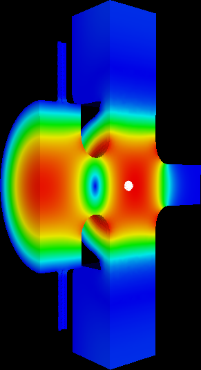
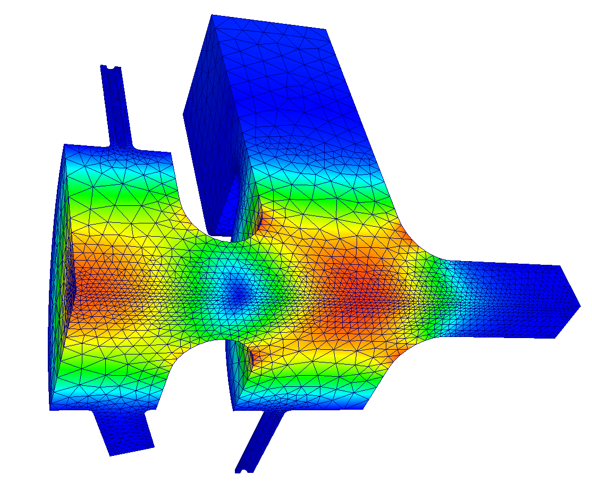

# Pic3P tutorial: LCLS RF gun

**Example directory:** `examples/pic3p/LCLSGun`

The 1.6-cell S-band photoinjector gun of LCLS. A 1 nC electron bunch is emitted from the cathode at the center of the half cell and accelerated through the full cell by the π mode at 120 MV/m peak field. The run follows the bunch for 420 ps, about 11.6 cm of travel, and records its emittance growth under space charge.

## Two meshes

As with TEM3P, two meshes of the same geometry serve two solvers. Omega3P needs a mesh resolving the cavity for the drive field; Pic3P needs one finer along the beam axis and at the cathode where the low-energy bunch is most sensitive. Both journals start from the same CAD file and the same sequence of concentric webcuts, so the surface IDs match.

```text title="mesh-Pic3P.jou (excerpt)"
import acis "LCLSGun.sat"

## three concentric cylinders along z for graded refinement
webcut volume 1 with cylinder radius 10 axis z center 0 0 0
webcut volume 2 with cylinder radius 6  axis z center 0 0 0
webcut volume 3 with cylinder radius 3  axis z center 0 0 0
merge tolerance 1.0e-5
imprint body all
merge body all

group 'ms'     add surface with is_merged
group 'ports'  add surface 16 3 31
group 'wgport' add surface 35
group 'bp'     add surface 40 49 62 64
group 'symx'   add surface 39 52 61 65
group 'symy'   add surface 41 50 59 67
group 'cath'   add surface 42 51 60 66
group 'copper' add surface all
copper subtract ms ports wgport bp symx symy cath from copper   # one line per group in the file

## merge small adjacent surfaces so sizing is uniform across them
composite create surf 17 25
composite create surf 20 to 23 2 4
composite create surf 26 27 29

#{h=2}                                  # h=2: 128k elements; h=1: 357k; h=0.5: 2.37M
curve 11 size {0.25*h}                  # beam axis
surface 42 51 size {h}                  # cathode, graded toward the center
surface 60 size {0.5*h}
surface 66 size {0.15*h}

volume 1 sizing function type skeleton scale 5 time_accuracy_level 3 min_size auto max_size {3*h}    max_gradient 5
volume 2 sizing function type skeleton scale 5 time_accuracy_level 3 min_size auto max_size {2*h}    max_gradient 2
volume 3 sizing function type skeleton scale 5 time_accuracy_level 3 min_size auto max_size {1.5*h}  max_gradient 2
volume 4 sizing function type skeleton scale 5 time_accuracy_level 3 min_size auto max_size {0.25*h} max_gradient 2
mesh volume 1 2 3 4

sideset 1 surface in symx symy
sideset 2 surface in ports
sideset 3 surface in bp
sideset 4 surface in cath
sideset 5 surface in wgport
sideset 6 surface in copper
block 1 vol all
block 1 element type tetra10
transform mesh output scale 0.001
export genesis "LCLSGun-Pic3P.gen" overwrite
```

The single parameter `h` scales the whole mesh; the comment records the element count at each value. The drive-field journal is identical except the axis and cathode sizes are coarser (`0.5*h`, `0.3*h`, `1*h`). Stored meshes: 64,116 elements for the drive field, 121,202 for the PIC run.

{ width="560" }
/// caption
The Pic3P mesh on the quarter model. Refinement is concentrated along the axis and at the cathode, where the bunch (visible as a point cloud) starts.
///

## Drive field from Omega3P

```text title="LCLSGun.omega3p"
ModelInfo : {
  File: LCLSGun-DriveField.ncdf
  BoundaryCondition : {
    Magnetic: 1 2        // symmetry planes and small ports
    Magnetic: 3          // beam pipe
    Exterior: 4 6        // cathode and cavity walls
    Magnetic: 5          // waveguide
  }
}
FiniteElement: { Order: 1  CurvedSurfaces: on }
EigenSolver : { FrequencyShift: 2.80e9  NumEigenvalues: 2 }
```

The two modes of a 1.6-cell gun are the 0 mode and the π mode. Omega3P finds them at 2.83750 GHz (Q~0~ 13,112) and 2.85281 GHz (Q~0~ 13,925). The π mode, in which the two cells are 180 degrees apart, is the accelerating mode and is mode 1 in Omega3P's zero-based count.

{ width="300" }
/// caption
E~z~ of the π mode on the symmetry plane. The field reverses between the half cell at the cathode and the full cell.
///

## PIC run

The full input is on the [module page](index.md#input-file). The points that make it a gun simulation:

- **`z0: -6.0325e-2`** puts the emission plane at the cathode, which is 60.325 mm upstream of the cell boundary at z = 0.
- **`Beta: 0 0 0.003`**, a 2 eV launch, is a stand-in for photoemission energy. Keep it small; the field does the accelerating.
- **1000 macroparticles for 1 nC** is coarse but fast. The emittance benchmark used far more. Increase `NumberOfParticles` for production and expect the run time to scale with it.
- **`CentroidPhaseBeforeCrest: -58`**: the bunch centroid is injected 58 degrees before the field crest at the cathode, so the head sees a rising field. The log reports the resulting RF phase at t = 0 as −66.75 degrees because the 10 ps bunch extends either side of the centroid.
- **`FieldValueAtPhase0: -120e6`** normalizes E~z~ at the cathode center to −120 MV/m at phase zero. The negative sign with negative charge gives acceleration in +z.
- **`DT: 5e-13`** and **`MaximumTime: 4.2e-10`**: 840 steps, during which the bunch travels from the cathode to past the gun exit.

```bash
srun -n 32 -c 8 t3p LCLSGun.pic3p
```

## Results

The log confirms the setup:

```text
PICLoading: Modeling symmetric quarter (1/4) -> reflections in X and Y
Just randomly created 1000 particles with n(r)*n(z) number density
Total particle charge: -1 nC
Loaded RF drive field, centroid injection phase: -58 degrees
Initial RF phase at time=0: -66.7503 degrees
Modeling PIC Causality Region with order p=1
 => 20 TimeSteps between PIC Mesh updates => margin of 0.000298305 m
```

`OUTPUT/Particles/particles.stat` tracks the bunch every 10 steps. Selected rows:

| Step | t (ps) | Particles | ⟨z⟩ (mm) | γ | E~kin~ (MeV) | ε~x~ (mm·mrad) | ε~y~ (mm·mrad) |
|---|---|---|---|---|---|---|---|
| 10 | 5 | 149 | −60.3 | 1.0007 | 0.0004 | 0.013 | 0.008 |
| 130 | 65 | 1000 | −48.6 | | | 3.6 | 3.0 |
| 250 | 125 | 1000 | −31.1 | | | 15.0 | 11.8 |
| 390 | 195 | 996 | −13.3 | 6.51 | 2.82 | 17.7 | 13.2 |
| 590 | 295 | 996 | +4.5 | 12.36 | 5.80 | 21.0 | 16.0 |
| 840 | 420 | 413 | +56.0 | 12.54 | 5.90 | 24.8 | 26.6 |

Reading the table:

- **Emission takes 65 ps.** The particle count rises from 149 to 1000 as the 10 ps flat-top (which is 10 ps in time, but emitted over a longer interval at β = 0.003) leaves the cathode.
- **Energy saturates at 5.9 MeV** by 300 ps, the gun's output energy at this gradient and phase.
- **Emittance grows from 0.01 to 25 mm·mrad.** Most of the growth happens in the first 125 ps while the bunch is still slow and space charge dominates. This is far above the benchmark curves on the module page because this run has only 1000 macroparticles and no solenoid; it demonstrates the mechanism, not the gun's performance.
- **Particles are lost after 300 ps.** The count drops to 413 as the head of the bunch leaves through the absorbing beam-pipe boundary, and the final-row statistics describe only what remains. Stop the run earlier, or extend the pipe, to keep the whole bunch.

{ width="620" }
/// caption
Field magnitude on the PIC mesh with the bunch in the full cell. The self-field of the bunch is visible as the localized disturbance on axis.
///

## Phase-space diagnostics

For one dump:

```bash
cd t3p_results/OUTPUT/Particles
acdtool postprocess pic3pconvert particles.000000000160ps.ncdf   # writes .txt
acdtool postprocess pic3pstats   particles.000000000160ps.ncdf 4  # 4 = quarter symmetry
```

The text file has one `x px y py z pz` line per particle for your own plotting. `pic3pstats` prints the moments and emittances of the unfolded full bunch. The observer-plane files record every particle's crossing time and phase space at z = −2 cm and z = +2 cm, which is how you build a longitudinal profile at a fixed location.

## Variations

- **Isolate space charge.** Set `TrackingOnly: yes` and rerun. The emittance growth that remains is RF-induced; the difference is space charge.
- **Realistic particle count.** Raise `NumberOfParticles` to 10^5^ or more and refine the mesh with `h=1`. The benchmark on the module page is the target behavior.
- **Add the solenoid.** Supply a Poisson field map through a `Solenoid` block in `Loading` to compensate the space-charge emittance growth, which is the gun's actual operating mode.
- **Scan the injection phase.** `CentroidPhaseBeforeCrest` controls energy and emittance together; a few runs bracket the optimum.
