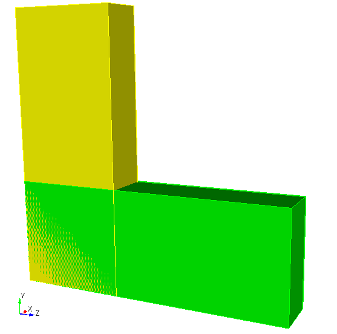
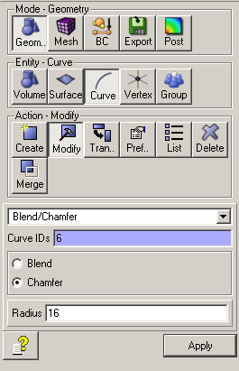
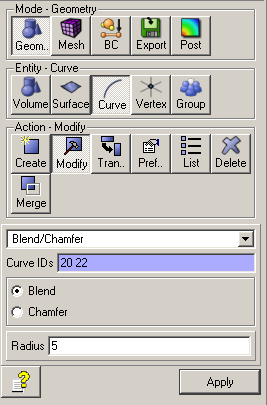
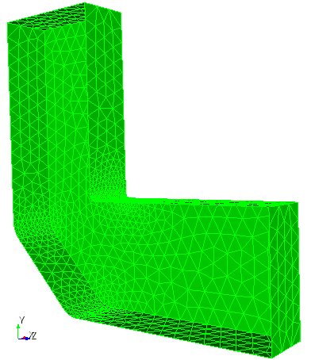
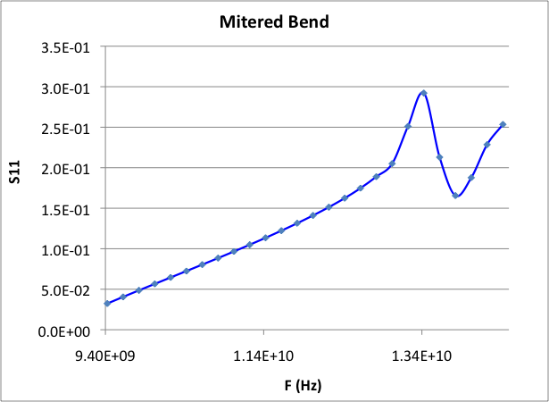
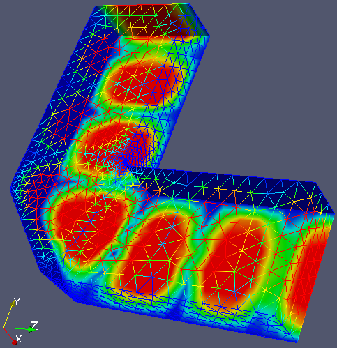
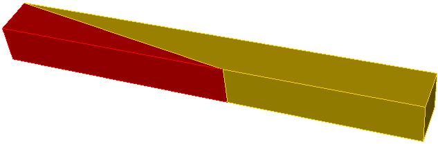
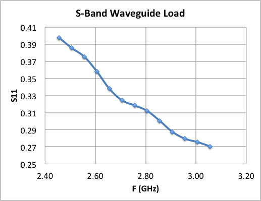
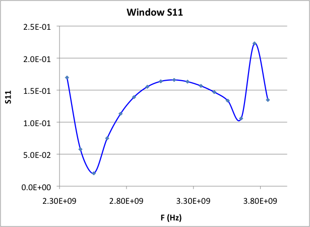
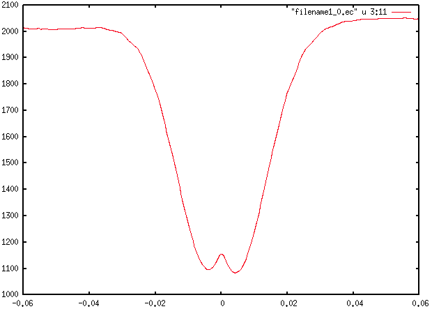

# S3P tutorials

Three worked examples from `examples/s3p`. Each follows the standard [workflow](../../workflow/index.md): Cubit journal, mesh export, `acdtool meshconvert`, solve, plot. The Cubit and acdtool mechanics are covered in the [Omega3P pillbox tutorial](../omega3p/tutorial-pillbox.md) and are not repeated here.

## Tutorial 1: X-band mitered bend

**Example directory:** `examples/s3p/90DegreeBend`

A 90 degree H-plane bend in WR90 waveguide with a chamfered outer corner. The chamfer is what makes the bend low-reflection; this tutorial computes how well it works across the band.

| Parameter | Value |
|---|---|
| Waveguide | WR90, 22.86 mm by 10.16 mm |
| Arm length | 60 mm each |
| Corner chamfer | 16 mm |
| Edge rounding | 1 mm on the inner corner, 5 mm on the chamfer edges |
| TE~10~ cutoff | 6.557 GHz |

### Build the model

The journal builds two bricks, unites them, chamfers the outer corner, and rounds the edges. Dimensions are parameterized at the top.

```text title="step1-Make-90DegreeBend.jou"
reset
#{wgwidth = 22.86}
#{wghight = 10.16}
#{wglength = 60.0}
#{cornercut = 16}
#{rcorner1 = 1}
#{rcorner2 = 5}

brick x {wghight} y {wgwidth} z {wglength}
move volume 1 location 0 0 {0.5*wglength-0.5*wgwidth}
brick x {wghight} y {wglength} z {wgwidth}
move volume 2 location 0 {0.5*wglength-0.5*wgwidth} 0
unite all
compress ids

modify curve 6  chamfer radius {cornercut}
modify curve 12  blend radius {rcorner1}
modify curve 20 22  blend radius {rcorner2}

export acis "90DegreeBend.sat" overwrite
```

{ width="200" }
{ width="190" }
{ width="190" }
/// caption
Model after uniting the bricks, after the chamfer, and after the edge rounding.
///

!!! tip "Curve IDs change"
    The curve numbers in `modify curve` depend on how Cubit numbered the geometry after `unite` and `compress ids`. If you change dimensions or build order, check the IDs interactively in Cubit before running the chamfer and blend commands.

### Mesh

Copy a meshing journal from an earlier example and adjust the sideset assignments. The two open ends become ports 7 and 8.

```text title="step2-Mesh-90DegreeBend.jou"
reset
import acis "90DegreeBend.sat"
volume all scheme Tetmesh
volume all sizing function type skeleton scale 5 time_accuracy_level 2 min_size auto max_size 3 max_gradient 1.2
mesh volume all

Sideset 7 surface 10          # port 1
Sideset 8 surface 12          # port 2
Sideset 6 surface all except 10 12

block 1 volume all
block 1 element type tetra10
volume all scale 0.001
export Genesis "90DegreeBend.gen" block all overwrite
```

{ width="330" }
/// caption
The skeleton sizing function refines the mesh around the rounded edges.
///

Convert with `acdtool meshconvert 90DegreeBend.gen` and confirm boundary IDs 6, 7, and 8 in the statistics.

### Input

```text title="90DegreeBend.s3p"
ModelInfo: {
  File: ./90DegreeBend.ncdf
  BoundaryCondition: {
    Exterior: 6
    Waveguide: 7, 8
  }
}

FiniteElement: {
  Order: 2
  CurvedSurfaces: on
}

FrequencyScan: {
  Start:    9.424e+9
  End:      12.424e+9
  Interval: 0.25e+9
}

PostProcess: {
  Toggle: on
  PortNumber: 7
}

Port: {
  ReferenceNumber: 7
  NumberOfModes: 2
}
Port: {
  ReferenceNumber: 8
  NumberOfModes: 2
}
```

No `SurfaceMaterial` block is given, so the walls are treated as lossless. Two modes are loaded per port. Only TE~10~ propagates below 13.1 GHz, so the second mode is evanescent across the scan and is included to absorb near-port field distortion.

### Run and plot

```bash
srun -n 16 s3p 90DegreeBend.s3p
```

Thirteen frequency points with 16 ranks take a few minutes. The result is `s3p_results/Reflection.out`. Column 2 is $|S_{11}|$ for TE~10~.

{ width="480" }
/// caption
Reflection versus frequency over an extended 9.4 to 14.4 GHz scan. The bend is well matched at the low end and degrades toward the TE~20~ cutoff at 13.1 GHz, where the resonance appears.
///

In ParaView, load `90DegreeBend.ncdf` with any `s3p.port7.mode0.*.mod` file through the SLAC toolbar to see the standing-wave pattern of the field at that frequency.

{ width="300" }

### Hands-on

Change `cornercut` and rerun. Plot several chamfer sizes on one graph to find the value that minimizes reflection at 11.424 GHz.

## Tutorial 2: waveguide load

**Example directory:** `examples/s3p/recWG-load1`

A matched load for WR284 waveguide: a wedge of lossy dielectric that tapers in over 200 mm. This is a one-port problem whose only output of interest is $|S_{11}|$, and it introduces multi-volume meshing with a lossy material.

{ width="520" }

| Parameter | Value |
|---|---|
| Waveguide | WR284, 72.136 mm by 34.036 mm |
| Load length | 200 mm, tapered |
| Vacuum section | 150 mm, port at the end |
| Load material | ε~r~ = 10, ε~r~'' = -1.52 |
| Symmetry | Half model, magnetic plane |

### Build and mesh

The journal makes the load brick, cuts it diagonally to form the wedge, and attaches the vacuum section. The two volumes are imprinted and merged so the wedge face is one shared surface.

```text title="step2-Mesh-recWG-load1.jou"
reset
import acis "recWG-load1.sat"
imprint body 1 2
merge body 1 2

volume all scheme tetmesh
surface all scheme triadvance
volume 1 size 8.0
volume 2 size 8.0
surface 1 size 8.0            # interface surface
surface 1 interval hard
mesh volume 1
mesh volume 2
smooth vol all
smooth surface all

sideset 1 surface 5 7         # symmetry plane
sideset 7 surface 6           # port
sideset 6 surface all except 5 7 6 1

block 1 vol 2                 # vacuum
block 2 vol 1                 # load
block all element type tetra10
transform mesh output scale 0.001
export genesis "recWG-load1.gen" overwrite
```

Note `surface 1 interval hard`, which fixes the mesh on the shared interface before either volume is meshed so both sides agree.

### Input

```text title="recWG-load1.s3p"
ModelInfo: {
  File: ./recWG-load1.ncdf
  BoundaryCondition: {
    Magnetic: 1
    Exterior: 6
    Waveguide: 7
  }
  Material : {
    Attribute: 1
    Epsilon:   1.0
    Mu:        1.0
  }
  Material : {
    Attribute: 2
    Epsilon:   10.0
    Mu:        1.0
    EpsilonImag: -1.52
  }
  SurfaceMaterial: {
    ReferenceNumber: 6
    Sigma: 5.8e7
  }
}

FiniteElement: {
  Order: 2
  CurvedSurfaces: on
}

FrequencyScan: {
  Start:    2.556e+9
  End:      3.156e+9
  Interval: 0.05e+9
}

PostProcess: {
  Toggle: on
  PortNumber: 7
}

Port: {
  ReferenceNumber: 7
  NumberOfModes: 2
}
```

The material blocks are the same as in the Omega3P [lossy load tutorial](../omega3p/tutorial-advanced.md). Block attribute 2 is the wedge, with a negative imaginary permittivity for loss.

### Result

{ width="480" }
/// caption
Reflection stays below about 0.05, or -26 dB, across the scan. A longer taper or a lower-permittivity material improves it further.
///

## Tutorial 3: RF window

**Example directory:** `examples/s3p/window`

A ceramic disk, 3 mm thick, sits inside a short pillbox cavity between two WR284 waveguides. This is the geometry of a vacuum window. The tutorial adds a quarter-symmetry model with three volumes, a dielectric without loss, and field extraction along the axis through acdtool.

| Parameter | Value |
|---|---|
| Waveguide | WR284, 72.136 mm by 34.163 mm, 60 mm each side |
| Pillbox radius | 45 mm |
| Pillbox half-length | 15 mm each side of the window |
| Window thickness | 3 mm |
| Window material | ε~r~ = 9.37, alumina |
| Symmetry | Quarter model, one magnetic and one electric plane |

### Build and mesh

The journal unites a brick and a cylinder, cuts the window slab out with two z-plane webcuts, then cuts to a quarter model. Three volumes result: vacuum on each side and the ceramic in the middle. Meshing uses Cubit groups to collect surfaces for the sidesets, which is more robust than listing surface IDs by hand when there are many of them:

```text title="step2-Mesh-window.jou (excerpt)"
merge tolerance 0.0001
imprint body all
merge body all

volume 1 3 sizing function type skeleton scale 5 time_accuracy_level 2 min_size auto max_size 6 max_gradient 1.2
volume 2   sizing function type skeleton scale 3 time_accuracy_level 2 min_size 1.5 max_size 3 max_gradient 1.2

group 'ms' add surface with Is_merged     # the two window faces
ms expand size 2
ms expand interval hard

mesh volume all
smooth vol all
smooth surface all

group "port7" add surface 16
group "port8" add surface 2
group "sym1"  add surface 5 11 17
group "sym2"  add surface 1 9 14
group "ss6" add surface all
ss6 subtract ms    from ss6
ss6 subtract sym1  from ss6
ss6 subtract sym2  from ss6
ss6 subtract port7 from ss6
ss6 subtract port8 from ss6

sideset 1 surface in sym1
sideset 2 surface in sym2
sideset 7 surface in port7
sideset 8 surface in port8
sideset 6 surface in ss6

block 1 vol 1 3               # vacuum
block 2 vol 2                 # ceramic
block all element type tetra10
transform mesh output scale 0.001
export genesis "window.gen" overwrite
```

The thin ceramic volume gets a finer sizing function so there are several elements through its thickness. The group `ms` holds the merged interface surfaces and is excluded from the exterior sideset, since an interior surface must not carry a boundary condition.

### Input

```text title="window.s3p"
ModelInfo: {
  File: ./window.ncdf
  BoundaryCondition: {
    Magnetic: 1
    Electric: 2
    Exterior: 6
    Waveguide: 7, 8
  }
  Material : {
    Attribute: 1
    Epsilon:   1.0
    Mu:        1.0
  }
  Material : {
    Attribute: 2
    Epsilon:   9.37
    Mu:        1.0
  }
  SurfaceMaterial: {
    ReferenceNumber: 6
    Sigma: 5.8e7
  }
}

FiniteElement: {
  Order: 2
  CurvedSurfaces: on
}

FrequencyScan: {
  Start:    2.356e9
  End:      3.856e9
  Interval: 0.1e+9
}
```

The quarter model uses one magnetic and one electric symmetry plane, which is the correct pair for the TE~10~ mode of the rectangular guide. Without `Port` blocks, S3P loads one mode per waveguide surface, which is right for a single-moded guide.

### Result

{ width="480" }
/// caption
The window is matched near 2.55 GHz. The second dip and sharp peak above 3.6 GHz come from a pillbox resonance.
///

### Field along the axis with acdtool

For a window, the field in the ceramic matters as much as the match. Extract it along the beam axis with `acdtool postprocess rf` using an `.rfpost` file that points at the S3P results. `FreqScanID` selects the frequency point, counting from zero, so index 2 is 2.556 GHz.

```text title="window.rfpost"
RFField
{
   ResultDir   = s3p_results
   FreqScanID  = 2              // third scan point: 2.556 GHz
   ModeID      = 0
   xsymmetry   = magnetic
   ysymmetry   = magnetic
   gradient    = -1
   cavityBeta  = 1.0
   reversePowerFlow = 0
   x0 = 0.0
   y0 = 0.0
   gz1 = -0.035
   gz2 =  0.035
   npoint = 300
   fmnx = 10
   fmny = 10
   fmnz = 50
}

ALLFieldOnLine
{
   ionoff   = 1
   modeID1  = -1
   modeID2  = -1
   npoint   = 300
   filename = field1
   rfphase  = 0.0
   x1 = 0.0
   x2 = 0.0
   y1 = 0.001
   y2 = 0.001
   z1 = 1e8                    // 1e8: full extent of the model
   z2 = 1e8
}
```

```bash
srun -n 1 acdtool postprocess rf window.rfpost
```

This writes `field1_0.ec` for the first port mode, a table of position and complex E-field components with amplitudes and phases:

```text
#  1     2     3      4      5      6      7      8      9     10     11     12    13       14       15       16
#  x     y     z      Ex_r   Ex_i   Ey_r   Ey_i   Ez_r   Ez_i   Ex_a   Ey_a   Ez_a  Ex_phase Ey_phase Ez_phase E_amp
```

Plot column 11, the E~y~ amplitude, against column 3:

```bash
gnuplot -e 'plot "field1_0.ec" using 3:11 with lines title "|Ey| on axis"'
```

{ width="480" }
/// caption
The field drops inside the ceramic, centered at z = 0, by roughly the ratio of the permittivities, and the small central bump is the standing wave across the 3 mm slab.
///

The same quantity is visible in ParaView by loading the mesh with the `.mod` file for the chosen frequency and using the SLAC toolbar line plot along the axis.
