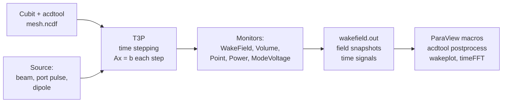
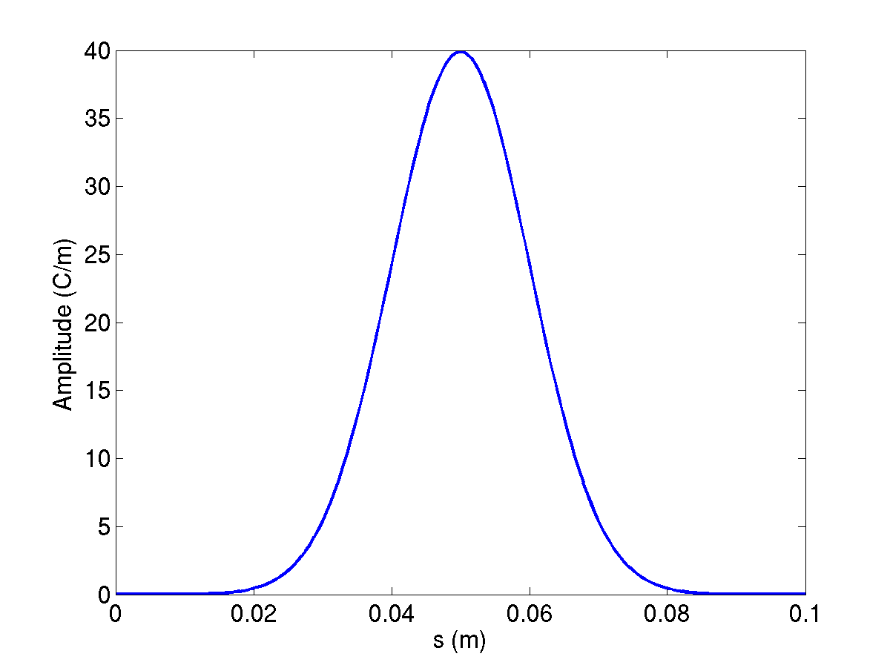

# T3P

T3P solves Maxwell's equations in the time domain on the same high-order finite-element mesh as the frequency-domain solvers. Its main uses are **wakefield** computation for beamline components, **transient** response of cavities and couplers to driven ports, and **pulse propagation** through long structures. The source executable is named `t3p`; in the ACE3P source tree the module lives under `tfe3p`.

## What it solves

Ampère's and Faraday's laws are combined into a second-order wave equation for the electric field, discretized in space with Nédélec elements and in time with an implicit Newmark-beta scheme. The implicit scheme is unconditionally stable, so the time step is chosen for accuracy rather than for stability, and each step requires one linear solve of the system matrix. The matrix does not change between steps, so a direct factorization done once is reused throughout the run.



Validation against Omega3P: a dipole-excited cavity gives the same resonant frequency in both codes to four digits, 11.024 GHz at order 1 and 11.037 GHz at order 2.

## Sources and boundaries

| Excitation | Block | Use |
|---|---|---|
| **Beam** | `LoadingInfo` with a `Bunch` | A rigid Gaussian bunch moving at c along a line. Several `LoadingInfo` blocks give multi-beam excitation, for dipole wakes. |
| **Port pulse** | `Loading` with `Type: PortModeLoading` and an `Excitation` | A modulated Gaussian pulse of a waveguide mode launched from a port surface, for transients and pulse propagation. |
| **Dipole** | `DipoleLoading` | A point dipole for mode identification by spectral analysis. Not covered by the tutorials. |
| **Eigenmode** | | A field from Omega3P or a user-defined field loaded onto a boundary. Not covered by the tutorials. |

Boundary conditions are the usual `Electric`, `Magnetic`, `Exterior` with `SurfaceMaterial`, `Absorbing`, and `Waveguide`, plus:

- **`Impedance`** with a `SurfaceMaterial` block, for a conductor with a frequency-dependent surface impedance. The optional `Coating` sub-block adds a thin lossy dielectric layer on top of the conductor without meshing it. See [Tutorial 5](tutorials.md#tutorial-5-surface-impedance-with-a-thin-lossy-coating).
- **PML** for free-space termination, through `PRegion`. Not covered by the tutorials.

Lossy dielectric volumes are frequency-independent and declared with `Material` blocks as in the other solvers.

## Beam excitation and wakefields

{ width="300" align=right }

A bunch of RMS length $\sigma$ has a spectrum that falls as $\exp(-\omega^2\sigma^2/2c^2)$; the frequency at which it has dropped by one e-folding is $f_1 = c/(2\pi\sigma)$, about 4.8 GHz for $\sigma$ = 1 cm. The time step must resolve the highest frequency you care about, and the mesh must resolve the corresponding wavelength. A rule of thumb from the examples is element size of about $\sigma/3$ near the beam path and `DT` of $\sigma/(10c)$ or finer.

The **longitudinal wakefield** is computed by indirect integration along the beam path: the field is integrated along the cavity gap on the axis, and a Laplace solve extends the result to the beam-pipe cross section. This works for structures where only vacuum is visible from the upstream pipe to the downstream pipe. The **transverse wakefield** follows from the Panofsky-Wenzel theorem, which relates the transverse kick to the transverse gradient of the longitudinal wake, evaluated with `acdtool postprocess transwake` at two transverse offsets.

T3P reports wakes per unit charge in V/pC and, in the header of `wakefield.out`, the **loss factor** for longitudinal wakes or the **kick factor** for transverse ones. The ParaView `wakeplot` macro Fourier-transforms the wake to give the impedance spectrum in ohms.

## Input file

Every block and key is described in the [T3P command syntax](../../reference/commands/t3p.md).

```text title="pillboxwg-closed.t3p"
ModelInfo: {
  File: ./pillboxwg.ncdf
  BoundaryCondition: {
    Exterior: 6 5
    Absorbing: 3 4            // beam pipe ends
    Magnetic: 1 2             // symmetry planes
  }
}

FiniteElement: {
  Order: 2
  CurvedSurfaces: on
}

LoadingInfo: {
  Bunch: {
    Type: Gaussian
    Sigma: 0.01               // m
    Number of sigmas: 5       // truncate the bunch at +-5 sigma
    Charge: 1.e-12            // C
  }
  SymmetryFactor: 4           // quarter model
  StartPoint: 0.0, 0.0, -0.075
  Direction: 0.0, 0.0, 1.0
  BoundaryID: 3               // bunch enters through this surface
}

TimeStepping: {
  MaximumTime: 5e-9
  DT: 2e-12
}

Monitor: {
  Type: Volume
  Name: mymon
  TimeStart: 0e-9
  TimeEnd:   5e-9
  TimeStep:  0.2e-9
}

Monitor: {
  Type: WakeField
  Name: wakefield
  StartContour: -0.075
  EndContour:    0.075
  Smax: 1.4                   // m, length of wake to record
}

LinearSolver: {
  Solver: MUMPS
}
```

### LoadingInfo and Bunch

| Key | Meaning |
|---|---|
| `Bunch.Type` | `Gaussian` |
| `Bunch.Sigma` | RMS bunch length in m |
| `Bunch.Number of sigmas` or `Nsigmas` | Where to truncate the Gaussian. Either spelling is accepted. |
| `Bunch.Charge` | Bunch charge in C. Negative charge is allowed and is used for dipole excitation. |
| `SymmetryFactor` | Fraction of the full structure modeled, as a divisor: 4 for a quarter model. T3P scales the effective charge in the domain by this factor and reports the wake for the full charge. |
| `StartPoint`, `Direction` | Beam line. The bunch starts centered at `StartPoint` minus `Nsigmas` times `Sigma` and travels at c along `Direction`. |
| `BoundaryID` | Surface through which the beam enters. Must be an `Absorbing` or `Waveguide` surface. |

Repeating `LoadingInfo` launches several bunches simultaneously. Two bunches of opposite charge at opposite transverse offsets excite a pure dipole wake.

### TimeStepping and CheckPoint

| Key | Meaning |
|---|---|
| `MaximumTime` | End of the run in s |
| `DT` | Time step in s |
| `CheckPoint.Action` | `none`, or `restart` to continue from a checkpoint |
| `CheckPoint.Ntimesteps` | Checkpoint interval in steps. Checkpoints go to `t3p_results/CHECKPOINT/`. |

### Monitors

Each `Monitor` block writes a file named after `Name` in `t3p_results/OUTPUT/`.

| `Type` | Keys | Output |
|---|---|---|
| `WakeField` | `StartContour`, `EndContour` (z range of the integration contour), `Smax` (wake length) | `wakefield.out`: s, W(s), bunch current. Header carries the loss or kick factor. |
| `Volume` | `TimeStart`, `TimeEnd`, `TimeStep` | One `<name>ts_t<time>ps.out.mod` field snapshot per sampled time, for ParaView animation |
| `Point` | `Coordinate` | `<name>.out`: time, E~x~ E~y~ E~z~, B~x~ B~y~ B~z~ at the point |
| `Line` | start, end, point count | Field along a line versus time |
| `Power` | `ReferenceNumber` | `<name>.out`: time, Poynting flux through the surface |
| `SurfacePowerLoss` | `ReferenceNumber` | Ohmic loss on an `Exterior` or `Impedance` surface versus time |
| `ModeVoltage` | `Port` sub-block with `ReferenceNumber` and an `ESolver` for the port modes | `<name>.out`: time, modal amplitude at the port |

For the coaxial-signal post-processor, the `Power` monitor on the port must be named `port` and the `ModeVoltage` monitor `modecoeff`. See [Tutorial 3](tutorials.md#tutorial-3-beam-position-monitor).

### LinearSolver

`MUMPS` is the sparse direct solver and is the right choice up to a few hundred thousand DOFs: the factorization is done once and each time step is a fast back-substitution. For larger problems where the factors do not fit in memory, use `CG`, an iterative solver whose cost per step is higher but whose memory is bounded. If the `Solver` key is absent or misspelled, the code picks the best direct solver compiled in, MUMPS on the SLAC and NERSC builds, so a missing block silently gives you MUMPS.

### PRegion: moving window

For a short bunch in a long structure, most of the mesh is empty of field at any one time. A **moving window** solves at full order only in a region that travels with the bunch and at order 0 elsewhere:

```text
FiniteElement: {
  Order: 0                    // outside the window
  CurvedSurfaces: on
}
PRegion: {
  Type: AutomaticMovingWindow
  Order: 2                    // inside the window
  Back:  0.005                // m behind the bunch
  Front: 0.05                 // m ahead of the bunch
  StructureEnd: 0.175         // z where the window stops moving
}
```

The wake is valid only for distances behind the bunch up to about `Back`; set it to the wake length you need. The same mechanism follows a port-launched pulse when `Object: Pulse`, `StartPoint`, `Direction`, and `ExcitationPort` are given. See [Tutorial 4](tutorials.md#tutorial-4-taper-with-a-moving-window).

## Running

```bash
srun -n 16 t3p pillboxwg-closed.t3p
```

Results go to `t3p_results/`. The DOF count is printed near the top of `t3p.log`; the quarter pillbox has 47,000 DOFs at order 2 and runs its 2,500 steps in a few minutes on 16 ranks. Rank count should grow with DOFs; the BPM example with 69,000 elements uses 128 ranks.

## Output

| Location | Content |
|---|---|
| `t3p.log`, `t3p.warn` | Log and warnings. The log names the time-stepping scheme and reports elements and DOFs. |
| `OUTPUT/wakefield.out` | Wake and bunch current versus s, with loss or kick factor in the header |
| `OUTPUT/<volume>ts_t<time>ps.out.mod` | Field snapshots. Load the series through the SLAC toolbar with the mesh and press Play. |
| `OUTPUT/<point>.out`, `<power>.out`, `<modecoeff>.out` | Time series from `Point`, `Power`, `ModeVoltage` monitors |
| `OUTPUT/Bunch<n>.out` | The bunch current profile used, time versus amperes |
| `OUTPUT/BBL<n>/` | Internal beam-loading data per bunch |
| `OUTPUT/signal.out` | Written by `acdtool postprocess coaxsignal`: time, voltage, beam current |
| `CHECKPOINT/` | Restart files |
| `monitorlist.fieldnode` | Bookkeeping for volume monitors |

## Post-processing

**Field animation.** In ParaView, click the SLAC toolbar reader, pick the mesh and the first `*.out.mod` snapshot; the reader detects the series. Press Play.

**Wake and impedance.** Edit the file path at the top of `wakeplot.py`, then click the `wakeplot` macro button. It plots W(s) with the bunch profile and the impedance spectrum from the Fourier transform. The spectrum is only meaningful up to the bunch's frequency content; the dashed line in the impedance plot is the bunch spectrum for reference.

**Transverse wake.** `acdtool postprocess transwake t3p_results x1 y1 x2 y2` rewrites `wakefield.out` as a transverse wake from the longitudinal wakes at two transverse points, with the kick factor in the header.

**Coaxial signal.** `acdtool postprocess coaxsignal t3p_results` converts `port.out` and `modecoeff.out` into the voltage on a 50 ohm coaxial line, written to `signal.out`. The `timeFFT` macro plots it and its spectrum normalized to the bunch spectrum, which is the BPM transfer impedance.

**Power.** `Power` monitors write plain two-column files; a six-line matplotlib script in the SIBC example plots input against output power.

!!! warning "acdtool.log is overwritten"
    Every acdtool invocation writes `acdtool.log` in the working directory. Running `meshconvert` and then `postprocess transwake` in the same directory overwrites the mesh statistics. Copy the log aside if you need it.

## Tutorials

1. **[Longitudinal wake of a pillbox](tutorials.md#tutorial-1-longitudinal-wakefield-of-a-cavity)**: quarter model, beam excitation, loss factor, impedance spectrum, and the effect of a waveguide boundary.
2. **[Transverse wake](tutorials.md#tutorial-2-transverse-wakefield-of-a-cavity)**: offset beam, Panofsky-Wenzel via acdtool, two-beam dipole excitation, and the equivalent half model with mixed symmetry.
3. **[Beam position monitor](tutorials.md#tutorial-3-beam-position-monitor)**: ceramic feedthrough, coaxial signal extraction, transfer impedance.
4. **[Taper with a moving window](tutorials.md#tutorial-4-taper-with-a-moving-window)**: short-range wake, order-0 background with a traveling order-2 window.
5. **[Surface impedance with a thin lossy coating](tutorials.md#tutorial-5-surface-impedance-with-a-thin-lossy-coating)**: port pulse through a coax with a coated inner conductor, power monitors.
