# T3P tutorials

Five worked examples from `examples/t3p`. Meshing and `acdtool meshconvert` are covered in the [Omega3P pillbox tutorial](../omega3p/tutorial-pillbox.md) and only the T3P-specific points are repeated here. All stored results were produced with the March 2023 ACE3P build.

## Tutorial 1: longitudinal wakefield of a cavity

**Example directory:** `examples/t3p/cavity-quarter`

An S-band pillbox with beam pipes and a waveguide slot, cut to a quarter model. A 1 pC Gaussian bunch of 1 cm length passes through; the longitudinal wake and loss factor are computed.

### Mesh

The journal builds the cavity at half scale, adds a waveguide stub through a slot, and cuts to a quarter. Sidesets: 1 and 2 symmetry planes, 3 and 4 beam pipe ends, 5 waveguide end, 6 wall. Element size is 6.25 mm, about $\sigma/1.6$, which is coarse; the taper and BPM examples use finer meshes. Note that this journal does not scale the mesh since the geometry is already in meters. The stored mesh has 7,552 elements.

### Input

```text title="pillboxwg-closed.t3p"
ModelInfo: {
  File: ./pillboxwg.ncdf
  BoundaryCondition: {
    Exterior: 6 5             // wall and closed waveguide end
    Absorbing: 3 4            // beam pipe ends
    Magnetic: 1 2             // symmetry planes
  }
}

FiniteElement: {
  Order: 2
  CurvedSurfaces: on
}

LoadingInfo: {
  Bunch: {
    Type: Gaussian
    Sigma: 0.01
    Number of sigmas: 5
    Charge: 1.e-12
  }
  SymmetryFactor: 4
  StartPoint: 0.0, 0.0, -0.075
  Direction: 0.0, 0.0, 1.0
  BoundaryID: 3
}

TimeStepping: {
  MaximumTime: 5e-9
  DT: 2e-12
}

Monitor: {
  Type: Volume
  Name: mymon
  TimeStart: 0e-9
  TimeEnd:   5e-9
  TimeStep:  0.2e-9
}

Monitor: {
  Type: WakeField
  Name: wakefield
  StartContour: -0.075
  EndContour:    0.075
  Smax: 1.4
}

LinearSolver: {
  Solver: MUMPS
}
```

Two magnetic symmetry planes with a beam on the axis select the monopole wake. The bunch enters through surface 3, which must be an absorbing boundary so that the beam's own field is not reflected. The wake contour spans the whole model from pipe end to pipe end. `Smax` of 1.4 m records the wake for about 4.7 ns behind the bunch, which matches `MaximumTime`.

### Run

```bash
srun -n 16 t3p pillboxwg-closed.t3p
```

The log reports 7,552 elements and 46,968 DOFs and confirms `factorizing the matrix using MUMPS`. The 2,500 time steps take a few minutes.

### Results

`t3p_results/OUTPUT/wakefield.out` begins:

```text
# T3P wakefield results at transverse point:
#(0.00000000000000e+00,0.00000000000000e+00)
# Loss factor = -3.88576373282202e-01 V/pC
#          s[m]        W_long(s)[V/pC]     I_bunch(s)[C/m]
0.00000000000000e+00 -4.64474318043810e-07 0.00000000000000e+00
5.99584916000000e-04 -7.75095377990907e-07 2.00284274868363e-16
```

The loss factor is 0.389 V/pC. Load the mesh and the `mymonts_*.out.mod` series in ParaView to see the field left behind after the bunch passes, then use the `wakeplot` macro.

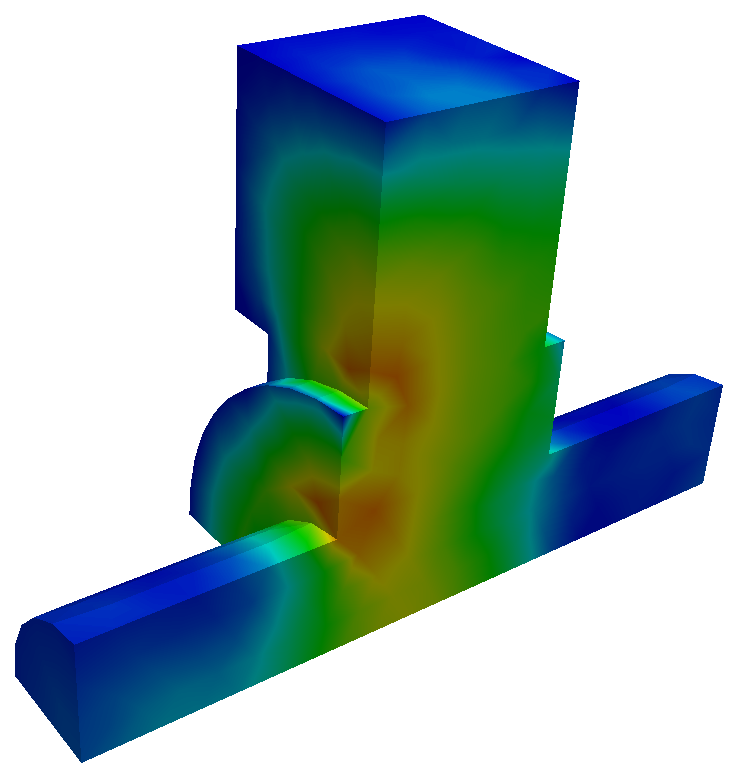{ width="300" }
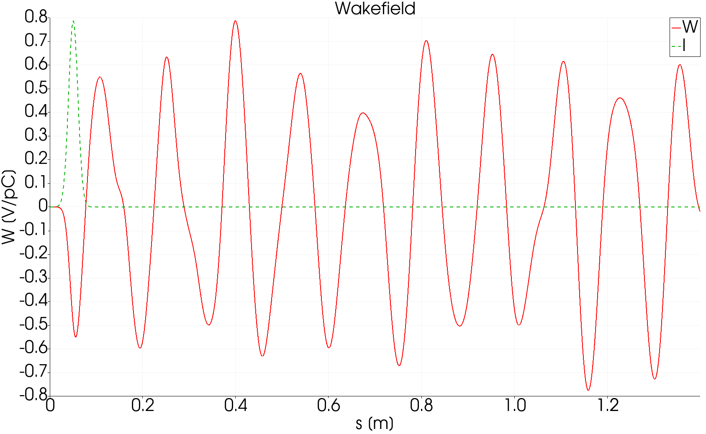{ width="520" }
/// caption
Field snapshot after the bunch has left, and the longitudinal wake over 1.4 m with the bunch profile in green. The wake rings at the cavity's monopole modes for the whole record because the closed cavity has no damping except the beam pipes.
///

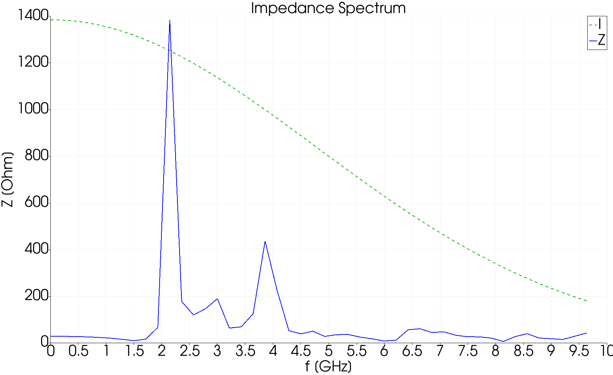{ width="520" }
/// caption
Impedance spectrum from the Fourier transform of the wake. The dominant peak at 2.15 GHz is the fundamental monopole mode of the half-scale pillbox; the second at 3.85 GHz is the next monopole. The dashed line is the bunch spectrum, which sets how far in frequency the impedance is trustworthy.
///

### Variant: waveguide boundary

In `cavity-quarter/open`, the waveguide end becomes a `Waveguide` boundary instead of `Exterior`, so power can leave through it:

```text
BoundaryCondition: {
  Magnetic: 1 2
  Absorbing: 3 4
  Waveguide: 5
  Exterior: 6
}
```

The stored result was run at order 1 and gives a loss factor of 0.386 V/pC, essentially the same, since the loss factor depends on the field the bunch sees during transit and not on what happens afterward. The wake behind the bunch, however, now decays as the waveguide drains the modes above its cutoff.

## Tutorial 2: transverse wakefield of a cavity

**Example directory:** `examples/t3p/cavity-half`

A transverse wake needs a beam off axis, which breaks one symmetry plane. Three ways to compute the same dipole wake are shown.

### Offset beam in a half model

`pillboxwg2.jou` builds a half model with sidesets 2 (symmetry), 3 and 4 (pipe ends), 5 (waveguide), 6 (wall). The stored mesh has 15,516 elements. The beam is offset to y = 6.25 mm:

```text title="pillboxwg2-closed.t3p (differences from Tutorial 1)"
CheckPoint: {
  Action: none
  Ntimesteps: 500
}
ModelInfo: {
  File: ./pillboxwg2.ncdf
  BoundaryCondition: {
    Exterior: 6 5
    Absorbing: 3 4
    Magnetic: 2
  }
}
LoadingInfo: {
  Bunch: { Type: Gaussian  Sigma: 0.01  Number of sigmas: 5  Charge: 1.e-12 }
  SymmetryFactor: 2
  StartPoint: 0.0, 6.25e-03, -0.075
  Direction: 0.0, 0.0, 1.0
  BoundaryID: 3
}
Monitor: {
  Type: WakeField
  Name: wakefield
  StartContour: -0.025
  EndContour:    0.025
  Smax: 1.4
}
```

The `CheckPoint` block with `Action: none` writes a checkpoint every 500 steps without restarting; change to `restart` to resume an interrupted run. The wake contour is shortened to the cavity gap.

The transverse wake comes from acdtool after the run:

```bash
srun -n 16 t3p pillboxwg2-closed.t3p
srun -n 1  acdtool postprocess transwake t3p_results 0. 0.00 0. 0.0125
```

The four numbers are two transverse points, here the axis and y = 12.5 mm, twice the beam offset. acdtool computes the longitudinal wake at both points, takes the difference, and applies the Panofsky-Wenzel theorem. It rewrites `wakefield.out`:

```text
# T3P transverse wakefield result using transverse points:
# (0.00000000000000e+00,0.00000000000000e+00) and
# (0.00000000000000e+00,1.25000000000000e-02)
# with offset 1.25000000000000e-02 m
# Kick factor = 9.64058337896157e-02 V/pC
#          s[m]        W_trans(s)[V/pC]     I_bunch(s)[C/m]
```

The log also notes that T3P used an effective charge of 0.5 pC in the half domain, which is `Charge` divided by `SymmetryFactor`.

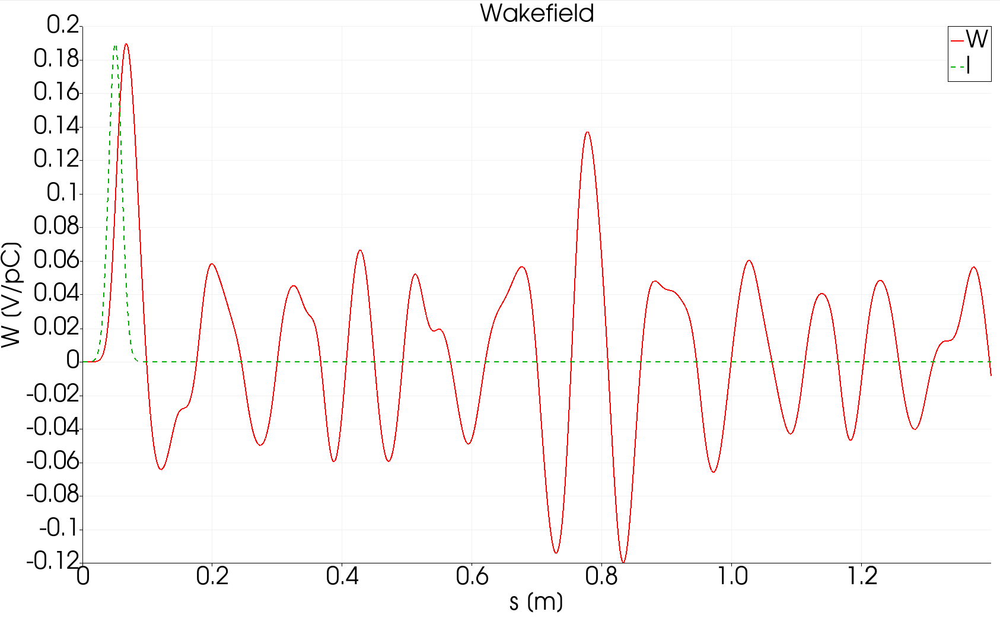{ width="440" }
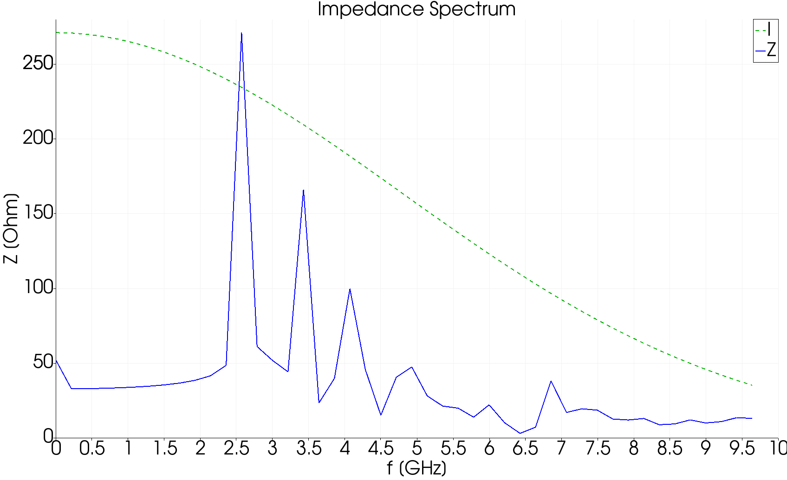{ width="440" }
/// caption
Transverse wake and impedance from the offset-beam run. The first dipole mode is at 2.6 GHz.
///

### Two beams of opposite charge

`multi-beam/pillboxwg2-closed1.t3p` adds a second `LoadingInfo` with `Charge: -1.e-12` at y = -6.25 mm. Two bunches at opposite offsets with opposite sign excite a pure dipole field with no monopole component. The kick factor from the same `transwake` post-processing is 0.175 V/pC, twice the single-beam value because there are two driving charges.

### Half model with mixed symmetry

`half-model/pillboxwg-closed.t3p` uses the quarter-model mesh from Tutorial 1 with one symmetry plane magnetic and the other electric:

```text
BoundaryCondition: {
  Exterior: 6 5
  Absorbing: 3 4
  Magnetic: 1
  Electric: 2
}
```

An electric symmetry plane is what a dipole field looks like at its antisymmetry plane, so a single offset beam in this quarter model represents the two-beam dipole excitation. The kick factor is 0.175 V/pC, matching the two-beam result at a quarter of the mesh. This is the efficient way to compute dipole wakes.

## Tutorial 3: beam position monitor

**Example directory:** `examples/t3p/BPM`

A button BPM: a 7 mm button in a housing on an elliptical vacuum chamber, with a ceramic window and a coaxial cable. T3P computes the wake the button adds to the beamline and the signal induced on the cable.

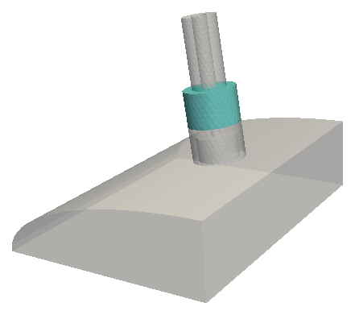{ width="300" }
/// caption
Quarter model. Block 1 is vacuum, block 2 the ceramic window.
///

### Mesh

Two journals: `ModelBPM.jou` builds the geometry parametrically, `MeshBPM.jou` meshes it. The mesh uses `imprint all` and `merge all` so the three volumes share faces, and Cubit groups collect the sidesets as in the [S3P window tutorial](../s3p/tutorials.md#tutorial-3-rf-window). The chamber is meshed at `max_size 1.5` mm, about $\sigma/3$ for the 5 mm bunch, and the button face at 0.5 mm. The stored mesh has 68,720 elements in two material blocks.

### Input

```text title="BPM.t3p"
ModelInfo: {
  File: BPM.ncdf
  BoundaryCondition: {
    Electric: 6
    Absorbing: 1 2 5          // pipe ends and coax end
    Magnetic: 3 4
  }
  Material : { Attribute: 1  Epsilon: 1.0  Mu: 1.0 }
  Material : { Attribute: 2  Epsilon: 4.9  Mu: 1.0 }    // ceramic
}

FiniteElement: {
  Order: 2
  Curved Surfaces: on
}

LoadingInfo: {
  Bunch: {
    Type: Gaussian
    Sigma: 0.005
    Nsigmas: 5
    Charge: 1.e-12
  }
  SymmetryFactor: 4
  StartPoint: 0.0 0.0 -0.025
  Direction: 0.0, 0.0, 1.0
  BoundaryID: 1
}

TimeStepping: {
  MaximumTime: 2.0e-9
  DT: 0.5e-12
}

Monitor: {
  Type: WakeField
  Name: wakefield
  Start contour: -0.0055
  End contour:    0.0055
  Smax: 0.35
}

Monitor: { Type: Point  Name: point      Coordinate: 0 0 0 }
Monitor: { Type: Point  Name: coaxpoint  Coordinate: 0.01457 0.03586 -0.0020955 }

Monitor: {
  Type: Volume
  Name: volume
  TimeStart: 0.000e-9
  TimeEnd:   0.4e-9
  TimeStep:  0.02e-9
}

// These two monitors feed acdtool postprocess coaxsignal.
// The names "port" and "modecoeff" are required.
Monitor: {
  Type: Power
  ReferenceNumber: 5
  Name: port
}

Monitor: {
  Type: ModeVoltage
  Name: modecoeff
  Port: {
    ReferenceNumber: 5
    ESolver: {
      Type: Numerical2D
      NumberOfModes: 1
      Frequency: 1.e9
      Tolerance: 1.e-15
      MaxIterations: 1000
    }
  }
}

LinearSolver: {
  Slover: CG
}
```

Several things to notice:

- The wall is `Electric`, not `Exterior`: wall loss is irrelevant over 2 ns, and the perfect conductor is cheaper.
- The 5 mm bunch has content to about 10 GHz, so `DT` is 0.5 ps, four times finer than the pillbox examples.
- `Curved Surfaces: on` with a space, `Nsigmas`, and `Start contour` with a space are all accepted alternate spellings.
- The coax end, surface 5, is `Absorbing` and carries both a `Power` and a `ModeVoltage` monitor. The `ESolver` sub-block tells T3P to compute the coax TEM mode numerically on that surface so the modal amplitude can be projected out at each step.
- The `LinearSolver` block has `Slover: CG`, misspelled. The parser ignores unknown keys, so `Solver` is absent and the default applies, which in a build with MUMPS is MUMPS. The stored results were therefore produced with the direct solver, not CG as the author intended.

### Run and post-process

```bash
srun -n 128 -c 2 t3p BPM.t3p
srun -n 1 acdtool postprocess coaxsignal t3p_results
```

The loss factor in `wakefield.out` is 3.71 mV/pC, two orders of magnitude below the pillbox cavity, as expected for a small discontinuity. `coaxsignal` combines the two port monitors into `OUTPUT/signal.out` with columns time, voltage on a 50 ohm line, and beam current.

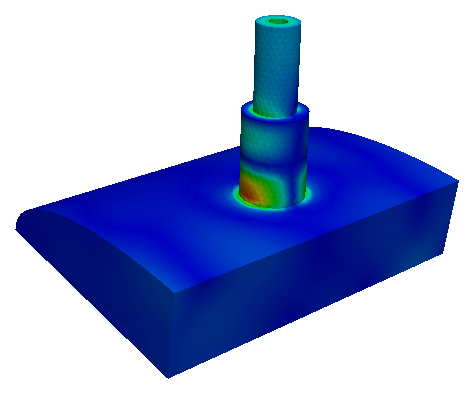{ width="300" }
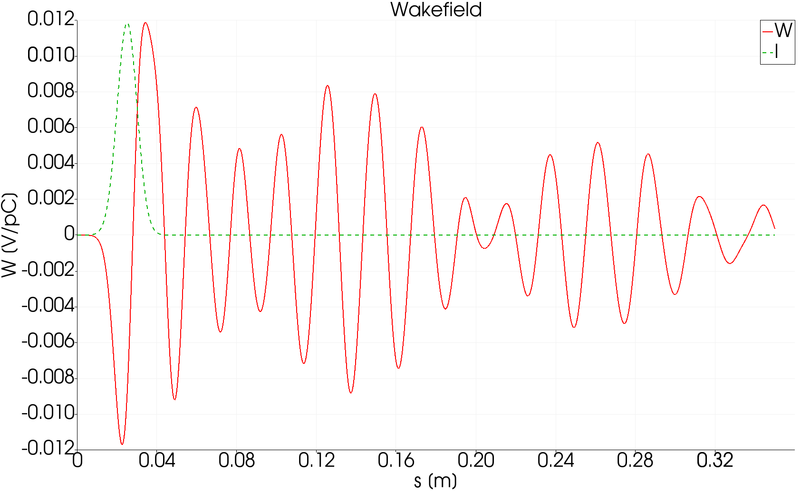{ width="520" }
/// caption
Field in the button housing after the bunch passes, and the longitudinal wake, which is a short pulse without the long ringing of a closed cavity.
///

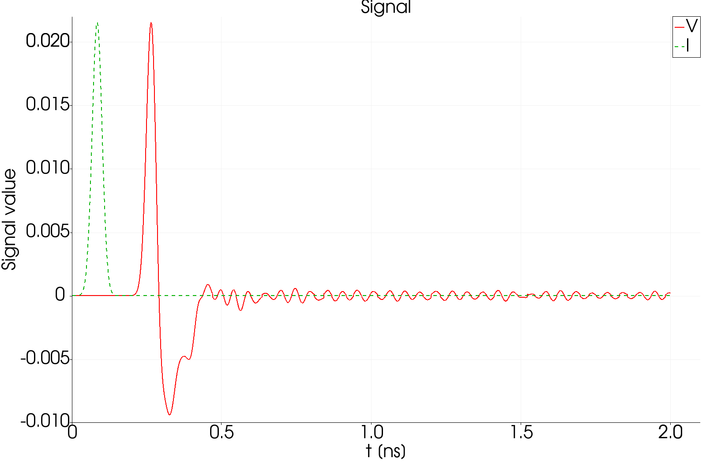{ width="440" }
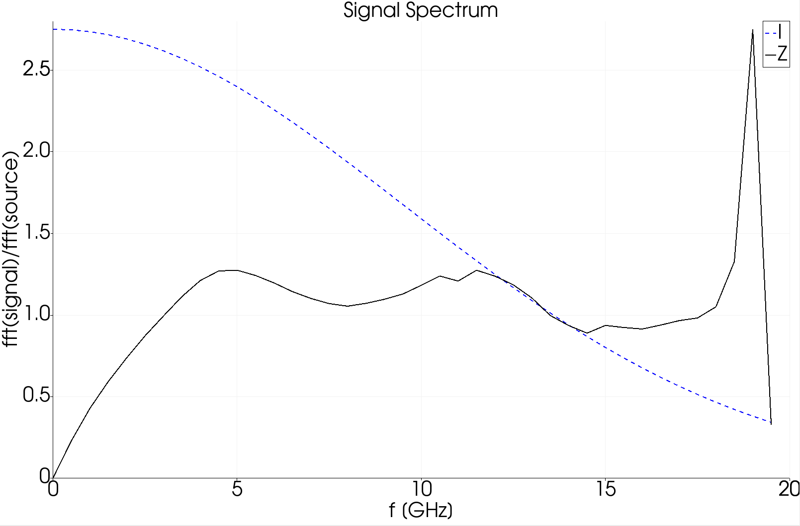{ width="440" }
/// caption
Voltage on the coaxial cable (red) against the beam current (green), plotted with the `timeFFT` macro, and the transfer impedance, which is the ratio of the two spectra. The bipolar pulse is the classic button BPM response.
///

## Tutorial 4: taper with a moving window

**Example directory:** `examples/t3p/taper`

A transition between two elliptical beam pipes, 350 mm long. This example introduces the moving window, which makes short-range wake computation in long structures affordable.

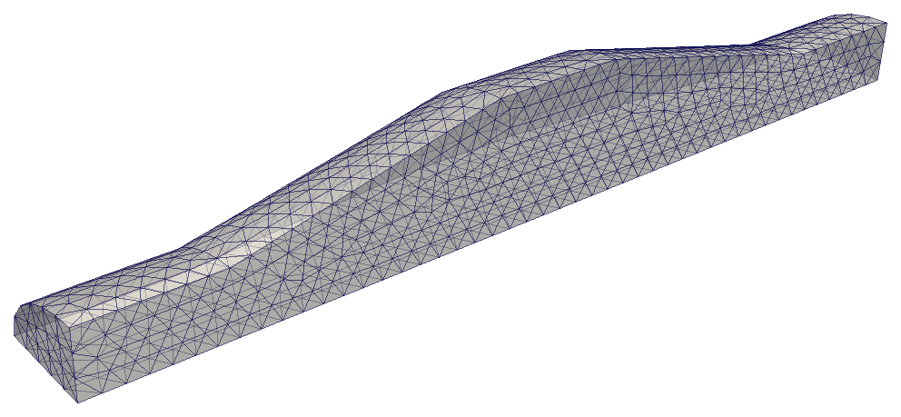{ width="560" }

### Mesh

`taper.jou` lofts between two ellipses and reflects to make a symmetric double taper, then cuts to a quarter. Uniform 7.5 mm elements; the stored mesh has 8,536. Sidesets: 1 and 2 pipe ends, 3 and 4 symmetry planes, 5 wall.

### Full-order reference run

`taper.t3p` is the Tutorial 1 input with the geometry swapped in and a shorter time: `MaximumTime: 1.6e-9`, wake contour from -0.175 to 0.175 m, `Smax: 0.45`. Loss factor 0.0762 V/pC.

### Moving-window run

`movingwindow/taper.t3p` differs in two blocks:

```text
FiniteElement: {
  Order: 0                    // background: lowest order
  CurvedSurfaces: on
}

PRegion: {
  Type: AutomaticMovingWindow
  Order: 2                    // inside the window
  Back:  0.005                // 5 mm behind the bunch
  Front: 0.05                 // 50 mm ahead
  StructureEnd: 0.175
}
```

Outside the window the field is represented at order 0, which is essentially free. Inside, a 55 mm long region at order 2 follows the bunch down the structure. The computational cost drops roughly in proportion to the window length over the structure length.

Loss factor: 0.0761 V/pC against 0.0762 V/pC for the full run, a 0.1% difference.

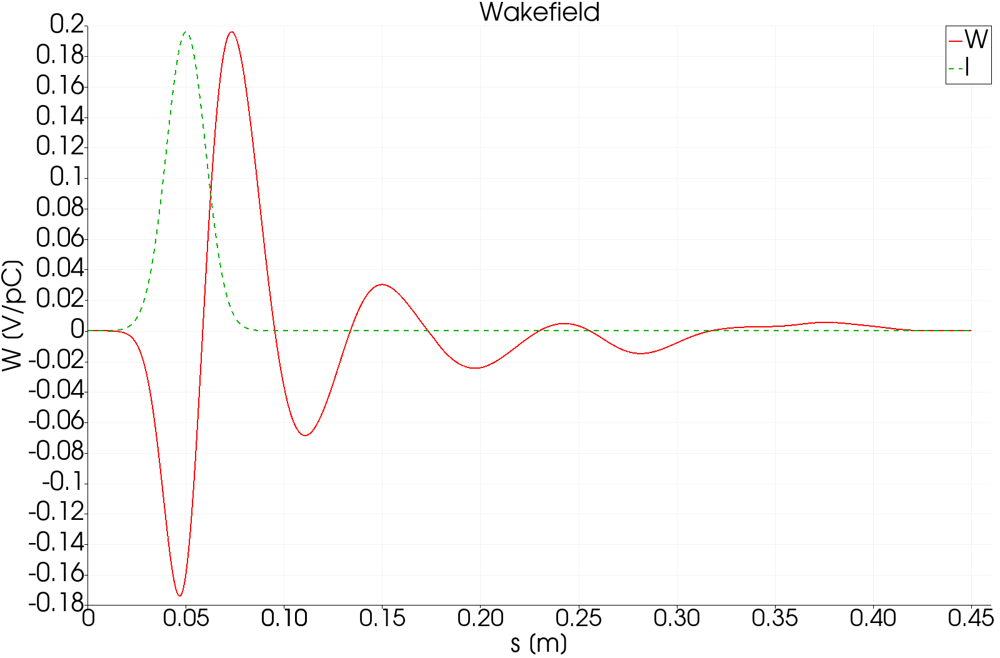{ width="440" }
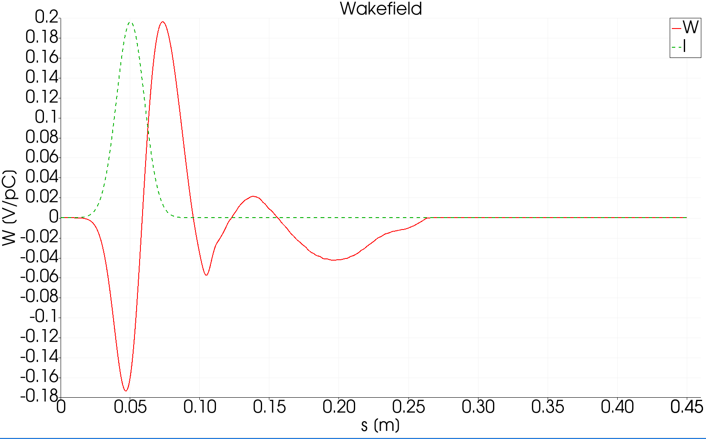{ width="440" }
/// caption
Longitudinal wake of the taper. Left: full order 2 everywhere. Right: moving window. The wakes agree through the bunch and the first oscillation, then the moving-window result dies away where the full run continues to ring.
///

The moving window is accurate only for distances behind the bunch up to about `Back`. Here `Back` is 5 mm, which is half a sigma, so only the wake within the bunch itself is trustworthy, and that is exactly what the loss factor depends on. For a long-range wake, enlarge `Back` and accept the higher cost. The agreement in the figure extends well beyond 5 mm because the taper's wake is dominated by the short-range geometric term, but that is a property of this structure, not a guarantee.

## Tutorial 5: surface impedance with a thin lossy coating

**Example directory:** `examples/t3p/SIBC`

A coaxial line whose inner conductor carries a 1 mm lossy dielectric coating over a 500 mm section. Meshing a 1 mm layer in a 100 mm structure would need tiny elements; the **surface impedance boundary condition** (SIBC) replaces the layer and the conductor beneath it with a frequency-dependent admittance on the surface. This example also demonstrates port excitation and the moving window applied to a pulse.

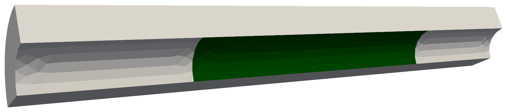{ width="620" }
/// caption
Quarter model of the coax. The green section of the inner conductor, sideset 3, carries the coating.
///

### Theory in brief

A thin layer of thickness $d$ with permittivity $\varepsilon_C$ and conductivity $\sigma_C$ on a conductor with conductivity $\sigma_M$ presents a surface admittance $Y(\omega) = Y_R + jY_I$ that depends on all those parameters. In the time domain T3P uses a narrow-band approximation around a reference frequency. The formulation follows Kobidze, IEEE Transactions on Antennas and Propagation 58 (2010).

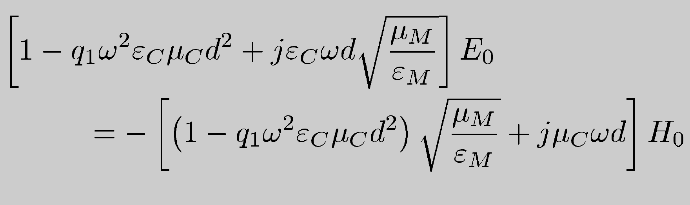{ width="480" }

### Mesh

`coating.jou` makes a quarter coax, radii 50 and 100 mm, length 1 m, split into three volumes at z = -0.25 and 0.25 so the coated section is a separate surface. Sidesets use coordinate filters: `sideset 4 surface with z_coord < -0.49` for the input port and so on. Element size 15 mm, about a tenth of a wavelength at 5 GHz.

### Input

```text title="SIBC.t3p"
CheckPoint: {
  Action: restart
  Ntimesteps: 500
}

ModelInfo: {
  File: test-sibc.ncdf
  BoundaryCondition: {
    Electric: 6
    Magnetic: 1 2
    Impedance: 3              // the coated wire section
    Absorbing: 4 5            // ports
  }
  SurfaceMaterial: {
    ReferenceNumber: 3
    Sigma: 5.8e7              // copper beneath
    Frequency: 5e9            // reference for the narrow-band model
    Coating: {
      Type: ThinLossyDielectric
      Epsilon:   56
      Sigma: 12               // S/m
      Thickness: 1.e-3        // m
    }
  }
}

FiniteElement: {
  Order: 0
  CurvedSurfaces: on
}

PRegion: {
  Type: AutomaticMovingWindow
  Object: Pulse
  StartPoint: 0.01 0.05 -0.5
  Direction: 0 0 1
  ExcitationPort: 4
  Order: 2
  Back:  0.1
  Front: 0.1
  StructureEnd: 0.5
}

Loading: {
  Type: PortModeLoading
  ScalingFactor: 1.0
  Port: {
    ReferenceNumber: 4
    SymmetricFactor: 4
    NumberOfModes: 1          // TEM
  }
  Excitation: {
    Power: 1.
    Pulse: {
      Type: Gaussian
      Frequency: 5e9          // carrier
      Bandwidth: 2e9
      DB: 30                  // truncate the envelope 30 dB down
      T0: 2.82                // delay in sigmas
      Phase: 0
    }
  }
}

TimeStepping: {
  MaximumTime: 1.0e-8
  DT: 10.e-12
}

Monitor: { Type: Volume  Name: field  TimeStart: 0  TimeEnd: 1.0e-8  TimeStep: 0.5e-9 }
Monitor: { Type: Power   ReferenceNumber: 4  Name: inputPower }
Monitor: { Type: Power   ReferenceNumber: 5  Name: outputPower }
Monitor: { Type: Power   ReferenceNumber: 3  Name: wallossPower }

LinearSolver: {
  Solver: CG
}
```

The excitation is a Gaussian-enveloped 5 GHz pulse of 2 GHz bandwidth launched as the TEM mode from port 4. The moving window follows it with `Object: Pulse`; `Back` and `Front` of 0.1 m bracket the roughly 0.3 m long pulse. `CheckPoint.Action: restart` here means the run will resume from a checkpoint if one exists.

!!! note "Key spellings differ between blocks"
    The port block inside `Loading` uses `SymmetricFactor`, while `LoadingInfo` for beams uses `SymmetryFactor`. Both are as the code reads them.

### Run and results

```bash
srun -n 16 t3p SIBC.t3p
```

The three `Power` monitors write time series of Poynting flux. Plot input against output:

```python
import numpy as np, matplotlib.pyplot as plt
A = np.loadtxt("t3p_results/OUTPUT/inputPower.out");  B = np.loadtxt("t3p_results/OUTPUT/outputPower.out")
plt.plot(A[:,0]*1e9, A[:,1], 'b', B[:,0]*1e9, B[:,1], 'r--'); plt.xlabel('Time [ns]'); plt.ylabel('Power'); plt.legend(['Input','Output']); plt.savefig('power.png')
```

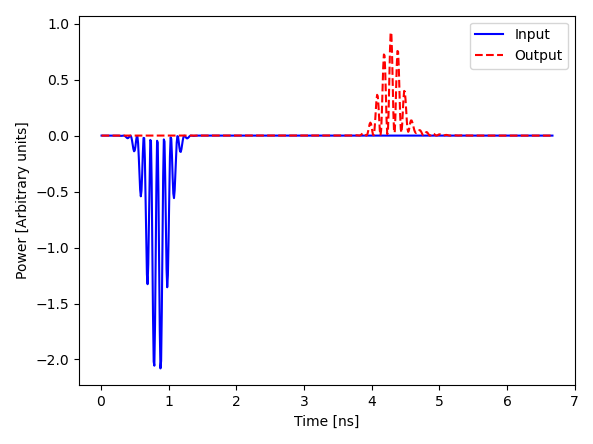{ width="440" }
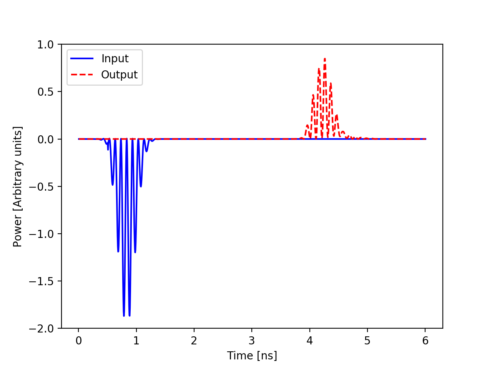{ width="440" }
/// caption
Left: the pulse enters at port 4 near 1 ns and emerges at port 5 near 4.3 ns, attenuated by the coated section. Input power is negative because the Poynting flux is referenced to the outward normal. Right: the same quantity from a direct simulation with the 1 mm dielectric layer meshed explicitly, which the SIBC result reproduces.
///

The transit time of 3.3 ns for 1 m is correct for a TEM mode in vacuum. Integrating the three monitors over the run, the output port receives 46% of the input energy and the coated wall absorbs 50%; the small remainder is numerical. `wallossPower.out` is the direct record of the coating loss.
