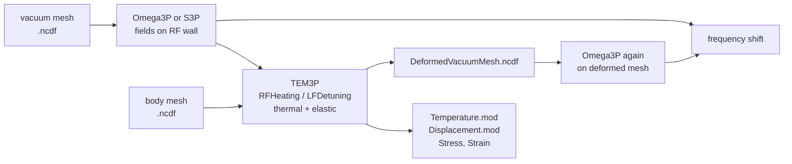
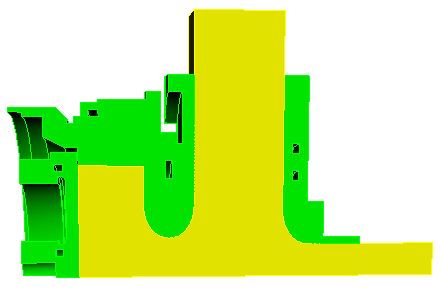

# TEM3P

TEM3P adds thermal and mechanical analysis to the ACE3P electromagnetic solvers. It takes RF wall loss or radiation pressure from Omega3P or S3P as a load, solves for temperature and displacement in the cavity metal, and writes a deformed vacuum mesh that Omega3P can re-solve to obtain the frequency shift. It also solves mechanical eigenmodes on their own.

## Capabilities

- Integrated electromagnetic, thermal, and mechanical analysis on separate vacuum and body meshes
- Thermal boundary conditions: fixed temperature, fixed heat flux, convection, RF heating from a field solution, volumetric dielectric heating
- Nonlinear thermal conductivity given as a function of temperature, for cryogenic materials
- Shell elements for thin coatings, so a 10 micron copper plating need not be meshed
- Elastic boundary conditions: fixed, free, per-direction mixed, and Lorentz-force loading from a field solution
- Thermal expansion coupled to the elastic solve through a reference temperature
- Mechanical eigenmodes and harmonic response
- Thermal transients

## Workflow

The multiphysics chain uses two meshes of the same geometry: the vacuum region for the field solver and the metal body for TEM3P. They share a surface, the RF wall, through which loads are transferred. The wall must carry a known sideset ID in each mesh so TEM3P can map one onto the other.



{ width="360" align=right }

For the thermal path, `RFHeating` reads the surface power loss from the field solution, scales it to a target gradient or input power, and applies it as a heat flux on the matching body surface. For the mechanical path, `LFDetuning` reads the surface fields and applies the radiation pressure $\tfrac{1}{4}(\mu_0 H^2 - \varepsilon_0 E^2)$ as a normal load, directed into the wall where the magnetic term dominates and outward where the electric term dominates. The elastic solve can also take the temperature field from a preceding thermal solve as a thermal strain. The deformed body surface is then mapped back onto the vacuum mesh and written out, and a second Omega3P run on that mesh gives the detuned frequency.

## Input file

A `.tem3p` file contains one or more **problem blocks**. The outermost block names the problem type; thermal and elastic problems can appear together under `ThermoElasticProblem`.

| Block | Solves |
|---|---|
| `ThermostaticProblem` | Steady-state heat conduction |
| `ElasticProblem` | Static linear elasticity, or mechanical eigenmodes when it contains an `EigenSolver` block |
| `ThermoElasticProblem` | Marker block that makes a following `ThermostaticProblem` and `ElasticProblem` run in sequence with the temperature passed to the elastic step. The `RunId` key seen in the example is not read by the code. |
| `ElectrostaticProblem`, `MagnetostaticProblem`, `DCGunProblem` | Static field problems shared with Gun3P. Not covered here. |

Each problem block has the same skeleton:

```text
ThermostaticProblem: {
  MeshFile: RfGunBody.ncdf
  BasisOrder: 2
  CurvedSurfaces: on

  LinearSolver: { ... }            // and optionally NonlinearSolver, PicardSolver

  ThermalConductivity: { ... }     // one per material block, or VolumeMaterial for elastic
  Shell: { ... }                   // optional, thermal only
  HeatSource: { ... }              // optional, volumetric dielectric heating

  Boundary: { Id: 1  ConditionType: ...  ... }
  Boundary: { ... }
}
```

Note the differences from the field solvers: the mesh is `MeshFile` not `ModelInfo.File`, the polynomial order is `BasisOrder` not `FiniteElement.Order`, and boundary conditions are one `Boundary` block per sideset rather than a list of IDs per type.

### Thermal boundary conditions

| `ConditionType` | Keys | Meaning |
|---|---|---|
| `Dirichlet` | `DirichletValue` | Fixed temperature. Units follow your material data; the examples use Celsius for copper and kelvin for cryogenic parts. |
| `Neumann` | `NeumannValue` | Fixed heat flux in W/m². Zero for an insulated or symmetry surface. |
| `Robin` | `RobinConstantFactor`, `RobinConstantValue` | Convection: flux = h (T − T~fluid~), given as h and the product h·T~fluid~. |
| `RFHeating` | `Directory`, `WhichMode`, `Method`, `TargetGradient` or `TargetPowerinput`, `Sigma` or `SurfaceResistance`, `DutyFactor`, `StartPoint`, `EndPoint` | Heat flux from the RF wall loss in a field solution. See below. |
| `ExtVHeating`, `RFHeatingMap`, `ConstantHeating` | | Other heat sources present in the code and not covered by the tutorials |

### Elastic boundary conditions

| `ConditionType` | Keys | Meaning |
|---|---|---|
| `Dirichlet` | `DirichletValue` | All three displacement components fixed to the value |
| `Neumann` | `NeumannValue` | Normal traction. Zero for a free surface. |
| `Mixed` | `MixedType`, `MixedValue` | Per direction: three entries of `DIRICHLET` or `NEUMANN` for x, y, z, with values. A symmetry plane normal to x is `DIRICHLET NEUMANN NEUMANN`. |
| `LFDetuning` | `Directory`, `Omega3PId`, `WhichMode`, `Method`, `TargetGradient`, `StartPoint`, `EndPoint` | Radiation pressure from the field solution as a normal load |

### Coupling to the field solution

`RFHeating` and `LFDetuning` share these keys:

| Key | Meaning |
|---|---|
| `Directory` | The `omega3p_results` or `s3p_results` directory |
| `WhichMode` | Mode index, default 0 |
| `Omega3PId` | Sideset number of the RF wall in the **vacuum** mesh, when it differs from the `Id` of this `Boundary` in the body mesh. `LFDetuning` only. |
| `Method` | How to scale the normalized field: `Gradient` (default), `Powerinput` (also spelled `PowerInput`), or `Powerloss` for heating; `Gradient`, `Voltage`, or `Powerinput` for detuning |
| `TargetGradient` | Accelerating gradient in V/m for `Method: Gradient`, with `StartPoint` and `EndPoint` defining the integration line, as in Track3P |
| `TargetPowerinput` | Input power in W for `Method: Powerinput`, used with S3P solutions |
| `Sigma` | Wall conductivity in S/m for computing the loss from H on the surface. Heating only. |
| `SurfaceResistance` | A function file giving R~s~(T), used instead of `Sigma` when the loss must follow the local temperature. Heating only. |
| `DutyFactor` | Multiplies the heat load for pulsed operation. Heating only. |

### Materials

```text
ThermalConductivity: { Id: 1  Value: 391 }                      // W/m/K, constant
ThermalConductivity: { Id: 3  Function: functions/ss304 }       // k(T) from a file

VolumeMaterial: {
  Id: 1
  ElasticMu: 4.3363e+10          // shear modulus, N/m^2
  ElasticLambda: 8.1244e+10      // Lamé's first parameter, N/m^2
  ElasticAlpha: 1.7e-5           // thermal expansion, 1/K
  Density: 8570                  // kg/m^3, needed for eigenmodes
}
```

`Id` is the Cubit block number. TEM3P uses the Lamé parameters rather than Young's modulus $E$ and Poisson ratio $\nu$; convert with $\mu = E/2(1+\nu)$ and $\lambda = E\nu/(1+\nu)(1-2\nu)$.

A **function file** is a table of piecewise expressions in the variable `T`, one per line: `Tstart Tend expression`. The `functions/` directory in the SRF coupler example has conductivity curves for niobium, NbTi, stainless steel, copper, and alumina, and surface-resistance curves for copper and NbTi.

### Shell elements

```text
Shell: {
  Bd: 6                 // sideset carrying the coating
  Material: 221         // a ThermalConductivity Id defined for the shell
  BasisOrder: 1
  Thickness: 1e-5       // m
}
```

A shell adds a conducting layer of the given thickness on a surface without meshing it. It is how a copper plating on stainless steel is modeled. The `Material` number must match a `ThermalConductivity` block; it is not a mesh block.

### Solvers

```text
LinearSolver: {
  Solver: CG                     // CG, GMRES, or a direct solver
  Preconditioner: DIAGONAL       // DIAGONAL or ILU
  Tolerance: 1.0e-10
  MaxIterations: 5000
}
NonlinearSolver: {               // when any material has a Function
  Solver: Newton
  PicardIteration: 100           // Picard steps before switching to Newton
  MaxIterations: 500
}
PicardSolver: { ... }            // linear solver used inside the Picard steps
```

The thermal and elastic systems are symmetric positive definite, so conjugate gradient with a diagonal preconditioner is the usual choice. Watch the iteration count in `tem3p.log`; if it hits `MaxIterations`, the result is not converged.

### MeshDump

```text
MeshDump: {
  WriteDeformedMesh: on          // body mesh with displacements applied
  WriteDeformedEMMesh: on        // vacuum mesh with the wall displacement mapped onto it
  EMMeshInputDir: omega3p_results
  WriteStressStrain: on
  MeshDeformScale: 0.2           // eigenmodes: scale factor for the mode shape
}
```

### EigenSolver

Inside `ElasticProblem`, an `EigenSolver` block switches from a static solve to a mechanical eigenmode solve. `NumEigenvalues` and `FrequencyShift` in Hz work as in Omega3P. `Density` is required in the material.

## Running

```bash
srun -n 16 tem3p RfGunBody.tem3p tem3p_results
```

The second argument names the results directory. The multiphysics chain is three commands in one batch script:

```bash
srun -n 16 omega3p RfGunVacuum.omega3p omega3p_results
srun -n 16 tem3p   RfGunBody.tem3p    tem3p_results
srun -n 16 omega3p DeformedRfGunVacuum.omega3p omega3p_results_deformed
```

where the third input file is identical to the first except that `ModelInfo.File` points at `tem3p_results/DeformedVacuumMesh.ncdf`.

## Output

| File | Content |
|---|---|
| `ResultFile` | Summary: max and min temperature, net power through each sideset in W, and displacement extrema per block. For eigenmodes, one line per mode with frequency in Hz. |
| `Temperature.mod` | Temperature on the body mesh, for ParaView with the body `.ncdf` |
| `Displacement.mod`, `Stress.mod`, `Strain.mod` | Elastic results on the body mesh |
| `DeformedMesh.ncdf` | The body mesh with displacements applied |
| `DeformedVacuumMesh.ncdf` | The vacuum mesh with the wall displacement mapped onto it, ready for Omega3P |
| `Displacement_Mode001_Freq62.82Hz.mod`, `DeformedMesh_Mode001_...ncdf` | Per-mode files from an eigenmode run |
| `tem3p.log`, `tem3p.out`, `tem3p.warn`, `tem3pStat.log` | Log, parsed input echo, warnings, timing |

The power balance in `ResultFile` is the first check on a thermal run: the RF heating surface should show the applied load as a negative number (power into the body) and the cooling surfaces should sum to the same magnitude with the opposite sign.

!!! warning "Frequency lines in tem3p.log for mechanical modes are wrong"
    In an eigenmode run the log prints `Eigenvalue:` and `Frequency:` pairs. The `Frequency` values there are computed with the electromagnetic conversion and are meaningless for mechanical modes, off by a factor of about 3×10⁸. The correct frequency is $\sqrt{\lambda}/2\pi$ and is what `ResultFile` and the output file names report.

## Post-processing

Displacements are typically micrometers on a meter-scale model and invisible when plotted directly. Use acdtool to exaggerate the deformed mesh:

```bash
acdtool mesh deform tem3p_results/DeformedMesh.ncdf Scaled5000Mesh.ncdf 5000
```

then load the scaled mesh alongside the undeformed one in ParaView. For eigenmodes, `MeshDeformScale` in `MeshDump` does the same at write time.

Temperature and displacement fields load through the SLAC toolbar with the body `.ncdf` and the `.mod` file; pick the array from the drop-down.

## Tutorials

1. **[RF gun coupler cell](tutorials.md#tutorial-1-rf-gun-coupler-cell)**: the complete Omega3P to TEM3P to Omega3P chain with RF heating, water cooling, thermal expansion, Lorentz force, and the resulting frequency shift.
2. **[SRF power coupler](tutorials.md#tutorial-2-srf-power-coupler-with-nonlinear-conductivity)**: thermal analysis from 2 K to 300 K with temperature-dependent conductivities, copper-plated shells, and dielectric heating of a window, driven by S3P fields.
3. **[Lorentz force detuning](tutorials.md#tutorial-3-lorentz-force-detuning-of-an-srf-cell)**: elastic-only analysis of a niobium cell under radiation pressure and the detuning it causes.
4. **[Mechanical eigenmodes](tutorials.md#tutorial-4-mechanical-eigenmodes-of-a-tesla-cavity)**: the five lowest vibration modes of a nine-cell cavity.
