# TEM3P tutorials

Four worked examples from `examples/tem3p`. All stored results were produced with the March 2023 ACE3P build. The Omega3P and S3P steps are shown only where they differ from the earlier module tutorials.

## Tutorial 1: RF gun coupler cell

**Example directory:** `examples/tem3p/RfGun-Coupler`

The coupler cell of a normal-conducting S-band RF gun, operated at 60 MV/m with a duty factor of 3.6×10⁻⁴. RF loss heats the copper, water channels cool it, the cell expands, and the frequency moves. This tutorial runs the whole chain.

{ width="300" }

### Two meshes from one CAD model

The CAD file `RfGun-CouplerCell.sat` contains two bodies, vacuum and copper. Two journals mesh them separately, each deleting the other body first. A quarter model is used.

=== "Vacuum mesh"

    ```text title="mesh-RfGunVacuum.jou (excerpt)"
    import acis "RfGun-CouplerCell.sat"
    del body 1                         # keep vacuum only
    compress ids
    volume all scheme Tetmesh
    vol 1 sizing function skeleton scale 3 min_size 0.5 max_size 3
    mesh vol 1
    block 1 vol 1
    block all element type tetra10

    group "beampipe" add surface 6
    group "disk"     add surface 1
    group "sym1"     add surface 3
    group "sym2"     add surface 2
    group "wgport"   add surface 7
    group "rest"     add surface all
    rest subtract beampipe from rest
    rest subtract disk from rest
    rest subtract sym1 from rest
    rest subtract sym2 from rest
    rest subtract wgport from rest

    sideset 1 surface in beampipe
    sideset 2 surface in disk
    sideset 3 surface in sym1
    sideset 4 surface in sym2
    sideset 5 surface in wgport
    sideset 6 surface in rest             # RF wall
    transform mesh output scale 0.001
    export genesis "RfGunVacuum.gen" overwrite
    ```

=== "Body mesh"

    ```text title="mesh-RfGunBody.jou (excerpt)"
    import acis "RfGun-CouplerCell.sat"
    del body 2                         # keep copper only
    compress ids
    volume all scheme Tetmesh
    vol 1 sizing function skeleton scale 3 min_size 0.5 max_size 3
    mesh vol 1
    block 1 vol 1
    block all element type tetra10

    group "beampipe" add surface 14
    group "sym1"     add surface with x_coord<0.001
    group "sym2"     add surface with y_coord<0.001
    group "outwall"  add surface 12 15 16 18 19
    group "cooling"  add surface 20 to 35
    group "rf"       add surface all
    rf subtract beampipe from rf
    rf subtract sym1 from rf
    rf subtract sym2 from rf
    rf subtract outwall from rf
    rf subtract cooling from rf

    sideset 1 surface in beampipe
    sideset 2 surface in sym1
    sideset 3 surface in sym2
    sideset 4 surface in outwall
    sideset 5 surface in cooling
    sideset 6 surface in rf               # RF wall, same ID as vacuum mesh
    transform mesh output scale 0.001
    export genesis "RfGunBody.gen" overwrite
    ```

The RF wall is sideset 6 in both meshes, which is what lets TEM3P map loads across. The stored vacuum mesh has 83,124 elements and the body mesh 229,035.

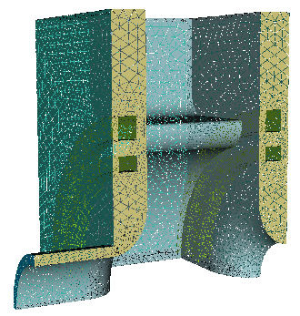{ width="300" }
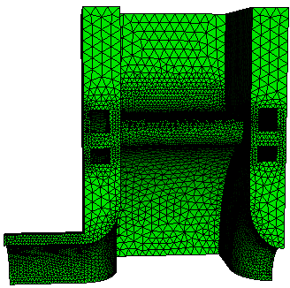{ width="300" }
/// caption
The copper body mesh and its sidesets: 1 beam pipe end, 2 and 3 symmetry planes, 4 outer wall, 5 cooling channels, 6 RF surface.
///

### Omega3P on the vacuum

```text title="RfGunVacuum.omega3p"
ModelInfo: {
  File: RfGunVacuum.ncdf
  BoundaryCondition: {
    Electric: 1
    Magnetic: 2 3 4
    Electric: 5
    Exterior: 6
  }
}
FiniteElement: { Order: 2  Curved Surfaces: on }
EigenSolver: { NumEigenvalues: 1  FrequencyShift: 2.8e9 }
```

The waveguide port, sideset 5, is closed with an electric wall for this eigenmode calculation. Result: 2.8533884 GHz, Q~0~ 15,080.

### TEM3P on the body

The input has three top-level blocks. `ThermoElasticProblem` is a marker that makes the following thermal and elastic problems run in sequence with the temperature carried over.

```text title="RfGunBody.tem3p"
ThermoElasticProblem: {
  RunId: 3
}

ThermostaticProblem: {
  MeshFile: RfGunBody.ncdf
  BasisOrder: 2
  CurvedSurfaces: on

  LinearSolver: {
    Solver: CG
    Preconditioner: DIAGONAL
    Tolerance: 1.0e-10
    MaxIterations: 5000
  }

  ThermalConductivity: { Id: 1  Value: 391 }           // copper, W/m/K

  Boundary: { Id: 1  ConditionType: Neumann  NeumannValue: 0.0 }   // beam pipe end
  Boundary: { Id: 2  ConditionType: Neumann  NeumannValue: 0.0 }   // symmetry
  Boundary: { Id: 3  ConditionType: Neumann  NeumannValue: 0.0 }   // symmetry
  Boundary: { Id: 4  ConditionType: Neumann  NeumannValue: 0.0 }   // outer wall, insulated

  Boundary: {
    Id: 5                                   // cooling channels
    ConditionType: Robin
    RobinConstantFactor: 20000.0            // h, W/m^2/K
    RobinConstantValue: 440000.0            // h * T_water, so T_water = 22 C
  }

  Boundary: {
    Id: 6                                   // RF wall
    ConditionType: RFHeating
    WhichMode: 0
    Sigma: 5.8e7
    Directory: omega3p_results
    Method: Gradient
    TargetGradient: 60e6
    DutyFactor: 0.00036
    StartPoint: 0.0001, 0.0001, -0.017018
    EndPoint:   0.0001, 0.0001,  0.017018
  }
}

ElasticProblem: {
  MeshFile: RfGunBody.ncdf
  BasisOrder: 2
  CurvedSurfaces: on
  ReferenceT: 25                            // strain-free temperature, C

  MeshDump: {
    WriteDeformedMesh: on
    WriteDeformedEMMesh: on
    EMMeshInputDir: omega3p_results
    WriteStressStrain: on
  }

  LinearSolver: {
    Solver: CG
    Preconditioner: DIAGONAL
    Tolerance: 1.00e-10
    MaxIterations: 50000
  }

  VolumeMaterial: {
    Id: 1                                   // copper
    ElasticMu: 4.3363e+10
    ElasticLambda: 8.1244e+10
    ElasticAlpha: 1.70000e-5
  }

  Boundary: { Id: 1  ConditionType: Mixed  MixedType: NEUMANN NEUMANN DIRICHLET  MixedValue: 0., 0., 0. }  // fix z
  Boundary: { Id: 2  ConditionType: Mixed  MixedType: DIRICHLET NEUMANN NEUMANN  MixedValue: 0., 0., 0. }  // fix x
  Boundary: { Id: 3  ConditionType: Mixed  MixedType: NEUMANN DIRICHLET NEUMANN  MixedValue: 0., 0., 0. }  // fix y
  Boundary: { Id: 4  ConditionType: Neumann  NeumannValue: 0. }     // outer wall free
  Boundary: { Id: 5  ConditionType: Neumann  NeumannValue: 0. }     // cooling channels free

  Boundary: {
    Id: 6                                   // RF wall
    ConditionType: LFDetuning
    WhichMode: 0
    Directory: omega3p_results
    Omega3PId: 6
    Method: Gradient
    TargetGradient: 60e6
    StartPoint: 0.0001, 0.0001, -0.017018
    EndPoint:   0.0001, 0.0001,  0.017018
  }
}
```

Points to notice:

- **The Robin condition encodes the water temperature indirectly.** With h = 20,000 W/m²/K and h·T = 440,000, the water is at 22 °C.
- **`DutyFactor: 0.00036`** scales the CW wall loss at 60 MV/m to the pulsed average.
- **Symmetry planes in the elastic problem** are `Mixed`: zero displacement normal to the plane, free in the plane. The beam-pipe end is fixed in z only, so the cell can expand radially.
- **`ReferenceT: 25`** is the temperature at which the copper is strain-free. Thermal strain is α (T − 25).
- **The RF wall carries both loads.** `RFHeating` in the thermal problem and `LFDetuning` in the elastic problem both point at the same Omega3P result on sideset 6.
- The file has `AbsoluteTolerante` in both solver blocks, a misspelling. See [Corrections](../../corrections.md).

### Run the chain

```bash
srun -n 16 omega3p RfGunVacuum.omega3p omega3p_results
srun -n 16 tem3p   RfGunBody.tem3p    tem3p_results
srun -n 16 omega3p DeformedRfGunVacuum.omega3p omega3p_results_deformed
```

TEM3P took 56 seconds on 16 ranks for 338,000 thermal DOFs. `DeformedRfGunVacuum.omega3p` is the first Omega3P input with the mesh file changed to `./tem3p_results/DeformedVacuumMesh.ncdf`.

### Results

`tem3p_results/ResultFile`:

```text
 Max T = 28.595
 Min T = 23.1171
 P (SideSet 1) = 2.40839e-07
 P (SideSet 2) = 0.00114157
 P (SideSet 3) = -0.0129865
 P (SideSet 4) = -0.0574297
 P (SideSet 5) = 213.111
 P (SideSet 6) = -215.613
#  u_x min [m]  u_x max [m]  u_y min [m]  u_y max [m]  u_z min [m]  u_z max [m]  u_mag max [m]  block_id
  -1.182e-06    4.556e-07    -7.828e-07   2.647e-07    0            3.311e-06    3.312e-06      1
```

The RF wall delivers 215.6 W into the quarter model and the cooling channels remove 213.1 W; the 1 percent imbalance leaks through the nominally insulated surfaces and is a measure of discretization error. The copper runs between 23.1 and 28.6 °C. The largest displacement is 3.3 μm, in z.

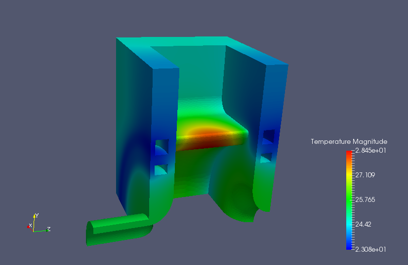{ width="440" }
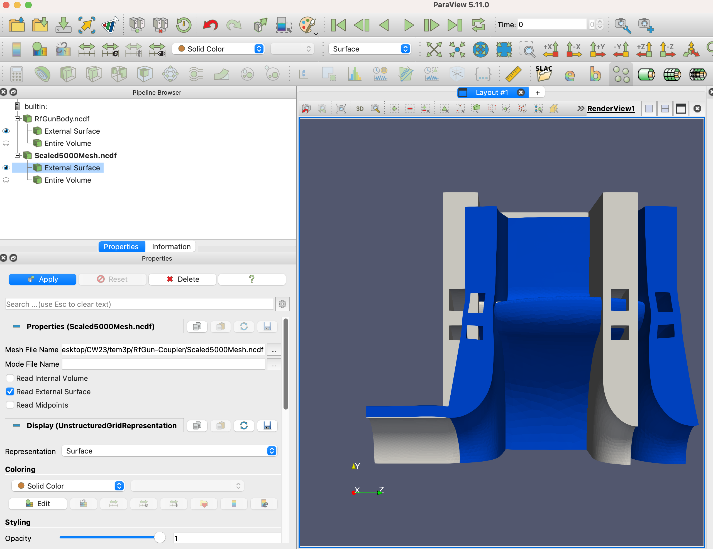{ width="400" }
/// caption
Temperature on the body, hottest on the iris nose where the surface current peaks, and the deformed mesh exaggerated 5000 times with acdtool overlaid on the original in grey.
///

The frequency shift comes from the two Omega3P results:

| | Frequency |
|---|---|
| Undeformed | 2,853,388,398.9 Hz |
| Deformed | 2,853,435,826.2 Hz |
| Shift | **+47.4 kHz** |

The shift is positive. Thermal expansion alone would lower the frequency by enlarging the cavity, so the sign reflects the balance of expansion against the inward Lorentz pressure on the nose and the constraints at the symmetry planes. Whether this matches the real gun is a question for the designer; the tutorial demonstrates the mechanism.

### Thermal transient

The same body mesh and boundary conditions can be run as a transient by adding time stepping to the thermal problem. The slides show the result for 80,000 s of heating from a cold start; the input file is not in the example directory.

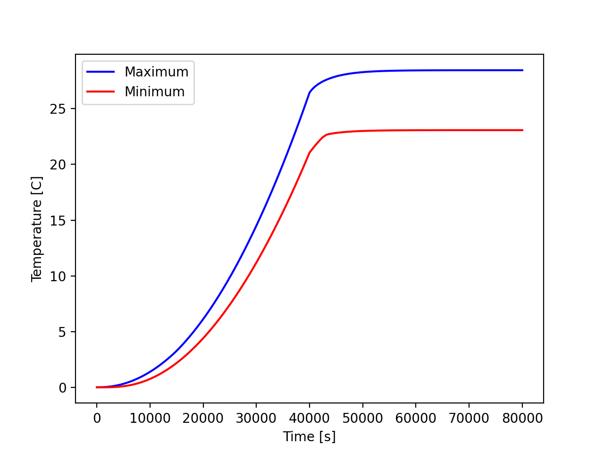{ width="440" }
/// caption
Maximum and minimum body temperature versus time. The steady state at about 12 hours matches the static solution.
///

## Tutorial 2: SRF power coupler with nonlinear conductivity

**Example directory:** `examples/tem3p/SrfCoupler`

The TTF3 fundamental power coupler for LCLS-II spans 2 K at the cavity flange to 300 K at the warm end. Copper plating on stainless steel conducts heat between the thermal intercepts. Material conductivities vary by orders of magnitude over this range, so the thermal problem is nonlinear.

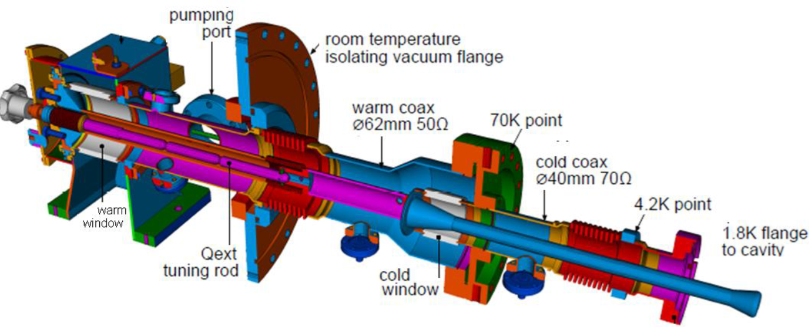{ width="620" }

### S3P on the vacuum

The meshes are provided as `.ncdf` files. S3P is run at the single operating frequency with lossy walls so that TEM3P can read the surface loss:

```text title="FPC-Vacuum.s3p"
ModelInfo: {
  File: 2D-TTF3-FPC-Vacuum.ncdf
  BoundaryCondition : {
    Impedance: 1               // exterior walls, lossy
    Magnetic: 2 3
    Waveguide: 4 5             // warm and cold coax ports
  }
  SurfaceMaterial : { ReferenceNumber: 1  Sigma: 5.7e7 }
  Material : { Attribute: 1  Epsilon: 9.0  EpsilonImag: -9.0e-4 }   // ceramic window
}
FiniteElement: { Order: 2  Curved Surfaces: on }
WaveguideFrequency: 1.3e+9
PostProcess : { Toggle: on  PortNumber: 4  ModeFile: mode }
```

`WaveguideFrequency` is an alternative to a `FrequencyScan` block for a single frequency. The walls are `Impedance` rather than `Exterior` so the loss is represented in the field solution itself.

### Body mesh and materials

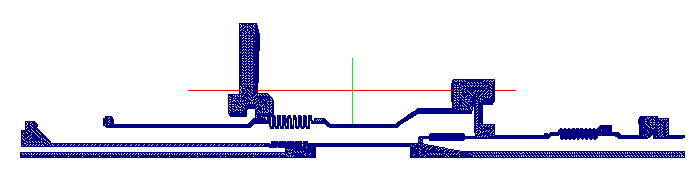{ width="620" }
/// caption
The coupler body. Block 1 niobium beam pipe, 2 NbTi flange, 3 stainless coax and flanges, 4 copper antenna, 5 alumina window. 315,091 elements.
///

Thermal intercepts are fixed temperatures: 2 K at the cavity flange (sideset 2), 4 K (3), 70 K (4), 300 K at the warm end (5). The copper plating is 10 μm on the outer conductor (sideset 6) and 100 μm on the inner (7). The copper antenna (8) and NbTi flange (9) are bare RF surfaces.

### TEM3P input

```text title="FPC-Body.tem3p (abridged)"
ThermostaticProblem: {
  MeshFile: 2D-TTF3-FPC-Body.ncdf
  BasisOrder: 1
  CurvedSurfaces: on

  NonlinearSolver: {
    Solver: Newton
    PicardIteration: 100
    MaxIterations: 500
  }
  PicardSolver: { Solver: CG  Preconditioner: DIAGONAL  Tolerance: 1.0e-10  MaxIterations: 100000 }
  LinearSolver: { Solver: GMRES  Preconditioner: ILU  Tolerance: 1.0e-10  MaxIterations: 100000 }

  // copper plating as shells
  Shell: { Bd: 6  Material: 221  BasisOrder: 1  Thickness: 1e-5 }
  Shell: { Bd: 7  Material: 221  BasisOrder: 1  Thickness: 1e-4 }
  ThermalConductivity: { Id: 221  Function: functions/CURRR100 }   // RRR 100 copper

  // bulk materials, all temperature dependent
  ThermalConductivity: { Id: 1  Function: functions/HighRRRNb }
  ThermalConductivity: { Id: 2  Function: functions/NbTi }
  ThermalConductivity: { Id: 3  Function: functions/ss304 }
  ThermalConductivity: { Id: 4  Function: functions/CURRR100 }
  ThermalConductivity: { Id: 5  Function: functions/al300 }

  // dielectric loss in the window volume
  HeatSource: {
    Id: 5
    ConditionType: RFHeating
    WhichMode: 0
    DielectricConstantE: 9
    LossTangentE: 0.0001
    Directory: s3p_results
    Method: Powerinput
    TargetPowerinput: 437.5             // 7 kW / 16 for the symmetric sector
  }

  // intercepts
  Boundary: { Id: 2  ConditionType: Dirichlet  DirichletValue: 2 }
  Boundary: { Id: 3  ConditionType: Dirichlet  DirichletValue: 4 }
  Boundary: { Id: 4  ConditionType: Dirichlet  DirichletValue: 70 }
  Boundary: { Id: 5  ConditionType: Dirichlet  DirichletValue: 300 }

  // RF heating on plated and bare surfaces
  Boundary: { Id: 6  ConditionType: RFHeating  WhichMode: 0  Directory: s3p_results
              Method: Powerinput  TargetPowerinput: 437.5  SurfaceResistance: functions/SRinnerCU }
  Boundary: { Id: 7  ... same as 6 ... }
  Boundary: { Id: 8  ... same as 6 ... }
  Boundary: { Id: 9  ConditionType: RFHeating  WhichMode: 0  Directory: s3p_results
              Method: Powerinput  TargetPowerinput: 437.5  SurfaceResistance: functions/SRinnerNbTi }

  Boundary: { Id: 1   ConditionType: Neumann  NeumannValue: 0.0 }   // rest
  Boundary: { Id: 10  ConditionType: Neumann  NeumannValue: 0.0 }   // symmetry
  Boundary: { Id: 11  ConditionType: Neumann  NeumannValue: 0.0 }   // symmetry
}
```

Four features appear here for the first time:

- **Nonlinear solve.** With any `Function` material, TEM3P iterates: `PicardIteration` fixed-point steps using the `PicardSolver`, then Newton steps using the `LinearSolver`. GMRES with ILU is chosen for the Newton system, which is not symmetric.
- **Shells.** Two `Shell` blocks add the copper plating to sidesets 6 and 7 as conducting layers of 10 and 100 μm, referencing a `ThermalConductivity` with the arbitrary Id 221.
- **Temperature-dependent surface resistance.** `SurfaceResistance: functions/SRinnerCU` replaces `Sigma`, so the RF loss on each surface follows the local temperature through the resistivity curve. This is the correct coupling for a part that spans 2 K to 300 K.
- **Volumetric dielectric heating.** `HeatSource` with `DielectricConstantE` and `LossTangentE` deposits the dielectric loss from the S3P field in the window volume.

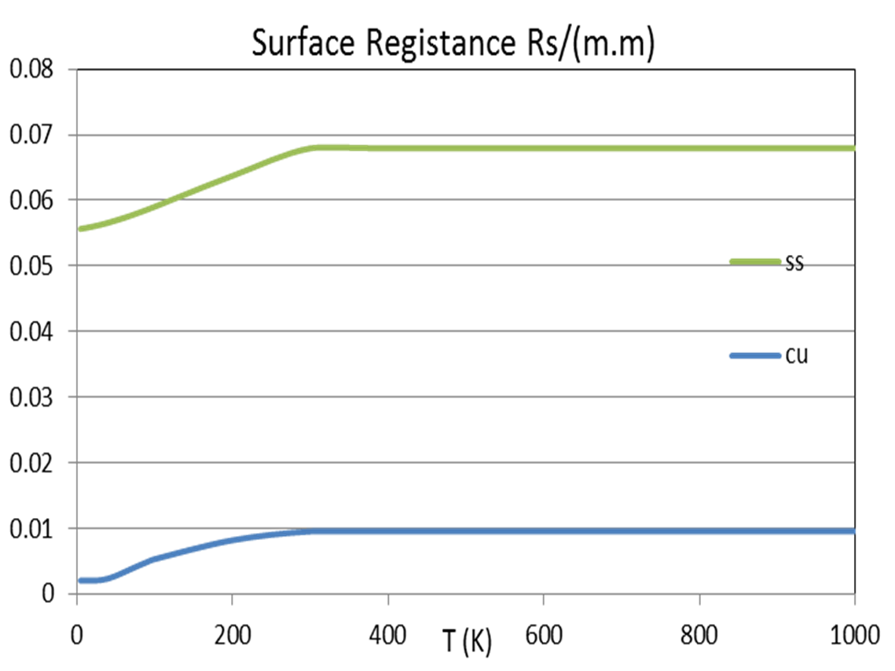{ width="440" }

The function files are piecewise expressions in `T`:

```text title="functions/ss304"
-10000 2.1   0.1124
2.1    300   10^((-1.4087)+(1.3982)*log10(T)+(0.2543)*(log10(T))^2+ ... )
300    10000 15.30865
```

### Run and results

```bash
srun -n 128 s3p   FPC-Vacuum.s3p s3p_results
srun -n 128 tem3p FPC-Body.tem3p tem3p_results
```

`ResultFile`:

```text
 Max T = 324.352
 Min T = 2
 P (SideSet 1) = 0.0872579
 P (SideSet 2) = 0.000564979
 P (SideSet 3) = 0.0395757
 P (SideSet 4) = 0.781339
 P (SideSet 5) = 0.100541
 P (SideSet 8) = -0.0325707
 P (SideSet 9) = -0.00288912
 P (SideSet 10) = -0.180994
 P (SideSet 11) = -0.200439
```

The heat loads at the intercepts are what the cryogenic designer needs: 0.6 mW at 2 K, 40 mW at 4 K, 0.78 W at 70 K, for one sixteenth of the coupler. The maximum temperature of 324 K is on the antenna tip, above ambient because of RF heating with no cooling path other than conduction.

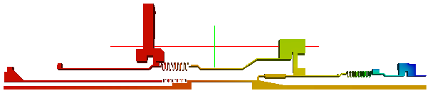{ width="620" }

!!! note "Shell power is reported as zero"
    `ResultFile` lists `P (SideSet 6) = 0` and `P (SideSet 7) = 0`. These are the shell surfaces, and the RF heat applied to them is accounted for through the shell elements rather than as a boundary flux, so it does not appear in the sideset power tally. The symmetry planes 10 and 11 show nonzero power, which indicates the shell heat is reported there instead. Treat the per-sideset numbers on shell runs with care.

## Tutorial 3: Lorentz force detuning of an SRF cell

**Example directory:** `examples/tem3p/SRFCell`

A 3 mm thick niobium cell from a TESLA cavity at 35 MV/m. Radiation pressure pushes the walls, the cell deforms, and the frequency shifts. This is an elastic-only TEM3P run; no thermal problem is involved.

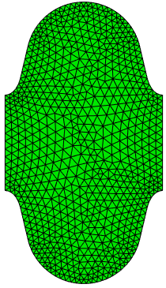{ width="220" }
/// caption
Half-cell models. Vacuum mesh sidesets: 1 symmetry plane, 2 and 3 disk centers, 6 wall. Shell mesh: 1 symmetry, 2 and 3 disks, 4 outer wall, 5 inner wall.
///

### Omega3P

```text title="SRFCell.omega3p"
ModelInfo: {
  File: SRFCellVacuum.ncdf
  BoundaryCondition: {
    Magnetic: 1          // symmetry plane for the TM0 mode
    Magnetic: 2 3        // disk centers for the pi mode
    Electric: 6          // Nb wall, lossless
  }
}
FiniteElement: { Order: 2  Curved Surfaces: on }
EigenSolver: { NumEigenvalues: 1  FrequencyShift: 1.2e9 }
```

Magnetic walls at the cell boundaries select the π mode of the periodic structure. The wall is a perfect conductor since superconducting loss is negligible for this purpose, so Omega3P reports Q~0~ as infinite. Frequency: 1.3009577 GHz.

### TEM3P

```text title="SRFCell.tem3p"
ElasticProblem: {
  MeshFile: SRFCellShell.ncdf
  BasisOrder: 2
  CurvedSurfaces: on

  MeshDump: {
    WriteDeformedEMMesh: on
    EMMeshInputDir: omega3p_results
  }

  LinearSolver: { Solver: CG  Preconditioner: DIAGONAL  Tolerance: 1.00e-10  MaxIterations: 150000 }

  VolumeMaterial: {                       // niobium
    Id: 1
    ElasticLambda: 13.5386473e+10
    ElasticMu:      4.2736232e+10
    ElasticAlpha:   6.50000e-6
  }

  Boundary: { Id: 1  ConditionType: Mixed  MixedType: NEUMANN DIRICHLET NEUMANN  MixedValue: 0., 0., 0. }  // symmetry
  Boundary: { Id: 2  ConditionType: Dirichlet  DirichletValue: 0. }    // one disk fully fixed
  Boundary: { Id: 3  ConditionType: Neumann  NeumannValue: 0. }        // other disk free
  Boundary: { Id: 4  ConditionType: Neumann  NeumannValue: 0. }        // outer wall free

  Boundary: {
    Id: 5                                 // inner wall
    ConditionType: LFDetuning
    Directory: omega3p_results
    Omega3PId: 6                          // the wall is sideset 6 in the vacuum mesh
    WhichMode: 0
    Method: Gradient
    TargetGradient: 35e6
    StartPoint: 0.0, 0.0, -0.0577
    EndPoint:   0.0, 0.0,  0.0577
  }
}
```

`Omega3PId: 6` is the essential link: the inner wall is sideset 5 in the shell mesh but sideset 6 in the vacuum mesh, and this key tells TEM3P which vacuum surface supplies the pressure. One disk is fully fixed and the other left free, which models a cell that can lengthen; a stiffer tuner would fix both.

### Results

```text title="ResultFile"
#  u_x min [m]   u_x max [m]   u_y min [m]   u_y max [m]   u_z min [m]   u_z max [m]   u_mag max [m]  block_id
  -1.813e-07     1.808e-07     -1.569e-07    1.808e-07     -1.942e-06    3.344e-08     1.947e-06      1
```

The wall moves by at most 1.9 μm, almost entirely in z, at the free disk. The Omega3P rerun on `DeformedVacuumMesh.ncdf` gives:

| | Frequency |
|---|---|
| Undeformed | 1,300,957,728.5 Hz |
| Deformed | 1,300,950,556.4 Hz |
| Shift | **−7.17 kHz** |

A static Lorentz force detuning coefficient is the shift divided by the gradient squared: −7.17 kHz / (35 MV/m)² = **−5.9 Hz/(MV/m)²**. Measured values for TESLA cavities with stiffening rings are around −1 Hz/(MV/m)² and for unstiffened cells several times larger, so this unstiffened single cell with one free end is in the expected range.

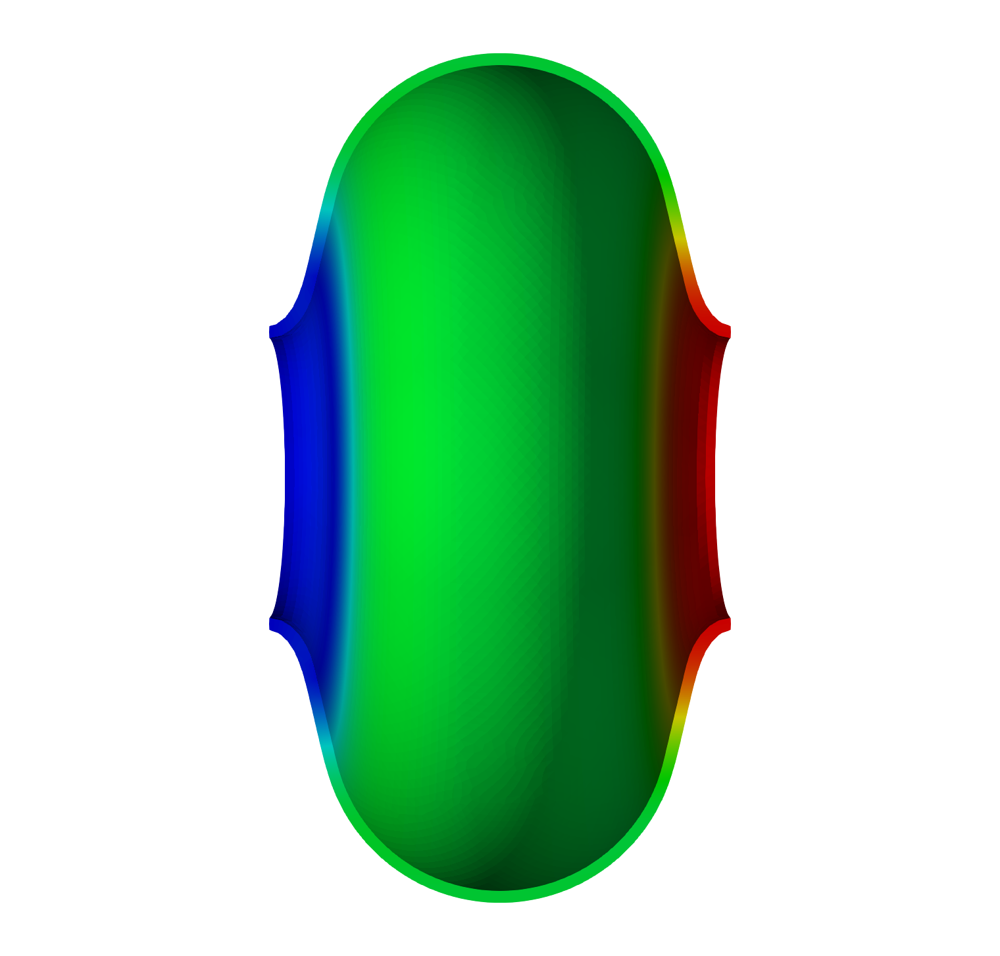{ width="300" }
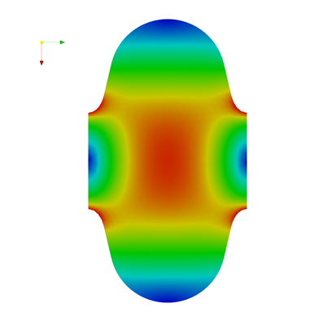{ width="300" }
/// caption
The π-mode electric field on the vacuum mesh, and the displacement on the shell mesh. The free disk at right moves outward; the iris at left is fixed.
///

## Tutorial 4: mechanical eigenmodes of a TESLA cavity

**Example directory:** `examples/tem3p/TeslaCavity`

Mechanical vibration modes of a nine-cell cavity can be driven by pumps or helium pressure fluctuations and modulate the RF frequency. This example computes the five lowest modes of a half cavity.

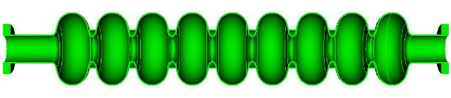{ width="620" }

### Mesh

The CAD model has fifteen bodies: cells, irises, and end plates. The journal deletes the end plates, unites everything into one niobium volume, and uses a half model with the symmetry plane selected by coordinate. 286,556 elements.

```text title="TeslaCavity.jou (excerpt)"
import acis "TeslaCavity.sat"
delete volume 14 15                         # end plates
unite volume 6 4 7 1 5 3 13 12 11 10 9 8 2
compress ids

group 'ss1' add surface 8                   # end plane
group 'ss2' add surface 100                 # end plane
group 'ss3' add surface with y_min > -0.1   # symmetry plane
group 'ss4' add surface all
ss4 subtract ss1 from ss4
ss4 subtract ss2 from ss4
ss4 subtract ss3 from ss4
Sideset 1 surface in ss1
Sideset 2 surface in ss2
Sideset 3 surface in ss3
Sideset 4 surface in ss4

block 1 volume 1
block 1 element type tetra10
volume 1 sizing function type skeleton scale 7 time_accuracy_level 2 min_size 2.5 max_size 15 max_gradient 2
mesh vol 1
transform mesh output scale 0.001
export genesis "TeslaCavity.gen" overwrite
```

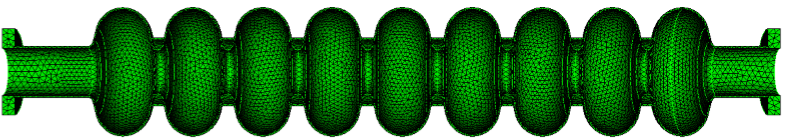{ width="620" }

### Input

```text title="TeslaCavity.tem3p"
ElasticProblem: {
  MeshFile: TeslaCavity.ncdf
  BasisOrder: 2
  CurvedSurfaces: on

  MeshDump: {
    WriteDeformedMesh: on
    MeshDeformScale: 0.2          // exaggerate mode shapes in the output meshes
  }

  EigenSolver : {
    NumEigenvalues: 5
    FrequencyShift: 5             // Hz
  }

  VolumeMaterial: {               // niobium
    Id: 1
    ElasticLambda: 20.9512e+10
    ElasticMu:      5.77227e+10
    ElasticAlpha:   6.50000e-6
    Density: 8570                 // kg/m^3, required for eigenmodes
  }

  Boundary: { Id: 1  ConditionType: Dirichlet  DirichletValue: 0. }    // end fixed
  Boundary: { Id: 2  ConditionType: Dirichlet  DirichletValue: 0. }    // end fixed
  Boundary: { Id: 3  ConditionType: Mixed  MixedType: NEUMANN DIRICHLET NEUMANN  MixedValue: 0., 0., 0. }  // symmetry
  Boundary: { Id: 4  ConditionType: Neumann  NeumannValue: 0. }        // free
}
```

The presence of `EigenSolver` turns the static problem into an eigenproblem. `Density` is mandatory since the mass matrix needs it. Both ends are clamped. The half model with a y-symmetry plane captures the longitudinal modes and the transverse modes polarized in x; the y-polarized transverse modes are excluded by the symmetry.

### Results

```bash
srun -n 16 tem3p TeslaCavity.tem3p tem3p_results
```

1.54 million DOFs at order 2. `ResultFile`:

```text
# Frequency [Hz]   u_x min [m]   u_x max [m]   u_y min [m]  u_y max [m]  u_z min [m]   u_z max [m]  u_mag max [m]  block_id
   62.822941       -0.44492086   0.00016858    -0.00254990  0.00265115   -0.12532522   0.12523272   0.44516552     1
  167.12759        -0.41393689   0.40925850    -0.00535491  0.00510317   -0.28438939   0.28260496   0.41476620     1
  242.46092        -0.01659370   0.01716134    -0.01693868  0.01611471   -1.2855e-05   0.41375152   0.41375219     1
  307.64515        -0.40210617   0.35293170    -0.00815388  0.00814531   -0.33878416   0.34097046   0.40679860     1
  468.56376        -0.40723536   0.41783503    -0.01263580  0.01200095   -0.45602865   0.44588751   0.46086550     1
```

Displacements of eigenvectors are normalized and have no physical magnitude; their pattern identifies the mode. Modes 1, 2, 4, and 5 have large u~x~ and are transverse bending modes: 1 is the fundamental with a single bow, 2 has one node, and so on. Mode 3 at 242 Hz has small u~x~ and large u~z~: it is the first longitudinal mode, which is the one that couples most strongly to the RF frequency through cell-length changes.

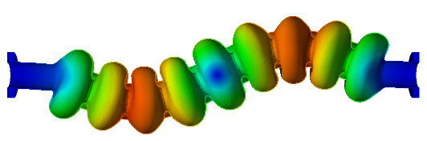{ width="520" }
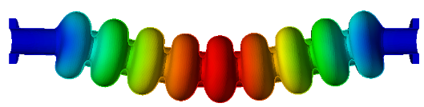{ width="520" }
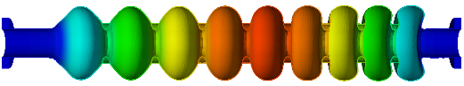{ width="520" }
/// caption
Displacement magnitude on the deformed meshes for the first three modes, exaggerated by `MeshDeformScale`. Modes 1 and 2 are transverse; mode 3 is longitudinal.
///

Each mode's shape is written as `DeformedMesh_Mode001_Freq62.82Hz.ncdf` with a matching `Displacement_*.mod`. Load the pair through the SLAC toolbar to see the shape directly.

!!! warning "Ignore the frequencies printed in tem3p.log"
    The log shows `Eigenvalue: 155810.34` followed by `Frequency: 18833843948`. The eigenvalue is correct and gives 62.82 Hz as $\sqrt{155810}/2\pi$, but the printed frequency used the electromagnetic conversion and is wrong by a factor of c. `ResultFile` has the right values.
