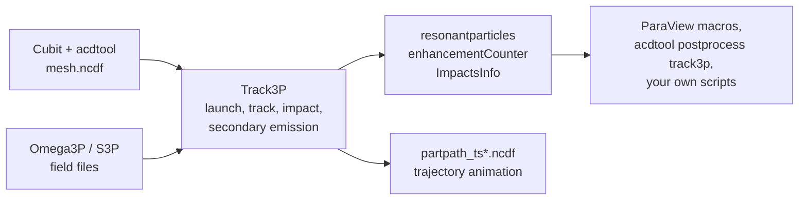
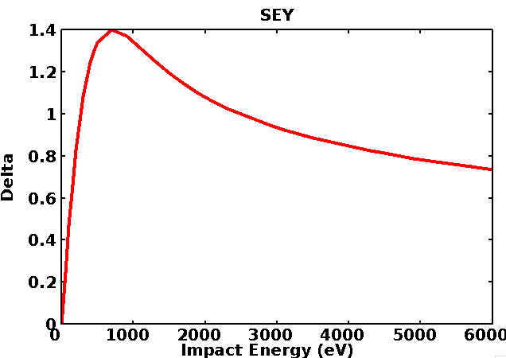
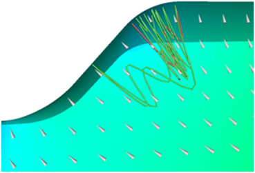

# Track3P

Track3P tracks charged particles through the electromagnetic fields computed by Omega3P, S3P, or T3P. Its two main uses are **multipacting** analysis, where secondary electrons resonate with the RF field and multiply, and **dark current** analysis, where field-emitted electrons are accelerated through the structure. Both produce impact statistics, trajectories, and derived quantities such as resonant particle maps and enhancement counters.

## How it works

Track3P loads a mesh and a field solution, launches primary particles from chosen surfaces, and integrates their motion under the Lorentz force. When a particle hits a wall, Track3P records the impact and, depending on the material assigned to that wall, either absorbs the particle or emits secondaries. Tracking continues for a specified number of RF cycles. A post-processing stage identifies particles whose trajectories repeat in phase with the RF, which is the signature of multipacting.



**Parallelization.** Every MPI rank loads the entire mesh and field. Particles are divided evenly across ranks and tracked independently, so there is no inter-rank communication and load balance is nearly perfect. The cost is memory: each rank holds the full problem. Within a rank, the particle loop is OpenMP-parallel, so a hybrid run with few ranks and many threads is often the best use of a node. A cryomodule dark-current study with 1.5 million elements and 2 million particles over 50 RF cycles ran in about 7 minutes on 240 cores.

## Multipacting background

Electrons released from a cavity wall are accelerated by the RF field and strike another point on the wall. If the impact energy falls in the range where the **secondary emission yield** (SEY) exceeds one, more than one electron leaves for each that arrives. If, in addition, the trajectory returns in phase with the RF so that the process repeats, the population grows exponentially. That avalanche is multipacting, and it limits achievable gradient in cavities, couplers, and windows.

{ width="360" align=right }

Multipacting is classified by **order**, the number of RF cycles a resonant electron takes to return to its launch site, and by **points**, the number of distinct impact sites in one period. Two-point multipacting between opposing walls at the equator of an elliptical cavity is the classic case.

Track3P separates the dynamics from the material. The tracking run finds trajectories that are resonant for the given geometry and field level, independent of surface condition. The **enhancement counter** then weighs each resonant trajectory by the SEY at each of its impact energies:

$$
\mathrm{EC} = \delta_1 \cdot \delta_2 \cdots \delta_m
$$

where $\delta_i$ is the SEY at the $i$-th impact. EC above one means the trajectory would grow for that surface; the larger EC, the harder the barrier. Because the SEY enters only at the post-processing stage, one tracking run can be evaluated against several surface treatments.

{ width="320" }
/// caption
A resonant trajectory bouncing between two points near an iris, from a Track3P benchmark against measured barriers on the ICHIRO cavity.
///

## Input file

The input `<project>.track3p` does **not** use the `ModelInfo` and `FiniteElement` blocks of the other solvers. The mesh and fields come from the solver results directory named in `Domain`. A complete multipacting scan:

```text title="Pillbox.track3p"
FieldScales: {
  Type: FieldGradient        // FieldGradient | InputPortPower | StorEnergy
  ScanToken: 1               // 1 scan a range, 0 single level
  Minimum: 23.0e+6           // V/m
  Maximum: 25.0e+6
  Interval: 1.0e+6
}

NormalizedField: {           // defines "gradient" for FieldGradient scaling
  StartPoint: 0.0 0.0 -0.057
  EndPoint:   0.0 0.0  0.057
}

Domain: {
  FieldDir: ./omega3p_results
}

Emitter: {
  BoundaryID: 6              // emit from this surface
  x0: 0.03  x1: 0.035        // only within this bounding box
  y0: 0.04  y1: 0.1
  z0: -0.045 z1: 0.0
}

Material: { Type: Primary    BoundarySurfaceID: 6 }
Material: { Type: Secondary  BoundarySurfaceID: 6 }
Material: { Type: Absorber   BoundarySurfaceID: 1 2 }

OutputImpacts: on

Postprocess: {
  Toggle: on
  ResonantParticles: { Token: on }
  EnhancementCounter: {
    Token: on
    MinimumEC: 0.01
    SEYFileName1: copper.dat
    BoundarySurfaceID1: 6
  }
}
```

!!! tip "Every default is written out for you"
    Track3P writes `InputParameters` into the results directory with every block, every keyword, and every default value it used, annotated with comments. That file is the most complete reference for the input format. Read it after your first run.

### Top-level keywords

| Keyword | Default | Meaning |
|---|---|---|
| `TotalTime` | 20 | Tracking duration in RF cycles |
| `OutputImpacts` | off | Write every impact to `ImpactsInfo_<level>`. Needed for resonant-particle analysis and for Faraday-cup post-processing. |
| `ParticlesTrajectories` | | Sub-block controlling trajectory output; only active when `ScanToken` is 0. Keys `ParticleFile` (prefix, default `partpath`), `Start`, `Stop`, `Skip` in time steps. |

### FieldScales

| Key | Meaning |
|---|---|
| `Type` | `FieldGradient` scales to an average accelerating gradient in V/m over the line in `NormalizedField`. `InputPortPower` scales to watts at the input port of an S3P solution. `StorEnergy` scales to joules of stored energy. |
| `ScanToken` | 1 to scan from `Minimum` to `Maximum` in steps of `Interval`; 0 to run a single level given by `Scale` |
| `Minimum`, `Maximum`, `Interval` | Scan range, in the units of `Type` |
| `Scale` | Single field level when `ScanToken` is 0 |

Every scan point is a complete tracking run, so a 30-level scan costs 30 times a single level.

### NormalizedField

Only used with `Type: FieldGradient`. `StartPoint` and `EndPoint` define the line along which the accelerating voltage is integrated, `N` the number of points (default 300), and `Beta` the particle velocity for the transit-time factor (default 1). Set the line to the cavity's active length so that "gradient" means what it does in RF test data.

### Domain

| Key | Default | Meaning |
|---|---|---|
| `FieldDir` | | Omega3P or S3P results directory |
| `ModeID1` | 0 | Which mode to load from `FieldDir` |
| `dt` | 1.0 | Time step factor; the step is `dt / frequency / 100` |
| `MaxImpacts` | 50 | Particles are dropped after this many impacts |
| `LowEnergy`, `HighEnergy` | 5 eV, 1e9 eV | Impacts outside this energy window kill the particle |
| `InitialEnergy` | 2 eV | Launch energy of primaries |
| `Bins` | 64 | Spatial binning used to locate particles in the mesh. Increase for large or elongated meshes; the Tesla example uses 640. |
| `ExternalMagneticField` | 0 0 0 | Uniform external B in tesla |
| `MagneticFieldMap` | | Sub-block loading a tabulated field: `File`, `Scaling`, `Units`, `ZOffset` |
| `SolidRegion`, `VacuumRegion` | | Block IDs for dielectric and vacuum, needed when particles emit from or cross a dielectric surface as in windows |
| `Voltage` | 0 | External DC voltage between two radii: `a ra rb`, giving V = a / log(rb / ra) |

### Emitter

One block per emission region. Primaries launch from faces of `BoundaryID` whose centroids fall inside the box `x0..x1`, `y0..y1`, `z0..z1`. Defaults for the box are effectively infinite, so an `Emitter` with only `BoundaryID` uses the whole surface.

| `Type` | Name | Use |
|---|---|---|
| 2 | `ElectronicSurface` | Default. Uniform launch from a metal surface over RF phase for multipacting. |
| 5 | `SolidElectronicSurface` | Launch from a dielectric surface, for windows. Requires `SolidRegion` in `Domain`. |
| 7 | `FieldEmission` | Fowler-Nordheim emission for dark current. Takes `N` particles, `WorkFunction` in eV, and field enhancement `Beta`. |

Other types exist in the code (`ThermalCathode`, `Injector`, `ChildLangmuir`, `LoadParticles`, and so on) but are not exercised by the tutorials. Emission runs from `t0` to `t1` in RF cycles, default the first cycle only.

### Material

Assigns behavior to surfaces by sideset, or to dielectric volumes by `SolidBlockID`.

| `Type` | Behavior |
|---|---|
| `Primary` | Primaries may be launched here. Pair with an `Emitter`. |
| `Secondary` | Impacts here generate secondaries. `Model: 1` (default) for multipacting; `Model: 2` for dark current, which also accepts an inline SEY table via `Sigma0` and `Einit`, plus `MinimumNumElectrons` and `ElasticThreshold`. |
| `Absorber` | Impacts here kill the particle. Use for symmetry planes, ports, and beam pipe ends. |

A surface can appear in both a `Primary` and a `Secondary` block, as the cavity wall does in every example.

### Postprocess

| Sub-block | Keys | Output |
|---|---|---|
| `ResonantParticles` | `InitialImpacts` (default 4), `EnergyRange` (default 10 to 10000 eV), `PhaseTolerance` (default 0.01) | `OUTPUT/resonantparticles` and one `OUTPUT/MPParticles<level>` per field level |
| `EnhancementCounter` | `MinimumEC`, `SEYFileName1`, `BoundarySurfaceID1`, and optionally a second SEY file and surface | `OUTPUT/enhancementCounter` |
| `FaradayCup` | `BoundaryID` list | One `OUTPUT/faradaycup_<id>` per surface, recording every impact there. Dark current only. |

The SEY file is two columns, impact energy in eV and yield, one pair per line. `copper.dat` in the example directories is the standard copper curve.

## Running

```bash
track3p <project>.track3p [results_dir]
```

The optional second argument names the results directory, default `track3p_results`. Use it to keep several runs on the same input side by side, as the examples do with `2.3MV`, `track3p_solid`, `track3p_3T`.

Resource guidance differs from the field solvers. Because each rank holds the full mesh, start with few ranks and use OpenMP threads for the rest of the node:

```bash
export OMP_NUM_THREADS=16
srun -n 1 -c 16 track3p Pillbox.track3p
```

Add MPI ranks when the particle count is large enough that one rank's share takes too long, keeping total memory per node in mind.

## Output

| Location | Content |
|---|---|
| `track3p.log`, `track3p.warn` | Log and warnings. The log ends with the field scale factor applied at each level. |
| `InputParameters` | Every input keyword with the value used, including defaults |
| `ImpactsInfo_<level>` | Every impact at that field level, if `OutputImpacts` is on. Columns: initial particle ID and impact number, initial and impact positions, initial and impact RF phase, impact energy, electrons in the macroparticle, momentum, face and volume IDs. |
| `OUTPUT/resonantparticles` | All resonant impacts at all levels. Columns: field level, particle ID, impact position, impact energy, launch position, total time, impact count. This is the file behind the multipacting map. |
| `OUTPUT/enhancementCounter` | Per resonant particle: field level, ID, EC, average and maximum EC, and the impact counts they were taken at. Newer versions append the final impact location. |
| `OUTPUT/MPParticles<level>` | Full impact-by-impact history of each resonant particle at that level |
| `OUTPUT/faradaycup_<id>` | Impacts on a monitored surface, dark current runs |
| `PARTICLES/partpath_ts<step>.ncdf` | Particle positions at each saved time step, for animation. Written only for single-level runs. |
| `PARTICLES/emissionevents_ts<step>.ascii` | Emission events per step |

## Post-processing

Three routes, in increasing order of effort:

1. **ParaView macros.** Load the mesh and mode file through the SLAC toolbar, then use the `resonant`, `enhancement`, and `trajectory` macros from the [local tools](../../getting-started/local-tools.md) page. `resonant` plots impact energy against field level and marks impact locations on the model; `enhancement` plots EC against field level; the SLAC reader animates `partpath_ts*.ncdf`.
2. **acdtool.** `acdtool postprocess track3p <project>.acdtool [results_dir]` recomputes the enhancement counter with a different SEY file, or extracts single-particle trajectories by ID as plain text. See [Tutorial 1](tutorials.md#tutorial-1-pillbox-cavity-multipacting-scan).
3. **Your own scripts.** The output files are whitespace-separated tables with a header line. The [S3DF workflow project](../../interfaces/workflow-assistant.md) includes a matplotlib script that produces the multipacting map and enhancement-counter chart shown in Tutorial 1 directly from `OUTPUT/`.

## Tutorials

1. **[Pillbox cavity: multipacting scan](tutorials.md#tutorial-1-pillbox-cavity-multipacting-scan)**: the complete workflow from Omega3P fields to the multipacting map, plus a single-level trajectory run and acdtool post-processing. Includes a 2026 rerun on S3DF.
2. **[Window: emission from a dielectric](tutorials.md#tutorial-2-rf-window-with-dielectric-emission)**: S3P traveling-wave fields, solid and vacuum emission types.
3. **[Muon cooling cavity: external magnetic field](tutorials.md#tutorial-3-external-magnetic-field)**: uniform and mapped external B fields.
4. **[Tesla cavity: dark current](tutorials.md#tutorial-4-dark-current-in-a-tesla-cavity)**: Fowler-Nordheim emission with and without secondaries, Faraday cup output.
