# Track3P tutorials

Four worked examples from `examples/track3p`. Each requires a field solution first, so the Omega3P or S3P step is shown briefly and the Track3P step in full. Meshing and `acdtool meshconvert` are covered in the [Omega3P pillbox tutorial](../omega3p/tutorial-pillbox.md).

## Tutorial 1: pillbox cavity multipacting scan

**Example directory:** `examples/track3p/Pillbox`

The same rounded pillbox as the Omega3P tutorials, here as a full 360 degree model rather than a quarter, scanned from 23 to 25 MV/m for multipacting.

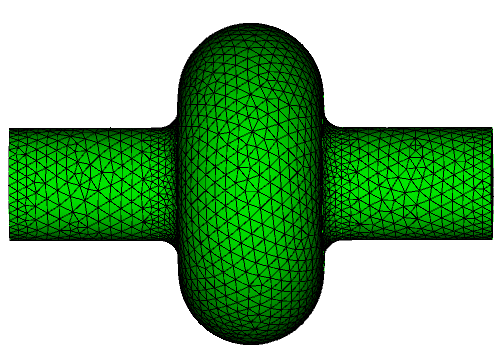{ width="340" }

### Step 1: Fields from Omega3P

```text title="Pillbox.omega3p"
ModelInfo : {
  File: ./Pillbox.ncdf
  BoundaryCondition : {
    Exterior: 1, 2, 6
  }
  SurfaceMaterial : {
    ReferenceNumber: 6
    Sigma: 5.8e7
  }
}
FiniteElement: {
  Order:           2
  CurvedSurfaces: on
}
EigenSolver : {
  NumEigenvalues: 2
  FrequencyShift:  1.0e9
}
```

Sidesets 1 and 2 are the beam pipe ends and 6 is the wall. All three are `Exterior` here because this is a full model with no symmetry planes. Omega3P writes `omega3p_results/omega3p.l0.m0000.1.3138e+09.mod`, the TM~010~ mode that Track3P will load.

!!! note "Mode file is required"
    Track3P reads the `.mod` field file, so the `PostProcess` block in the Omega3P input must be on, or omitted so that the default applies. If Omega3P was run with `PostProcess: { Toggle: off }`, rerun it.

### Step 2: Multipacting scan

```text title="Pillbox.track3p"
FieldScales: {
  Type: FieldGradient
  ScanToken: 1
  Minimum: 23.0e+6
  Maximum: 25.0e+6
  Interval: 1.0e+6
}

NormalizedField: {
  StartPoint: 0.0 0.0 -0.057
  EndPoint:   0.0 0.0  0.057
}

Domain: {
  FieldDir: ./omega3p_results
}

Emitter: {
  BoundaryID: 6
  x0: 0.03   x1: 0.035
  y0: 0.04   y1: 0.1
  z0: -0.045 z1: 0.0
}

Material: { Type: Primary    BoundarySurfaceID: 6 }
Material: { Type: Secondary  BoundarySurfaceID: 6 }
Material: { Type: Absorber   BoundarySurfaceID: 1 2 }

OutputImpacts: on

Postprocess: {
  Toggle: on
  ResonantParticles: { Token: on }
  EnhancementCounter: {
    Token: on
    MinimumEC: 0.01
    SEYFileName1: copper.dat
    BoundarySurfaceID1: 6
  }
}
```

The emitter box restricts launch sites to a patch of the cavity wall near the equator, which keeps the run short. The normalization line spans the 90 mm cavity length, plus a little, so that the scan levels are accelerating gradients in the usual sense. The beam pipe ends absorb.

Run it with 16 threads on one rank; the three levels finish in about two minutes:

```bash
export OMP_NUM_THREADS=16
srun -n 1 -c 16 track3p Pillbox.track3p
```

The end of `track3p.log` reports the scale factor applied to the normalized Omega3P field at each level:

```text
number of all emitting faces = 16
scale 1.144609569160e+06 Field 2.300000000000e+07
scale 1.194375202602e+06 Field 2.400000000000e+07
scale 1.244140836043e+06 Field 2.500000000000e+07
Done!
```

### Step 3: Read the results

`OUTPUT/resonantparticles` has one row per resonant impact:

```text
 Field_Level    ID    Resonant_X   Resonant_Y   Resonant_Z     Energy     Initial_X    Initial_Y    Initial_Z    Total_time    Total_Num
 2.30000e+07  16100  4.73236e-02  8.80929e-02  7.68720e-05  1.47562e+01  3.16915e-02  5.95758e-02 -4.32326e-02  1.98753e+01     39
 2.30000e+07  16100  4.71849e-02  8.81666e-02 -1.84656e-04  1.43454e+01  3.16915e-02  5.95758e-02 -4.32326e-02  1.98753e+01     39
```

Particle 16100 launched from (31.7, 59.6, -43.2) mm and is now bouncing across the equator at z near zero with about 15 eV per impact, having made 39 impacts in 19.9 RF cycles. That is a two-point, first-order trajectory. Hundreds of such rows per level make up the map.

`OUTPUT/enhancementCounter` weighs each resonant particle by the copper SEY:

```text
  fieldlevel         ID      enhancement      averageEnhancement     maxEnhancement        maxEnhancementImpactNum   totalImpactNum
 2.30000e+07       2300      1.13300e+00          1.06442e+00          1.27139e+00                    1                    2
```

### The multipacting map

Plot impact energy against field level, either with the `resonant` ParaView macro or with a short script. The scan covers only three levels so the "map" is three columns, but the structure is clear: distinct bands of impact energy at each level corresponding to different trajectory families.

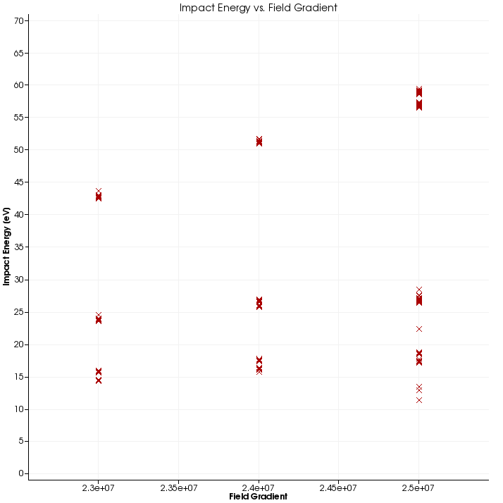{ width="420" }
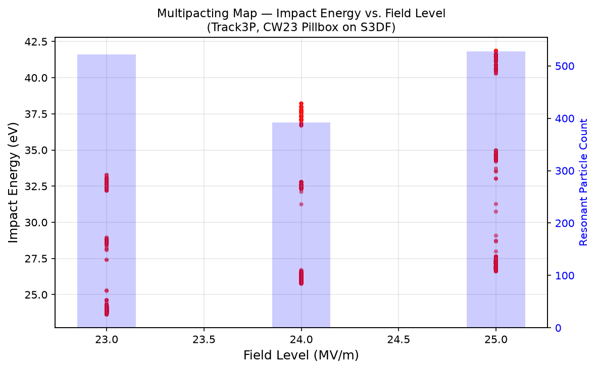{ width="460" }
/// caption
Left: the 2016 Track3P build used for the CW18 workshop. Right: the same input rerun in July 2026 on S3DF with the current build, plotted with the workflow project's matplotlib script. Bars show resonant particle count per level.
///

The two runs agree on the qualitative picture but not on the numbers, and that is worth dwelling on. The 2016 run found resonant impacts up to 84 eV; the 2026 run tops out at 42 eV. Resonant particle counts dropped from 642, 518, 642 to 522, 392, 528 across the three levels. Ten years of development separate the two binaries, and the trajectory integrator, impact detection, and resonance criteria have all changed. **Treat numbers in old tutorial material as illustrations of the method, not as reference values**, and when a result matters, establish your own baseline with the build you are using.

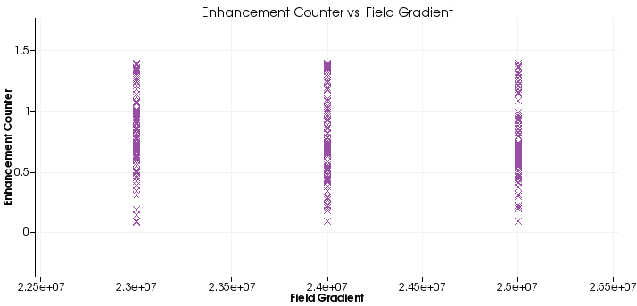{ width="440" }
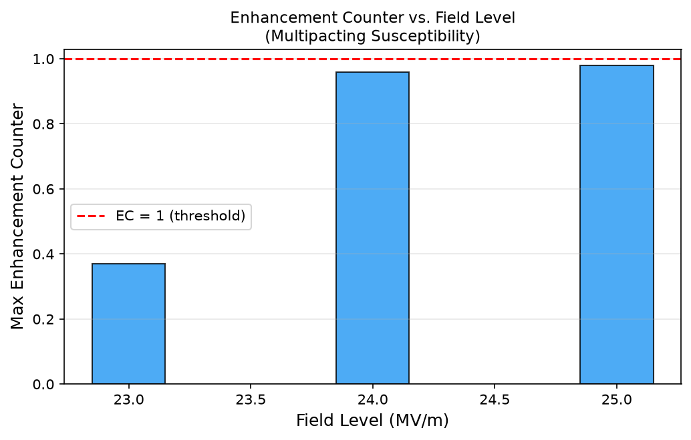{ width="440" }
/// caption
Enhancement counter against field level. The 2016 run shows a spread of EC values per level reaching 1.4. The 2026 run, summarized as the maximum per level, stays below 1.0 everywhere.
///

The consequence of the lower impact energies in the newer run is visible in the enhancement counter. Copper's SEY crosses 1.0 near 300 eV, so impacts at 15 to 40 eV have SEY of about 0.1 to 0.3 and the product over many impacts is small. The newer build predicts no sustained multipacting for copper in this range; the older build predicted a soft barrier. Resolving which is right requires comparison against measurement, which is why the ICHIRO benchmark on the module page matters.

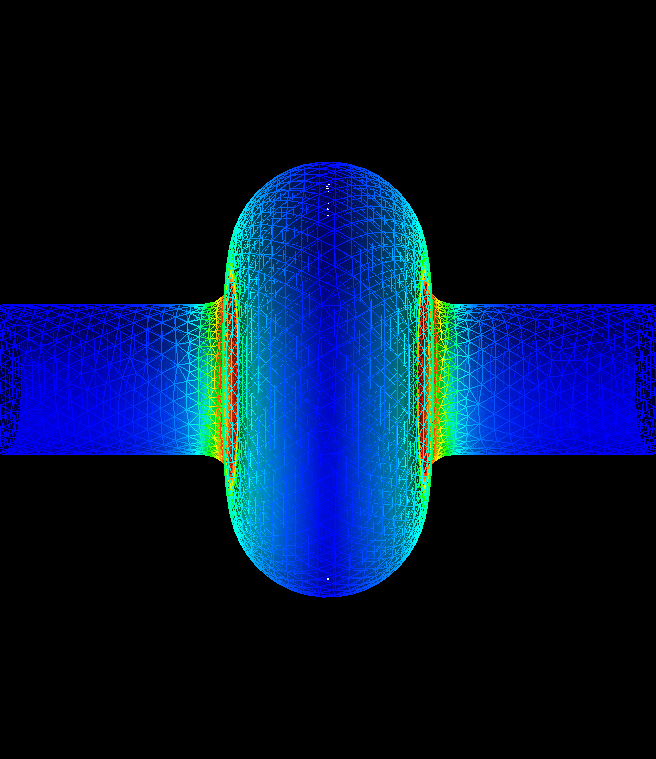{ width="300" }
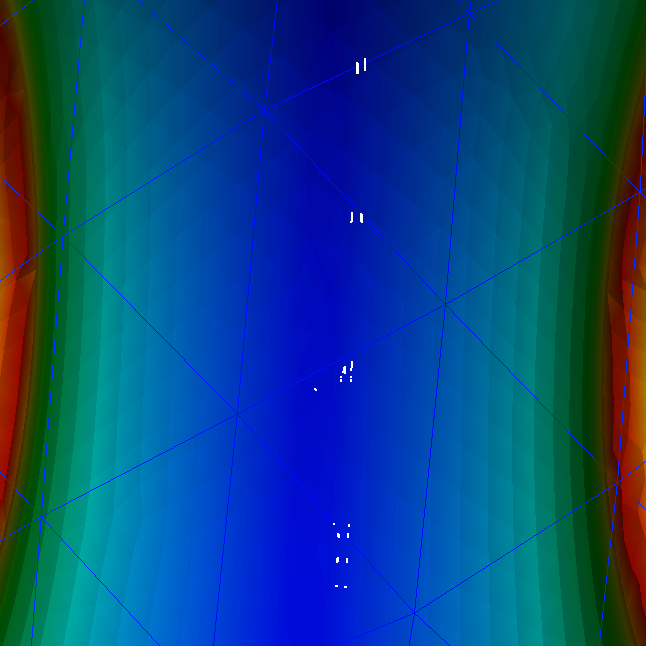{ width="300" }
/// caption
The `resonant` macro also marks impact sites on the model. They cluster on the equator, as expected for two-point multipacting in a pillbox.
///

### Step 4: Trajectories at one field level

To see what the particles are doing, rerun at a single level with trajectory output. `Pillbox2.3MV.track3p` differs from the scan input only in the `FieldScales` block:

```text
FieldScales: {
  Type: FieldGradient
  ScanToken: 0
  Scale: 23.00e+6
  EmissionOutput: 1
}
TotalTime: 5
```

Give the run its own results directory so it does not overwrite the scan:

```bash
srun -n 1 -c 16 track3p Pillbox2.3MV.track3p 2.3MV
```

This writes `2.3MV/PARTICLES/partpath_ts*.ncdf`, one file per time step. In ParaView, load mesh, mode file, and the particle file series through the SLAC toolbar, then press Play.

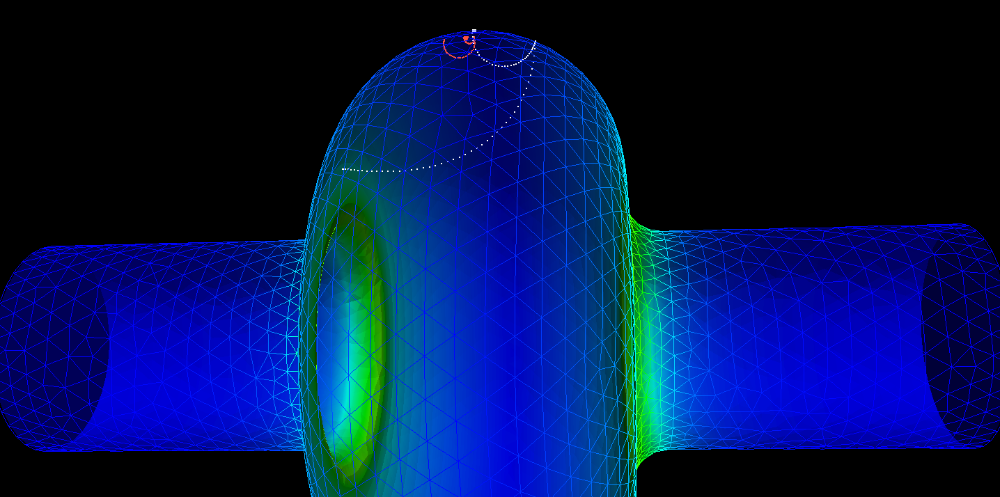{ width="560" }
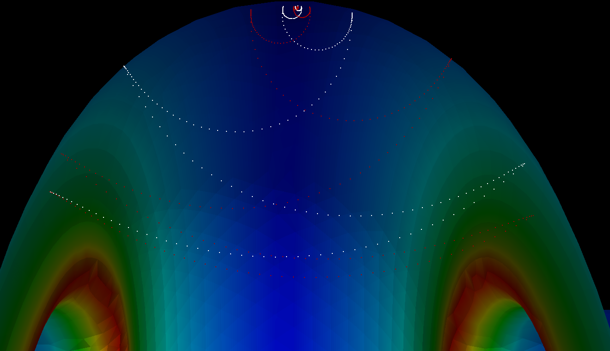{ width="560" }
/// caption
Two particles tracked from the wall to the equator, where they settle into tight two-point orbits.
///

### Step 5: acdtool post-processing

`acdtool postprocess track3p` recomputes the enhancement counter from the impact data with a different SEY file, so one tracking run can be evaluated for several surfaces, and extracts individual trajectories as text:

```text title="Pillbox.acdtool"
EnhancementCounter: {
   Token               : on
   SEYFileName1        : copper.dat
   SEYFileName2        : copper.dat
   BoundarySurfaceID1  : 6
   BoundarySurfaceID2  : 6
   SolidVolID          : 0
   MinimumEC           : 0.01
   OutputFile          : en
}
Trajectory: {
   Token               : on
   ParticleID          : 16100 15400
}
```

```bash
srun -n 1 acdtool postprocess track3p Pillbox.acdtool 2.3MV
```

The enhancement counter goes to `2.3MV/en`. Each trajectory goes to a file named by particle ID in the working directory, as rows of step number and position, ready for any plotting tool or for the `trajectory` ParaView macro.

## Tutorial 2: RF window with dielectric emission

**Example directory:** `examples/track3p/Window`

The alumina window from the [S3P tutorials](../s3p/tutorials.md#tutorial-3-rf-window), now checked for multipacting. Windows are a classic multipacting site because electrons can be emitted from the ceramic surface as well as the metal, and because the traveling-wave field pattern differs from a standing wave.

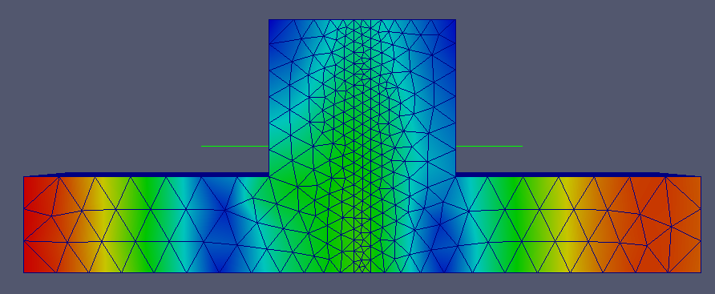{ width="520" }

### Fields from S3P

S3P is run at the single operating frequency, 2.856 GHz, with the same input as the S3P window tutorial except `Start` equals `End`. The result is `s3p_results/s3p.port7.mode0.f2.856000000E+09.mod`, the field for excitation from port 7.

### Three emission configurations

The example has three input files that differ only in the `Emitter` blocks. The one that emits from both regions:

```text title="Window-Solid+VacuumEmission.track3p"
TotalTime: 2

FieldScales: {
  Type: InputPortPower       // S3P field: scale by input power
  ScanToken: 0
  Scale: 8.0e+06             // 8 MW
}

Emitter: {                   // from the ceramic surface
  Type: 5
  x0: 0.0  x1: 0.045
  y0: 0.0  y1: 0.045
  z0: -0.002  z1: 0.0
  BoundaryID: 6
}

Emitter: {                   // from the metal wall
  Type: 2
  x0: 0.001  x1: 0.045
  y0: 0.001  y1: 0.045
  z0: 0.0    z1: 0.06
  BoundaryID: 6
}

Material: { Type: Primary    BoundarySurfaceID: 6 }
Material: { Type: Primary    SolidBlockID: 2 }
Material: { Type: Absorber   BoundarySurfaceID: 1 2 7 8 }
Material: { Type: Secondary  BoundarySurfaceID: 6 }
Material: { Type: Secondary  SolidBlockID: 2 }

Domain: {
  Bins: 128
  SolidRegion: 2             // ceramic block
  VacuumRegion: 1
  FieldDir: ./s3p_results
}

OutputImpacts: off
```

Three things are new here:

- **`InputPortPower` scaling.** With an S3P field, "field level" is naturally the drive power. `Scale: 8.0e+06` is 8 MW incident at port 7.
- **Emitter `Type: 5`** for the dielectric surface. The emitter box `z0: -0.002, z1: 0.0` selects the ceramic face. `Domain` must declare which block is `SolidRegion` and which is `VacuumRegion` so Track3P knows which side of the surface is inside the dielectric.
- **`Material` blocks keyed by `SolidBlockID`** rather than by boundary surface, assigning primary and secondary emission to the ceramic volume's surfaces.

Run each configuration into its own directory:

```bash
srun -n 1 -c 16 track3p Window-SolidEmission.track3p track3p_solid
srun -n 1 -c 16 track3p Window-VacuumEmission.track3p track3p_vacuum
srun -n 1 -c 16 track3p Window-Solid+VacuumEmission.track3p track3p_solid_vacuum
```

With `ScanToken: 0`, each run writes `PARTICLES/partpath_ts*.ncdf` for animation. The example directories include the resulting movies.

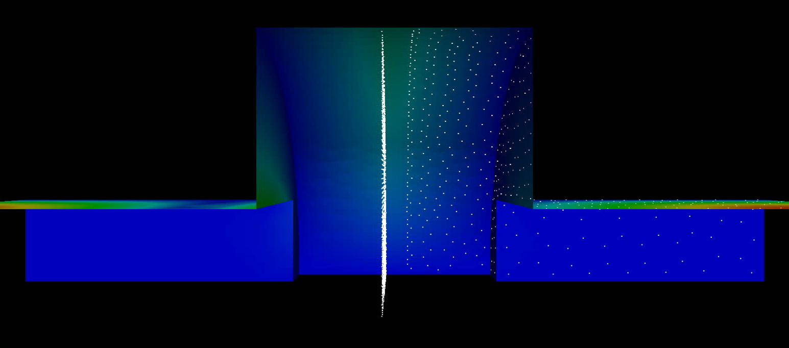{ width="640" }
/// caption
Particles emitted from the ceramic face (dense column at center) and from the metal walls (scattered points), in the traveling-wave field at 8 MW.
///

## Tutorial 3: external magnetic field

**Example directory:** `examples/track3p/Muon201MHz`

A 201 MHz cavity for muon ionization cooling operates inside a solenoid. The magnetic field bends electron trajectories and changes which ones are resonant, so multipacting must be evaluated with the external field present. Track3P accepts either a uniform field or a tabulated map.

The Omega3P input for this cavity has two features not seen earlier: two surface materials with different conductivity, since the end walls (sidesets 3 and 4) are beryllium windows rather than copper, and waveguide boundaries on the coupler ports (7 and 8).

### Three runs

The three input files share everything except the `Domain` block:

```text title="Muon.track3p (shared part)"
TotalTime: 50

FieldScales: {
  Type: FieldGradient
  ScanToken: 1
  Minimum:  1.0e6
  Maximum:  16.0e6
  Interval: 1.0e6
}

NormalizedField: {
  StartPoint: 0.0 0.0 -0.18032
  EndPoint:   0.0 0.0  0.23657
  Beta: 1.0
}

Emitter: {
  x0: 0.4   x1: 0.65
  y0: 0.0   y1: 1.136
  z0: -0.25 z1: 0.25
  BoundaryID: 6
}

Material: { Type: Primary    BoundarySurfaceID: 6 }
Material: { Type: Secondary  BoundarySurfaceID: 3 4 6 }
Material: { Type: Absorber   BoundarySurfaceID: 7 8 }

OutputImpacts: on

Postprocess: {
  Toggle: on
  ResonantParticles: {
    InitialImpacts: 2
    EnergyRange: 50 3000
    Token: on
  }
}
```

A 16-level scan over 50 RF cycles each is a substantial run; use several MPI ranks. The `Domain` block for each case:

=== "No external field"

    ```text
    Domain: {
      Bins: 256
      LowEnergy: 50
      HighEnergy: 3000
      FieldDir: ./omega3p_results
    }
    ```

=== "Uniform 3 T solenoid"

    ```text
    Domain: {
      Bins: 256
      LowEnergy: 50
      HighEnergy: 3000
      FieldDir: ./omega3p_results
      ExternalMagneticField: 0.0 0.0 3.0      // tesla
    }
    ```

=== "Field map from a solenoid model"

    ```text
    Domain: {
      Bins: 256
      LowEnergy: 50
      HighEnergy: 3000
      FieldDir: ./omega3p_results
      MagneticFieldMap: {
        File: BField
        // Scaling: 0.0001     // if the file is in gauss
        // Units: 0.001        // if coordinates are in mm
        ZOffset: 0.27          // shift the map's z origin
      }
    }
    ```

The `LowEnergy` and `HighEnergy` cutoffs are raised to 50 eV and 3 keV here, and `EnergyRange` in `ResonantParticles` matches them. Low-energy impacts below the SEY crossover are not interesting for this cavity and dropping them early saves time.

### Compare the maps

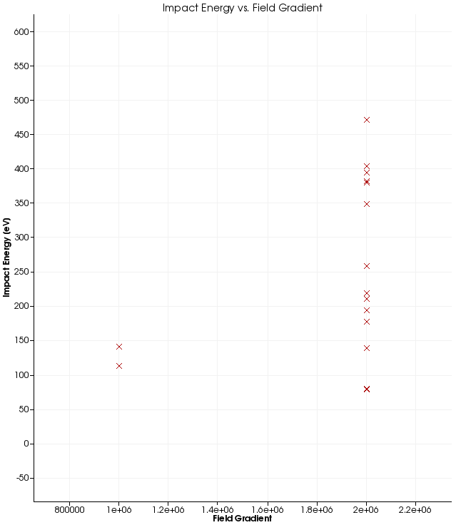{ width="330" }
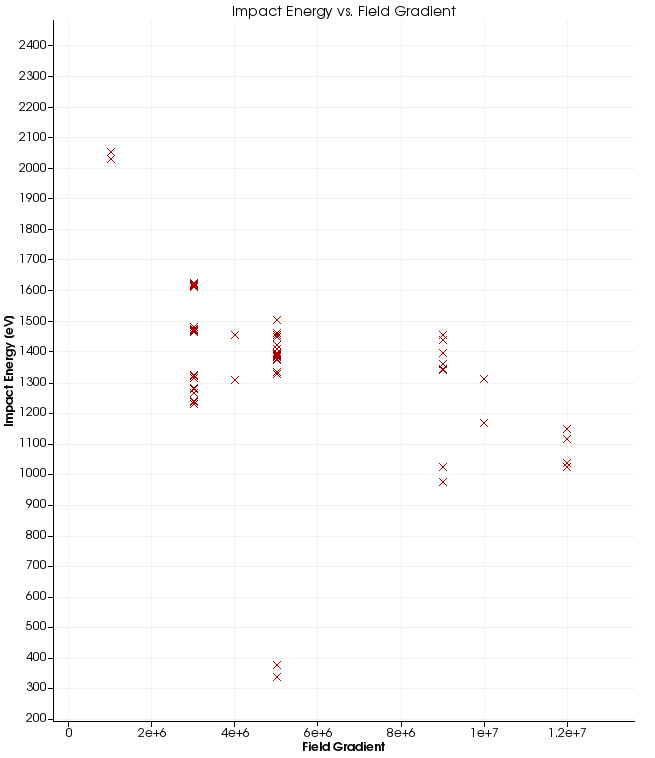{ width="330" }
/// caption
Impact energy versus gradient without external field (left) and in a uniform 3 T solenoid field (right). Note the very different energy scales.
///

Without the magnetic field, resonant particles appear only at 1 and 2 MV/m with impact energies up to about 470 eV. With 3 T, they appear across the whole scan up to 12 MV/m, with impact energies of 1 to 2 keV, well into the range where copper's SEY exceeds one. The solenoid field confines electrons to tight helices along field lines, which makes resonance far easier to satisfy. This is the known multipacting problem of cooling-channel cavities, and the example reproduces it.

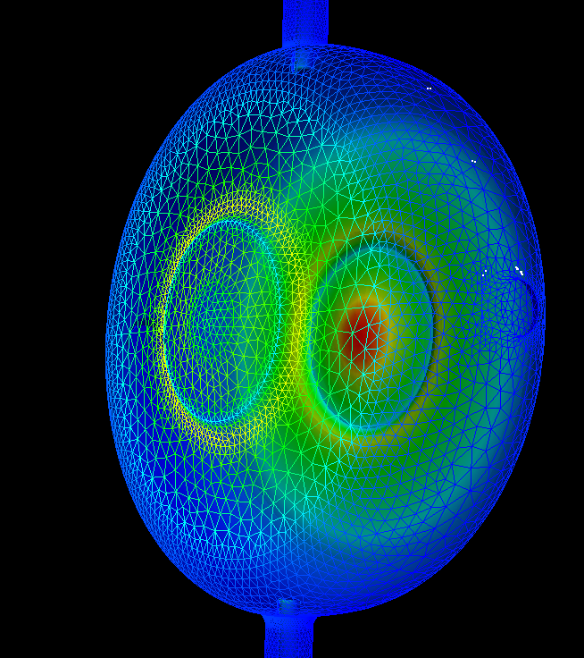{ width="340" }
/// caption
Resonant impact sites on the cavity, no external field. Sites cluster around the beryllium window and the coupler iris.
///

The example directory contains the corresponding plots for all three cases as `RF-N`, `RF-3T`, `RF-M` (impact energy) and `RL-N`, `RL-3T`, `RL-M` (locations).

## Tutorial 4: dark current in a Tesla cavity

**Example directory:** `examples/track3p/Tesla`

Dark current is field-emitted electrons from high-field regions of the wall, accelerated through the cavity and lost downstream or on the walls. Track3P models the emission with the Fowler-Nordheim law and, optionally, secondary emission at impacts.

### Fowler-Nordheim emission

The current density from a metal surface with work function $\phi$ in eV under a field $E$ enhanced by a geometric factor $\beta$ is

$$
J = 1.54\times10^{-6}\,\frac{(\beta E)^2}{\phi}\,10^{4.52/\sqrt{\phi}}\,
    \exp\!\left(-\frac{6.53\times10^{9}\,\phi^{1.5}}{\beta E}\right)
$$

Track3P converts $J$ into a number of electrons per emitting face per time step. Typical $\beta$ for a real cavity surface is 50 to 200; the example uses 120 with the copper work function.

### Primary emission only

```text title="Tesla-PEmission.track3p"
ParticlesTrajectories: {
  Skip: 2                    // save every other step
}
TotalTime: 6

FieldScales: {
  Type: FieldGradient
  ScanToken: 0
  Scale: 16.00e+6            // 16 MV/m
}

NormalizedField: {
  StartPoint: 0.0 0.0 0.0
  EndPoint:   0.0 0.0 1.036200   // full 9-cell length
}

Domain: {
  FieldDir: ./omega3p_results
  Bins: 640                  // long structure: finer binning
  MaxImpacts: 2              // drop particles after two impacts
}

Emitter: {
  Type: 7                    // FieldEmission
  BoundaryID: 6
  t0: 0
  t1: 1
  x0: 0.0   x1: 0.104
  y0: 0.0   y1: 0.104
  z0: 0.0   z1: 0.114        // first cell only
  N: 1000
  WorkFunction: 4.2
  Beta: 120
}

Material: { Type: Primary    BoundarySurfaceID: 6 }
Material: { Type: Secondary  BoundarySurfaceID: 6 }
Material: { Type: Absorber   BoundarySurfaceID: 1 2 }

OutputImpacts: on
```

`Bins: 640` matters here. The default of 64 is tuned for a compact cavity; a one-meter structure with fine irises needs many more bins for particle localization to be efficient. `MaxImpacts: 2` keeps the run to primaries and their first bounce, since secondaries are switched off by the absence of a `Model: 2` secondary material.

Run with the results directory named explicitly:

```bash
srun -n 16 track3p Tesla-PEmission.track3p track3p_PEmission
```

### With secondary emission and Faraday cups

`Tesla-SEmission.track3p` adds a dark-current secondary model and surface monitors:

```text
Material: {
  Type: Secondary
  BoundarySurfaceID: 6
  Model: 2                   // dark-current secondary emission
  // inline SEY table for niobium
  Sigma0: 0.0 0.972 1.13 1.222 1.439 1.478 1.486 1.442 1.378 1.314 1.258 1.214 1.167 1.125 1.092 1.061 1.033 1.011 0.986 0.967 0.944 0.931 0.5
  Einit:  0.0 50 75 100 200 300 400 500 600 700 800 900 1000 1100 1200 1300 1400 1500 1600 1700 1800 1900 1e12
  MinimumNumElectrons: 1000
  ElasticThreshold: 1000
}

Postprocess: {
  Toggle: on
  ResonantParticles: { Token: off }
  FaradayCup: {
    Token: on
    BoundaryID: 6 1 2
  }
}
```

`Model: 2` enables the dark-current secondary model: true secondaries following a Lye-Dekker yield curve given inline by `Sigma0` against `Einit`, plus elastic reflection when a macroparticle carries more than `ElasticThreshold` electrons. `MinimumNumElectrons` prunes macroparticles that have shrunk below that count.

The `FaradayCup` post-processor writes every impact on each listed surface to `OUTPUT/faradaycup_<id>`, in the same column format as `ImpactsInfo`. Surfaces 1 and 2 are the beam pipe ends, so `faradaycup_1` and `faradaycup_2` are the dark current leaving the cavity upstream and downstream, which is what a real Faraday cup would measure. These files are the input to X-ray and radiation estimates.

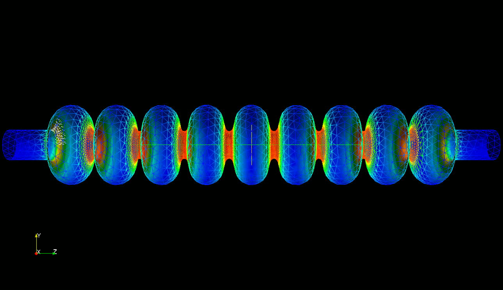{ width="700" }
/// caption
Particles emitted from the first cell at 16 MV/m, tracked through the 9-cell Tesla cavity with secondary emission on. The white cluster at left is the emission site; particles that reach the far end are captured in the Faraday cup output.
///

### Scaling up: a cryomodule

The same input pattern extends to an entire LCLS-II cryomodule of eight 9-cell cavities, 10.96 m long, with 1.5 million particles emitted on the first RF cycle and tracked for 50 cycles. The mesh is refined at the irises, and a convergence check between 303 thousand and 1.45 million elements confirms the dark current loss map.

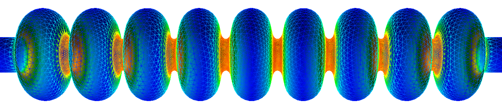{ width="700" }
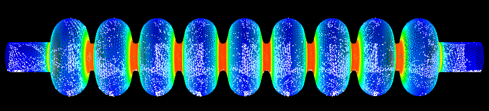{ width="700" }
/// caption
Pi-mode field at 1.2999669 GHz across one cavity of the cryomodule, and a snapshot of dark current particles tracked through it.
///

A run of this size is where the Track3P parallel model pays off: with no inter-rank communication it scales linearly in particles, and the 7-minute figure quoted on the module page is for this class of problem.
