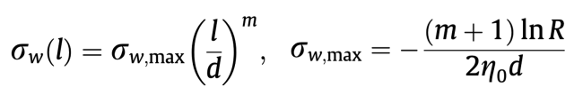
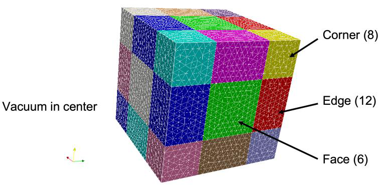
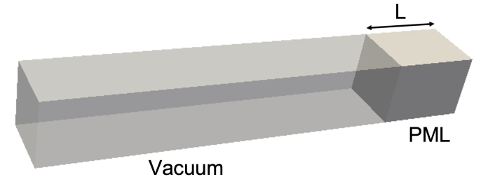

# Omega3P command syntax

Block-by-block description of the `.omega3p` input file. Each block is shown as a complete example followed by the meaning of every key. Narrative explanations and worked cases are in the [Omega3P module guide](../../modules/omega3p/index.md); the machine-generated list of every keyword the code reads, with defaults and source locations, is in the [Omega3P keyword table](../omega3p.md).

Top-level blocks: `ModelInfo`, `FiniteElement`, `PRegion`, `EigenSolver`, `Port`, `PostProcess`.

## ModelInfo

```text
ModelInfo : {
  File: ./pillbox+recWG4.ncdf
  BoundaryCondition : {
    Magnetic:  1, 2
    Electric:  3, 4
    Exterior:  6
    Waveguide: 7
  }
  SurfaceMaterial : {
    ReferenceNumber: 6
    Sigma: 5.8e7
  }
  Material : {
    Attribute: 1
    Epsilon:   1.0
    Mu:        1.0
  }
}
```

**`File`**: mesh in NetCDF format, with an optional path. Default directory is where the job was submitted.

**`BoundaryCondition`**: maps boundary types to the sideset numbers assigned in Cubit. Every surface must belong to exactly one.

| Type | Meaning |
|---|---|
| `Electric` | Tangential E = 0. Perfect conductor or electric symmetry plane. |
| `Magnetic` | Tangential H = 0. Magnetic symmetry plane. |
| `Exterior` | Computationally identical to `Electric`, but marks a real metal wall so that wall loss and Q~0~ are computed by perturbation using the conductivity in `SurfaceMaterial`. |
| `Impedance` | Fields related by a surface impedance from the conductivity in `SurfaceMaterial`. For a lossy conductor when the skin depth is small compared with the element size. Requires `FrequencyShift` to be close to the mode frequency, since the impedance is evaluated there. |
| `Absorbing` | First-order absorbing boundary for waves at c. For coaxial ports and beam pipe truncation. See `Port` with `CutoffFrequency`. |
| `Waveguide` | Modal waveguide boundary. Pair with a `Port` block. |
| `Periodic_M`, `Periodic_S` | Master and slave surfaces of a periodic boundary. Their surface meshes must be identical. |
| `Theta` | Phase advance in degrees between master and slave. |

**`SurfaceMaterial`**: wall properties for loss calculation. `ReferenceNumber` is the sideset; `Sigma` the conductivity in S/m. Absent, the wall is copper at 5.8×10⁷ S/m. Repeat the block for surfaces of different materials.

**`Material`**: volume properties by Cubit block. Absent, the volume is vacuum.

| Key | Meaning |
|---|---|
| `Attribute` | Block ID |
| `Epsilon`, `Mu` | Relative permittivity and permeability |
| `EpsilonImag`, `MuImag` | Imaginary parts for material loss. Default 0. Negative for a passive lossy material. |
| `PML` | Sub-block making this block a perfectly matched layer, below |

### PML

A perfectly matched layer terminates a domain by absorbing outgoing waves in an artificially lossy region. The conductivity ramps from zero at the inner face to a maximum at the outer face:

{ width="420" }

where $d$ is the layer thickness, $m$ the polynomial order, $R$ the desired reflection coefficient, and $\eta_0$ the free-space impedance. Give either `Reflection Coefficient`, from which the maximum is computed, or `Maximum Sigma` directly.

{ width="380" }
{ width="340" }

Free-space termination needs face, edge, and corner layers; a waveguide termination needs one face layer.

```text
Material : {
  Attribute: 2
  PML: {
    Type: Face
    Start: -0.01143 -0.00508 0.08       // bounding box of the layer, m
    End:    0.01143  0.00508 0.10
    Direction: 0. 0. +1.                // outward normal
    Reflection Coefficient: 1.e-5
    Polynomial Order: 2
    Maximum Sigma: 2.e0 2.e0 2.e0       // alternative to Reflection Coefficient
  }
}
```

| Key | Meaning |
|---|---|
| `Type` | `Face` (6 orientations), `Edge` (12), or `Corner` (8) |
| `Start`, `End` | Bounding box of the layer in m |
| `Direction` | Orientation: one nonzero component for `Face`, two for `Edge`, three for `Corner`, each ±1 |
| `Reflection Coefficient` | Target reflection; sets `Maximum Sigma` |
| `Maximum Sigma` | Conductivity in x, y, z in S/m, if not derived from the reflection coefficient |
| `Polynomial Order` | $m$ in the profile |

A spherical or cylindrical PML replaces the bounding box and direction with the layer geometry:

```text
PML: {
  Type: Face
  SubType: Sphere            // or Cylinder
  BoundaryID: 6              // sideset of the outer surface
  Radius: 0.05
  Thickness: 0.004
  Reflection Coefficient: 1.e-5
  Polynomial Order: 2
}
```

## FiniteElement

```text
FiniteElement : {
  Order:          2
  CurvedSurfaces: on
}
```

`Order` is the polynomial order of the basis functions, 1 to 6; 2 is adequate for most work. `CurvedSurfaces` (also accepted as `Curved Surfaces`) uses the mid-edge nodes of the quadratic mesh to represent curved boundaries; default on.

## PRegion

Different orders in different blocks. Set the global order to 0 and give each block its own:

```text
FiniteElement : { Order: 0  CurvedSurfaces: on }
PRegion : { Type: Material  Reference: 1  Order: 2 }
PRegion : { Type: Material  Reference: 2  Order: 3 }
```

`Reference` is the block ID. Every block must then appear in a `PRegion`.

## EigenSolver

```text
EigenSolver : {
  NumEigenvalues: 1
  FrequencyShift: 1.0e9
  Tolerance:      1e-7
  MaxIterations:  300
}
```

| Key | Default | Meaning |
|---|---|---|
| `NumEigenvalues` | 1 | Modes to find, counting upward from `FrequencyShift` |
| `FrequencyShift` | 10 GHz | Modes above this frequency are searched. Set just below the lowest mode of interest. |
| `Tolerance` | 1e-8 | Relative eigenpair residual |
| `MaxIterations` | 200 | Krylov iteration limit |

The default solver handles real (lossless) and complex (lossy or port-loaded) problems as linear or quadratic eigenproblems. A port-loaded problem stays quadratic only when every loaded port mode shares the same cutoff frequency. Otherwise use the nonlinear solver below.

### Linear solver inside the eigensolver

The shift-invert operator inside each Arnoldi iteration can use PETSc instead of the default direct solver, which matters for problems too large for MUMPS:

```text
EigenSolver : {
  NumEigenvalues: 1
  FrequencyShift: 1.0e9
  Arnoldi: {
    LinearSolver: {
      Solver: PETSc
      Preconditioner: MP         // p-order multilevel preconditioner
      SubCommSize: 8
      Tolerance: 1e-10
      MaxIterations: 8000
      PETScOption: {
        Runtime: -ksp_type cg -log_view -options_left -ksp_converged_reason
      }
    }
  }
}
```

| Key | Default | Meaning |
|---|---|---|
| `Solver` | MUMPS | `PETSc` to use a PETSc Krylov solver |
| `Preconditioner` | PETSc built-in | `MP`: ACE3P's multilevel preconditioner, which solves at order 1 to precondition order 2 |
| `SubCommSize` | 8 | MPI sub-communicator size for `MP` |
| `Tolerance` | 1e-16 | Relative convergence |
| `MaxIterations` | 1000 | Krylov iteration cap |
| `PETScOption.Runtime` | | PETSc command-line options; several `Runtime` lines allowed |

Use `-ksp_type cg` for lossless (Hermitian) problems and `-ksp_type gmres` for lossy (non-Hermitian) ones; CG diverges on the latter. Complex problems need the binaries built against complex PETSc, in the `bin-petsc-complex` directory of the installation. The same `LinearSolver` nesting applies inside `ESIL`, `InvertMode`, and the other eigensolver containers.

### Nonlinear eigensolver (CORK)

```text
EigenSolver : {
  NumEigenvalues: 3
  Tolerance:      1e-10
  FrequencyShift: 1.0e9
  SolverMode:     CORK
  CORK: {
    TargetFrequencyMin:  1.0e9
    TargetFrequencyMax:  2.4e9
    TargetFrequencyImag: 5.0e8
    MaxIterations:       500
    ApproxTolerance:     1e-12
    ApproxMaxDegree:     100
    OneRKSShift:         1
  }
}
```

| Key | Meaning |
|---|---|
| `TargetFrequencyMin`, `TargetFrequencyMax` | Real-frequency search window in Hz |
| `TargetFrequencyImag` | Largest imaginary part searched, Hz |
| `MaxIterations` | Nonlinear iteration cap |
| `ApproxTolerance` | Accuracy of the rational approximation |
| `ApproxMaxDegree` | Maximum polynomial degree of the approximation |
| `OneRKSShift` | Use a single rational Krylov shift. Read by `CORK_RationalNewton.C`; present in the CW23 example but not described in the command reference. |

Procedure: run once loading many modes per port, read the cutoffs in `2dports.log`, count the propagating modes at each port for the modes of interest, and rerun loading only those. [Tutorial 2](../../modules/omega3p/tutorial-ports.md#nonlinear-eigenproblem) walks through it.

## Port

```text
Port : {
  ReferenceNumber: 7
  NumberOfModes:   1
}
```

One block per `Waveguide` surface. Absent, one mode is loaded. `ReferenceNumber` must match the sideset listed under `Waveguide`.

For an `Absorbing` surface, a `Port` block with `CutoffFrequency` improves the first-order boundary by giving it the guide's phase velocity at the eigenfrequency instead of c:

```text
Port : {
  ReferenceNumber: 7
  CutoffFrequency: 1e9
}
```

## PostProcess

```text
PostProcess : {
  Toggle:    on
  ModeFile:  mode
  WriteLoss: on
}
```

| Key | Default | Meaning |
|---|---|---|
| `Toggle` | on | Write `.mod` field files for ParaView |
| `ModeFile` | `omega3p` | Prefix of the mode files |
| `WriteLoss` | off | Also write `.loss` files with the surface power density distribution. Read as `PostProcess.WriteLoss` in the shared post-processor `emfem/src/NewPP.C`. |

Post-processing of modes for R/Q, kick factors, and field extraction is done by `acdtool postprocess rf`; see the [acdtool command syntax](acdtool.md).
