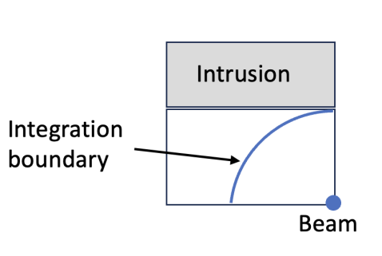

# T3P command syntax

Block-by-block description of the `.t3p` input file. Worked cases are in the [T3P module guide](../../modules/t3p/index.md).

Top-level blocks: `ModelInfo`, `FiniteElement`, `PRegion`, `LoadingInfo`, `Loading`, `TimeStepping`, `Monitor`, `LinearSolver`, `CheckPoint`.

## ModelInfo

As in [Omega3P](omega3p.md#modelinfo) with these differences.

Boundary types: `Electric`, `Magnetic`, `Exterior`, `Absorbing`, `Waveguide` (broadband, dispersive), `Impedance`.

`Material` gains time-domain options:

```text
Material : {
  Attribute: 1
  Epsilon:   35.83
  Mu:        1.0
  Sigma:     0.316           // bulk conductivity, S/m, frequency independent
  Chi2:      ...             // second-order nonlinear susceptibility
  Chi3:      ...             // third-order nonlinear susceptibility
  Dispersion : {             // Lorentz model; only one dispersive material allowed
    Type:    Lorentz
    Omega_0: ...             // resonance angular frequency
    Omega_p: ...             // resonant strength
    Gamma:   ...             // decay rate
    Eps_inf: ...             // high-frequency permittivity
  }
}
```

The Lorentz permittivity is

$$
\varepsilon(\omega) = \varepsilon_\infty + \frac{\omega_p^2}{\omega_0^2 - \omega^2 + j\omega\gamma}
$$

`SurfaceMaterial` takes `Frequency` and an optional `Coating` as in [S3P](s3p.md#modelinfo). The `Impedance` boundary with a `SurfaceMaterial` is also what the `SurfacePowerLoss` monitor reads.

`PML` is as in Omega3P, with `Polynomial Order` typically 3 in time domain.

## FiniteElement and PRegion

`Order` and `CurvedSurfaces` as elsewhere. For the moving window, set the global order to 0 and define the window:

```text
FiniteElement : { Order: 0  CurvedSurfaces: on }
PRegion : {
  Type:         AutomaticMovingWindow
  Order:        2
  Back:         0.001          // m behind the bunch
  Front:        0.002          // m ahead
  StructureEnd: 0.0689         // z where the window stops moving
}
```

The window spans `Back` plus the bunch length plus `Front`. When the bunch reaches the front of the window a new window is created and the system matrix is reassembled, so a very short window saves per-step cost but adds reassembly cost. The wake is valid only up to about `Back` behind the bunch.

## LoadingInfo

Beam excitation by a rigid bunch moving at c along z.

```text
LoadingInfo : {
  Bunch : {
    Type:             Gaussian
    Sigma:            0.01            // m
    Number of sigmas: 5
    Charge:           1e-12           // C
  }
  SymmetryFactor:  4.0
  StartPoint:      0 0 -0.10
  Direction:       0 0 1
  BoundaryID:      3
  StartTime:       1.e-9              // optional, s
  NumBunches:      2                  // optional, bunch train
  BunchSeparation: 0.1                // optional, m
}
```

Bunch shapes:

| `Type` | Keys |
|---|---|
| `Gaussian` | `Sigma`, `Number of sigmas` (or `Nsigmas`). Total length 2 × Sigma × Number of sigmas. |
| `BiGaussian` | `Sigma1` (front), `Sigma2` (back), `Number of sigmas`. Asymmetric. |
| `Flattop` | `Rise sigma`, `Number of rise sigma`, `Drop sigma`, `Number of drop sigma`, `Flattop width`. Half-Gaussian edges on a flat top. |

| Key | Meaning |
|---|---|
| `SymmetryFactor` | 2 if the beam lies on one magnetic symmetry plane, 4 at the corner of two. Scales the effective charge in the domain. |
| `StartPoint`, `Direction` | Entry point and direction; only z is allowed |
| `BoundaryID` | Surface the beam enters through; make it `Absorbing` |
| `StartTime` | Injection time of this bunch, default 0 |
| `NumBunches`, `BunchSeparation` | A train of identical bunches spaced in m |

Several `LoadingInfo` blocks give several independent bunches, used for dipole excitation with opposite charges.

## Loading

Dipole, port, and surface excitation.

=== "DipoleLoading"

    ```text
    Loading : {
      Type:       DipoleLoading
      Coordinate: 0.0001, 0.00001, 0.
      Direction:  0.0, 0.0, 1.0
      Tolerance:  0.001
      Excitation : {
        Power: 1.                        // dipole moment, A·m
        Pulse : { ... }                  // see Pulse below
      }
    }
    ```

=== "PortModeLoading"

    ```text
    Loading : {
      Type: PortModeLoading
      Port : {
        ReferenceNumber: 3
        SymmetricFactor: 4               // 1 none, 2 one plane, 4 two planes
        NumberOfModes:   1
      }
      Excitation : { Power: 1.  Pulse : { ... } }
    }
    ```

    The port surface is `Absorbing` in `ModelInfo` so outgoing waves leave. Port modes are solved numerically, or imported from files:

    ```text
    Port : {
      ReferenceNumber: 3
      Origin:     0.0 0.0 -1.928
      XDirection: 1.0 0.0 0.0
      YDirection: 0.0 1.0 0.0
      ESolver : {
        Type: Interpolative
        Mode : { ExFile: Ex.prn  EyFile: Ey.prn  BxFile: Bx.prn  ByFile: By.prn }
      }
    }
    ```

    Each file is a table of `ix iy x y F` on an M×N grid, rows advancing `ix` fastest, E in V/m and B in T.

=== "SurfaceLoading"

    ```text
    Loading : {
      Type:            SurfaceLoading
      ReferenceNumber: 4
      InputFile:       TM01.prn
      Excitation : { Mode number: 1  Power: 1.  Pulse : { ... } }
    }
    ```

    A user field map on a curved `Absorbing` surface, given on a (θ, φ) grid as `ix iy theta phi Ex Ey Ez Bx By Bz`, angles in radians.

### Pulse

| `Type` | Keys |
|---|---|
| `Gaussian` | `Frequency` (carrier, Hz), `Bandwidth` (Hz), `DB` (truncation below peak), `T0` (delay in sigmas), `Phase` (degrees) |
| `Monochromatic` | `Frequency`, `Rise periods` (cycles to full amplitude), `Fall periods` (optional), `T0` (start time, s), `TMax` (total duration, s, optional) |
| `UserDefinedPulse` | `T0` (time offset, s), `Scaling`, `Frequency` (for port-mode evaluation, Hz), `File`: two-column text, time and amplitude |

Note that `SymmetricFactor` inside `Loading.Port` is spelled differently from `SymmetryFactor` in `LoadingInfo`. Both are as the code reads them.

## TimeStepping

```text
TimeStepping : {
  MaximumTime: 3.0e-9
  DT:          1e-12
}
```

Both in seconds. The implicit scheme is unconditionally stable, so `DT` is set by the frequency content to be resolved.

## Monitor

| `Type` | Keys | Output |
|---|---|---|
| `Point` | `Name`, `Coordinate` | `<Name>.out`: t, H~x~ H~y~ H~z~, E~x~ E~y~ E~z~ in SI |
| `Volume` | `Name`, `TimeStart`, `TimeEnd`, `TimeStep` | `<Name>ts_t<time>ps.out.mod` snapshots for ParaView |
| `WakeField` | `Name`, `StartContour`, `EndContour`, `Smax`, optional `Grid` | `<Name>.out`: s, W(s) in V/C, I(s) in A/m, with loss or kick factor in the header |
| `Power` | `Name`, `ReferenceNumber`, optional `TimeStart`, `TimeEnd`, `TimeStep` | `<Name>.out`: t, power through the surface in W |
| `SurfacePowerLoss` | `Name`, `ReferenceNumber` | `<Name>.out`: t, ohmic loss on the surface in W. Needs a `SurfaceMaterial` on that surface. |
| `ModeVoltage` | `Name`, `Port` with `ReferenceNumber` and `ESolver` (`Type: Numerical2D`, `NumberOfModes`, `Frequency`, `Tolerance`, `MaxIterations`) | `<Name>.out`: t, modal voltage in V |

### WakeField details

`StartContour` and `EndContour` bound the integration in z and default to the model ends. `Smax` is the wake length recorded and is limited by causality: with model length L and downstream pipe length l, the maximum is c × MaximumTime − (L − l).

The default is indirect (Weiland) integration along the beam-pipe boundary, valid when only vacuum is visible from pipe end to pipe end. The wake is computed at the beam's transverse position; for other positions use `acdtool postprocess wake_new`, and for transverse wakes `acdtool postprocess transwake`.

For collimator-like structures with intrusions, use direct integration along a circle inside the vacuum:

```text
Monitor : {
  Type: WakeField
  Name: wakefield
  StartContour: 0.
  EndContour:   0.6
  Smax:         0.10
  Grid : {
    Method:     Circle
    Radius:     0.0149       // m
    NPoints:    10
    StartDense: 0            // degrees
    EndDense:   90
    Fraction:   1
  }
}
```

{ width="320" }

A long downstream catch-up distance is needed for convergence. `acdtool postprocess wake_direct` evaluates it at other positions.

## LinearSolver

```text
LinearSolver : { Solver: MUMPS }
LinearSolver : { Solver: CG  Preconditioner: CHOLESKY }
```

MUMPS, direct, for small problems. CG with `CHOLESKY` or `DIAGONAL` for large ones. A missing or misspelled `Solver` key gives the compiled-in default, MUMPS on the SLAC and NERSC builds.

## CheckPoint

```text
CheckPoint : {
  Action:     restart        // none or restart; restart is default
  Ntimesteps: 700            // interval, default 1000
}
```

Resubmitting a run with `restart` continues from the last checkpoint. To extend a finished run, raise `MaximumTime` and resubmit.
