# Geometry and meshing with Cubit

Cubit is the geometry and mesh generation toolkit from Sandia National Laboratories that every ACE3P workflow starts with. This chapter walks through building and meshing a pillbox cavity, first interactively so you learn the interface, then as journal files so the process is reproducible. The export rules and the `acdtool` conversion that follow are on the [mesh preparation](mesh.md) page.

Cubit's own tutorials at [cubit.sandia.gov](https://cubit.sandia.gov/tutorials) and [coreform.com](https://coreform.com/products/coreform-cubit/tutorials/) go deeper on the tool itself.

## The interface

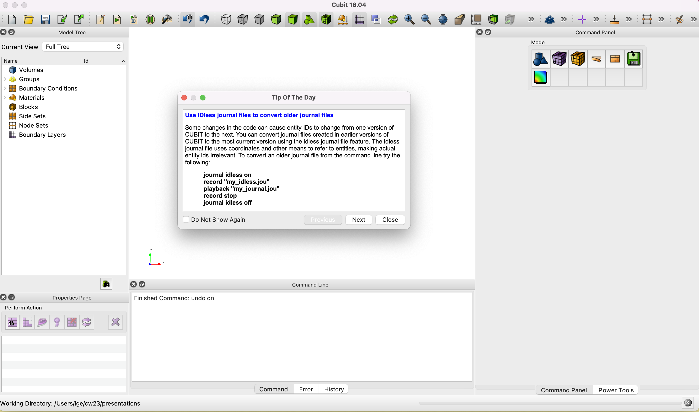{ width="720" }
/// caption
Cubit on first launch. Model Tree at left, graphics window center, Command Panel at right, Command Line at bottom. Close the Tip of the Day.
///

Five regions matter:

| Region | Use |
|---|---|
| **Model Tree** | Browse volumes, surfaces, curves, and the sidesets and blocks you define. Clicking an entity highlights it in the graphics window. |
| **Graphics window** | Rotate with the left mouse button, zoom with the right, pan with the middle. Click an entity to select it; its ID appears in the command line. |
| **Command Panel** | Three rows of icons: Mode (Geometry, Mesh, Exodus for boundary conditions, and so on), then Entity (Volume, Surface, Curve, Vertex), then Action. Each click descends one level and ends at a form with an Apply button. |
| **Command Line** | Every GUI action echoes here as a text command. You can also type commands directly. The History tab keeps the last hundred. Type `help <command>` for syntax. |
| **Properties Page and Power Tools** | Properties of the selected entity; geometry checking and repair tools. |

Set the working directory before anything else, with **File, then Set Directory**, or by typing `cd "/path/to/pillbox"` in the command line. Files are read and written relative to it.

!!! tip "Work in millimeters, export in meters"
    Build and mesh in the natural units of the drawing, usually millimeters, to avoid tolerance problems with tiny coordinates. Scale by 0.001 as the last step before export. ACE3P expects meters.

## Modeling a pillbox interactively

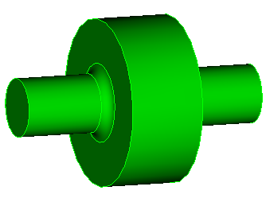{ width="320" align=right }

The target is an L-band pillbox: cavity 90 mm long and 100 mm in radius, beam pipe 35 mm in radius and 300 mm long overall, iris rounded with a 12 mm radius. Its TM~010~ mode is near 1.2 GHz.

### Create the cell

In the Command Panel choose **Mode Geometry, Entity Volume, Action Create**, select Cylinder, enter height 90 and radius 100, and click Apply. The command line shows the equivalent text:

```text
create cylinder height 90 radius 100
```

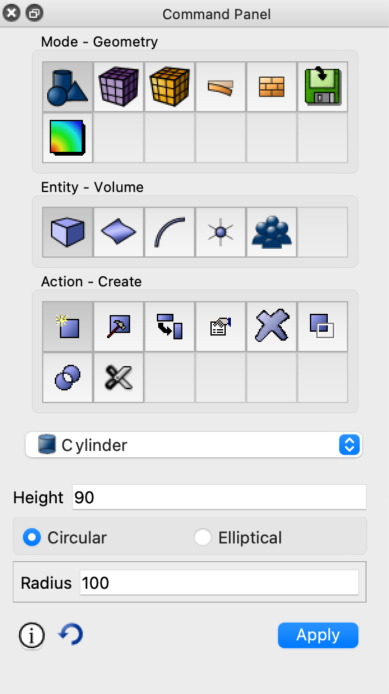{ width="300" }

### Add the beam pipe

Repeat with height 300 and radius 35. Both cylinders are centered on the origin along z, so the pipe passes through the cell.

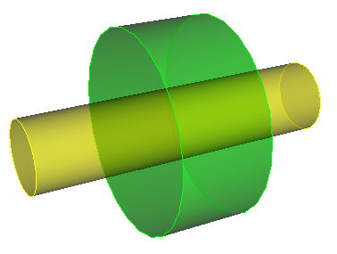{ width="300" }

### Unite

Under **Entity Volume, Action Boolean**, pick Unite, enter volume IDs `1 2`, Apply. Then **compress ids** so the surviving body is volume 1 with consecutive surface and curve numbers:

```text
unite volume 1 2
compress ids
```

The three Boolean operations are Unite, Subtract, and Intersect. Cubit renumbers entities after every Boolean or deletion, and the gaps confuse later commands, so get in the habit of compressing IDs immediately.

### Round the iris

Click a curve in the graphics window and its ID appears in the command line. The two iris circles where the pipe meets the cell are curves 5 and 6 after the compress. Under **Entity Curve, Action Modify**, choose Blend/Chamfer, enter `5 6`, Blend, radius 12, Apply:

```text
modify curve 5 6 blend radius 12
```

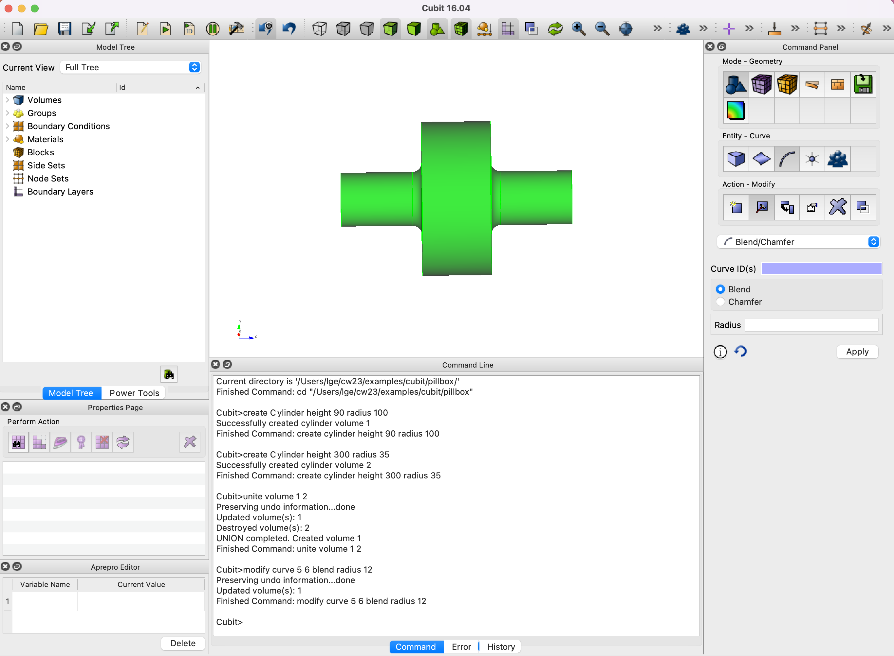{ width="620" }
/// caption
The full model. The command line records every step taken through the GUI, which is what you will collect into a journal file.
///

### Cut to a quarter

Omega3P needs only the symmetric quarter. **Entity Volume, Action Webcut**, Coordinate Plane, volume 1, YZ plane, offset 0, Apply, then delete the half you do not want:

```text
webcut volume 1 with plane xplane offset 0 noimprint nomerge
delete volume 2
compress ids
webcut volume 1 with plane yplane offset 0 noimprint nomerge
delete volume 1
compress ids
```

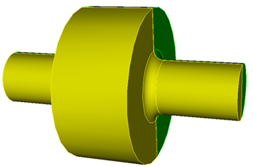{ width="320" }

Which half to delete depends on which side of the plane Cubit numbered as volume 2; check the Model Tree or click the body. Webcutting also has cylindrical, extended-surface, and tool-body variants for more complex cuts.

### Export

**File, Export**, choose ACIS `.sat`, name it `pillbox`, Export All, Finish:

```text
export acis "pillbox.sat" overwrite
```

ACIS is Cubit's native solid format and preserves exact geometry. Keep the `.sat` file; it is the input to the meshing step and to any later modification.

## The same model as a journal file

Every command above is in the Command Line's Command tab. **Tools, then Journal Editor**, then **File, Import, Command Tab** pulls them into an editor. Clean up, parameterize, and save as `step1-Make-pillbox.jou`:

```text title="step1-Make-pillbox.jou"
reset

#{cav_length = 90}
#{cav_radius = 100}
#{bp_length  = 300}
#{bp_radius  = 35}
#{iris_rounding = 12}

create Cylinder height {cav_length} radius {cav_radius}
create Cylinder height {bp_length} radius {bp_radius}
unite volume 1 2
compress ids
modify curve 6 5 blend radius {iris_rounding}

webcut volume 1 with plane xplane offset 0 noimprint nomerge
delete volume 2
compress ids
webcut volume 1 with plane yplane offset 0 noimprint nomerge
delete volume 1
compress ids

export acis "pillbox.sat" overwrite
```

Three edits turn a transcript into a reusable script:

- **`reset` at the top** clears the session so the journal gives the same result every time.
- **`#{name = value}` variables** replace literal numbers, so a dimension changes in one place. Expressions like `{0.5*cav_length}` are allowed.
- **`overwrite` on the export** so replaying does not stop at a prompt.

Play it with the **Play Journal File** toolbar button, or from the Journal Editor, or by typing `playback "step1-Make-pillbox.jou"`. The Journal Editor can also play a selection: highlight lines, right-click, **Play Selected**. That is the way to debug a journal step by step.

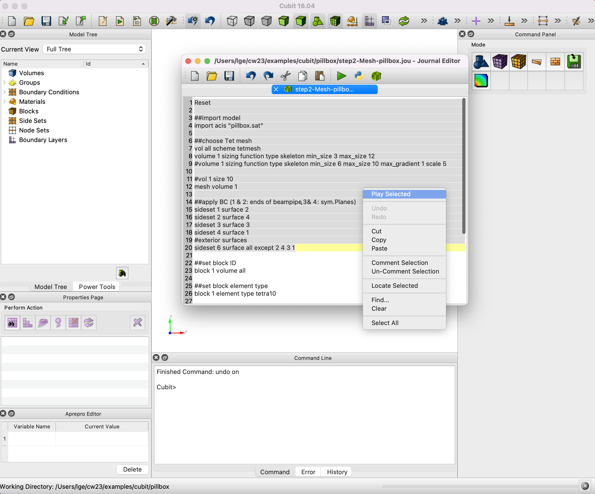{ width="720" }

!!! warning "Entity IDs are not stable across Cubit versions or geometry changes"
    `modify curve 5 6` works because of how Cubit numbered the curves after this particular unite. Change a dimension, reorder operations, or move to a different Cubit release and the iris curves may be 7 and 8. When a journal fails at a blend or sideset command, click the entity in the graphics window to find its current ID. Cubit's `journal idless on` mode records commands by coordinates instead of IDs and avoids the problem at the cost of readability.

## Meshing

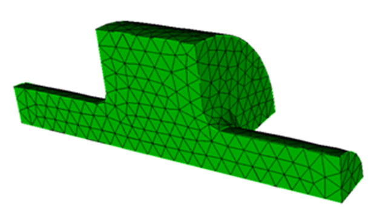{ width="360" align=right }

ACE3P uses quadratic tetrahedral elements, `tetra10`, whose mid-edge nodes follow curved surfaces. The meshing journal imports the `.sat`, sets the scheme, chooses a size, meshes, assigns sidesets and blocks, scales, and exports.

```text title="step2-Mesh-pillbox.jou"
reset
import acis "pillbox.sat"

volume all scheme tetmesh
volume 1 sizing function type skeleton min_size 3 max_size 12
mesh volume 1

# 1 and 2: beam pipe ends, 3 and 4: symmetry planes
sideset 1 surface 2
sideset 2 surface 4
sideset 3 surface 3
sideset 4 surface 1
sideset 6 surface all except 2 4 3 1

block 1 volume all
block 1 element type tetra10

volume 1 scale 0.001
export genesis "pillbox.gen" overwrite

quality vol all distortion high 0.0 draw mesh
```

Open it in the Journal Editor and play it line by line the first time so you can inspect each stage.

### Element size

Two choices:

=== "Uniform"

    ```text
    volume 1 size 10
    mesh volume 1
    ```

    Every element about 10 mm. Simple and predictable. Generate meshes at several sizes and run a convergence study.

    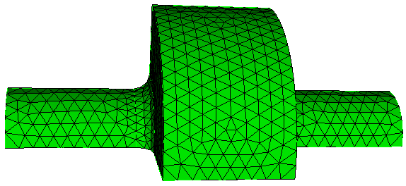{ width="440" }

=== "Adaptive (skeleton sizing)"

    ```text
    volume 1 sizing function type skeleton min_size 3 max_size 12 max_gradient 1.2 scale 5
    mesh volume 1
    ```

    Element size follows local geometry: fine at the iris rounding, coarse along the pipe. Parameters:

    | Argument | Range and default | Effect |
    |---|---|---|
    | `min_size`, `max_size` | auto | Bounds on edge length in model units |
    | `max_gradient` | 1.0 to 3.0, default 1.5 | How fast size may change between neighbors. Smaller gives smoother transitions and more elements. |
    | `scale` | 1 to 10, default 7 | Overall density. Smaller is finer. |
    | `time_accuracy_level` | 1 to 3, default 2 | Internal effort of the sizing function. Try higher levels only if the mesh is poor. |

    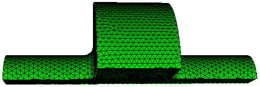{ width="440" }

To try a different size, delete the mesh first: `delete mesh volume 1`, or **Mode Mesh, Entity Volume, Action Delete** in the panel.

### Sidesets and blocks

A **sideset** groups surfaces and becomes a boundary ID in ACE3P. A **block** groups volumes and becomes a material attribute. Both are set under **Mode Exodus** in the Command Panel, or by command:

```text
sideset 1 surface 2
block 1 volume all
```

Find surface IDs by clicking in the graphics window. The idiom `sideset 6 surface all except 2 4 3 1` assigns every surface not already named to the wall, so nothing is left without a boundary ID. The command line confirms what each sideset received:

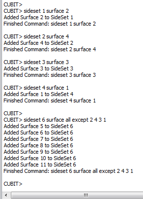{ width="280" }

Check the assignment visually with `draw sideset 1 2 3 4`, which shows only those surfaces:

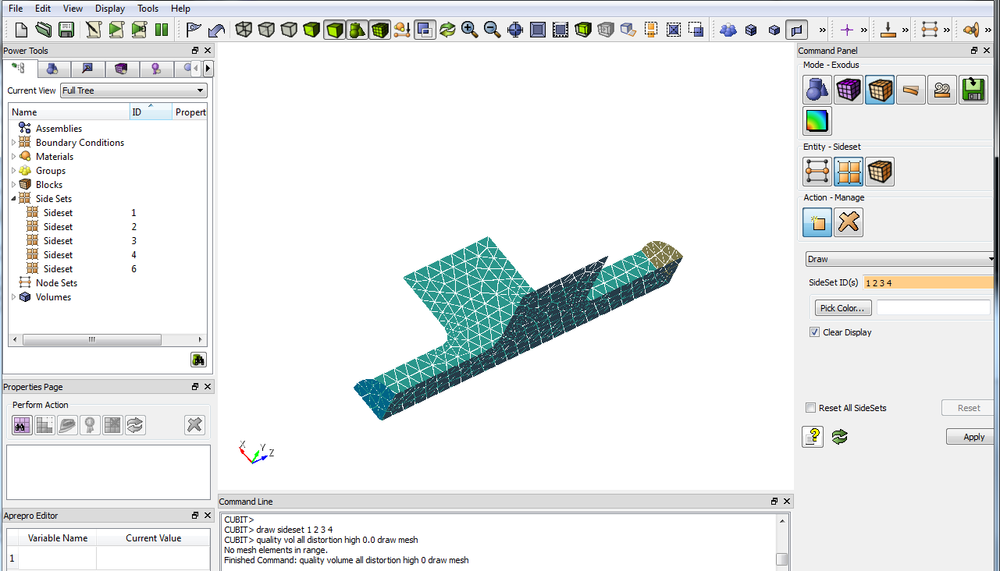{ width="720" }

For models with many surfaces, Cubit groups make sideset assignment robust. See the window example in the [S3P tutorials](../modules/s3p/tutorials.md#tutorial-3-rf-window) and the two-mesh models in the [TEM3P tutorials](../modules/tem3p/tutorials.md#tutorial-1-rf-gun-coupler-cell), which select surfaces by coordinate and by merge status:

```text
group "sym1" add surface with x_coord < 0.001
group "ms"   add surface with is_merged
```

### Quality check in Cubit

The last line of the journal, `quality vol all distortion high 0.0 draw mesh`, colors elements by distortion. Reading "No mesh elements in range" in the command line means none are badly distorted. The definitive check is `acdtool meshconvert` on the HPC side, described on the [mesh preparation](mesh.md#read-the-statistics) page.

## Tips for harder models

- **Check and heal imported CAD first.** Power Tools has geometry diagnostics; `import acis "file.sat" heal` repairs common defects. Small sliver surfaces and short curves are the usual meshing failures.
- **Imprint and merge multi-volume models** before meshing: `imprint body all` then `merge body all`. Without merging, touching volumes have duplicate faces and the mesh is disconnected. The [lossy load tutorial](../modules/omega3p/tutorial-advanced.md) shows the consequence.
- **Mesh small or critical surfaces first** with their own size, then the volume: `surface 14 size 0.5` then `mesh surface 14` then `mesh volume 3`. The BPM example in the [T3P tutorials](../modules/t3p/tutorials.md#tutorial-3-beam-position-monitor) does this for a button face.
- **Split a volume to control size regionally.** Webcut a volume into pieces, give each its own sizing function, and merge. The TTF3 coupler in the TEM3P example separates five materials this way.
- **Smooth the transition** from fine to coarse regions with `max_gradient` near 1.2. Abrupt size changes degrade element quality and the finite-element solution.
- **Periodic faces need identical meshes.** Mesh the master face, copy it to the slave with `copy mesh surface ... onto surface ...`, then mesh the volume without smoothing. The [periodic boundary tutorial](../modules/omega3p/tutorial-advanced.md#part-b-periodic-boundaries-for-a-disk-loaded-structure) shows the commands.
- **Start coarse.** A quick coarse mesh reveals sideset mistakes and geometry problems before you invest in a fine one.

## When acdtool reports bad elements

If `acdtool meshconvert` finds invalid second-order tetrahedra, it replaces them with straight-sided ones and writes a warning. If it finds elements with poor aspect ratio or shape measure, it writes `.vtu` files marking them. Load the `.ncdf` through the SLAC toolbar in ParaView, then **File, Open** the `.vtu`, color it red, and make the mesh translucent to see where to refine.

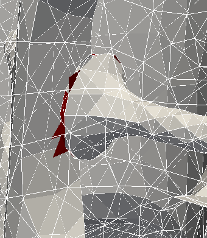{ width="340" }
/// caption
Invalid elements, in red, clustered where a curved surface meets a flat one at a sharp angle. Finer `min_size` or a blend on the edge fixes this.
///

## Cubit on S3DF

A licensed Cubit 16.12 is installed at `/sdf/group/rfar/software/Cubit-16.12/`. Run the GUI through a NoMachine desktop or `ssh -X`, or play a journal with no display:

```bash
/sdf/group/rfar/software/Cubit-16.12/cubit -batch -nographics -input step2-Mesh-pillbox.jou
```

Batch mode is what a workflow engine calls when meshing is one step in an automated chain. See the [workflow assistant](../interfaces/workflow-assistant.md) page.
