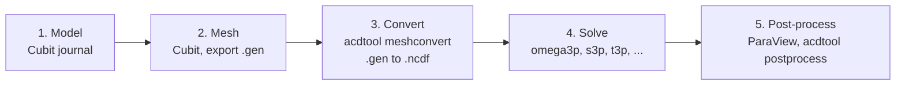

# Workflow overview

Every ACE3P simulation follows the same five steps regardless of which solver you use.

| Step | Tool | Where | Input | Output |
|---|---|---|---|---|
| 1. Build the model | Cubit | Laptop | `.jou` journal | `.sat` ACIS geometry |
| 2. Mesh the model | Cubit | Laptop | `.sat`, `.jou` | `.gen` Genesis mesh |
| 3. Convert the mesh | `acdtool meshconvert` | HPC | `.gen` | `.ncdf` NetCDF mesh |
| 4. Run the solver | `omega3p`, `s3p`, ... | HPC | `.ncdf` plus `<name>.<module>` input | results directory with `.mod` fields and `.out` log |
| 5. Post-process | ParaView, `acdtool postprocess rf` | Laptop or HPC | `.ncdf`, `.mod`, `.rfpost` | plots, R/Q, surface fields |

## Conventions

**File naming.** The solver input file is named `<project>.<module>`, for example `pillbox.omega3p` or `coupler.s3p`. Post-processing input for acdtool is `<project>.rfpost`.

**Boundary and material IDs.** In Cubit, surfaces are grouped into **sidesets** and volumes into **blocks**. The sideset number becomes the boundary `ReferenceNumber` in the ACE3P input, and the block number becomes the material `Attribute`. Pick a consistent scheme and stick to it. The tutorials use:

| Sideset | Meaning |
|---|---|
| 1, 2 | Symmetry planes |
| 3, 4 | Beam pipe ends or additional symmetry planes |
| 6 | Exterior cavity wall |
| 7 and up | Waveguide or coax ports |

**Units.** ACE3P expects meters. Build in millimeters if that is convenient, then `volume all scale 0.001` before export.

**Symmetry.** Cut the model along symmetry planes to reduce the problem size. A quarter model with two magnetic symmetry planes gives the monopole modes of a cylindrically symmetric cavity. Switching one plane to electric selects dipole modes.

## Next

- [Input file format](input-format.md), the block syntax shared by all solvers
- [Geometry and meshing with Cubit](cubit.md), building and meshing a model interactively and by journal
- [Mesh preparation](mesh.md), Cubit export rules and acdtool conversion
- [Batch jobs](batch-jobs.md), running solvers under Slurm
